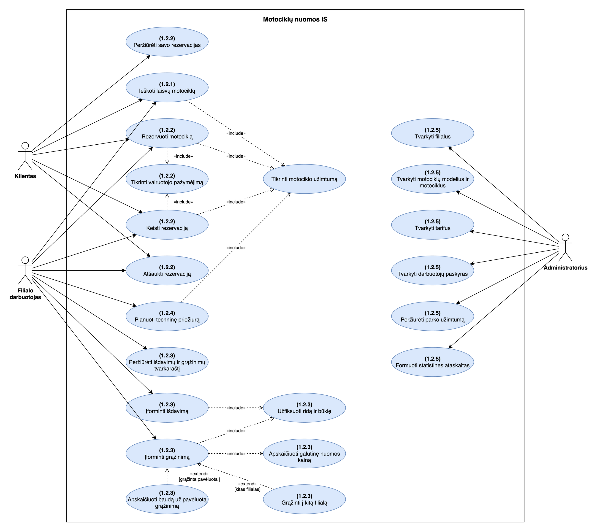

# 7. Panaudos atvejų diagrama

Medžiaga ataskaitos skyriui 1.4 „Panaudos atvejų diagrama“.

**Būsena:** baigta 2026-11-18.

Diagramoje pavaizduoti visi trys vartotojai iš `02-vartotojai.md` (klientas, filialo darbuotojas, administratorius) ir jiems sistemoje prieinami panaudos atvejai. Kiekvieno panaudos atvejo ovale skliaustuose nurodytas funkcinio reikalavimo numeris (žr. `04-reikalavimai.md`), kad diagramą būtų galima susieti su reikalavimais. Panaudos atvejis „Tikrinti motociklo užimtumą“ naudojamas keliuose reikalavimuose (1.2.1, 1.2.2, 1.2.4), todėl numeris ovale nenurodytas.

Šaltinis: `diagramos/07-panaudos-atvejai.drawio`, paveikslas: `diagramos/07-panaudos-atvejai.png`.

*Motociklų nuomos IS panaudos atvejų diagrama* (paveikslo numeris bus suteiktas surenkant ataskaitą)

## Žymėjimas

- Rodyklė nuo aktoriaus į panaudos atvejį: aktorius inicijuoja šį panaudos atvejį (kaip 3 paskaitos pavyzdžiuose).
- Punktyrinė rodyklė «include»: bazinis panaudos atvejis visada įtraukia nurodytą panaudos atvejį.
- Punktyrinė rodyklė «extend»: panaudos atvejis papildo bazinį tik esant nurodytai sąlygai (sąlyga laužtiniuose skliaustuose).

## Panaudos atvejų sąrašas

Pagalbinė lentelė darbui (į ataskaitą perkeliama, jei reikės paaiškinti diagramą). Aktoriai: K – klientas, D – filialo darbuotojas, A – administratorius.

| Nr. | Panaudos atvejis | Aktoriai | Reikalavimas | Ryšiai |
|---|---|---|---|---|
| PA1 | Ieškoti laisvų motociklų | K, D | 1.2.1 | «include» PA6 |
| PA2 | Rezervuoti motociklą | K, D | 1.2.2 | «include» PA6, PA7 |
| PA3 | Peržiūrėti savo rezervacijas | K | 1.2.2 | – |
| PA4 | Keisti rezervaciją | K, D | 1.2.2 | «include» PA6, PA7 |
| PA5 | Atšaukti rezervaciją | K, D | 1.2.2 | – |
| PA6 | Tikrinti motociklo užimtumą | – | 1.2.1, 1.2.2, 1.2.4 | įtraukiamas į PA1, PA2, PA4, PA11 |
| PA7 | Tikrinti vairuotojo pažymėjimą | – | 1.2.2 | įtraukiamas į PA2, PA4 |
| PA8 | Peržiūrėti išdavimų ir grąžinimų tvarkaraštį | D | 1.2.3 | – |
| PA9 | Įforminti išdavimą | D | 1.2.3 | «include» PA12 |
| PA10 | Įforminti grąžinimą | D | 1.2.3 | «include» PA12, PA13 |
| PA11 | Planuoti techninę priežiūrą | D | 1.2.4 | «include» PA6 |
| PA12 | Užfiksuoti ridą ir būklę | – | 1.2.3 | įtraukiamas į PA9, PA10 |
| PA13 | Apskaičiuoti galutinę nuomos kainą | – | 1.2.3 | įtraukiamas į PA10 |
| PA14 | Apskaičiuoti baudą už pavėluotą grąžinimą | – | 1.2.3 | «extend» PA10 [grąžinta pavėluotai] |
| PA15 | Grąžinti į kitą filialą | – | 1.2.3 | «extend» PA10 [kitas filialas] |
| PA16 | Tvarkyti filialus | A | 1.2.5 | – |
| PA17 | Tvarkyti motociklų modelius ir motociklus | A | 1.2.5 | – |
| PA18 | Tvarkyti tarifus | A | 1.2.5 | – |
| PA19 | Tvarkyti darbuotojų paskyras | A | 1.2.5 | – |
| PA20 | Peržiūrėti parko užimtumą | A | 1.2.5 | – |
| PA21 | Formuoti statistines ataskaitas | A | 1.2.5 | – |

PA numeriai naudojami tik darbe (pvz., atsekamumo matricai) ir diagramoje nerodomi.

## Paaiškinimai

- **PA6 Tikrinti motociklo užimtumą** tikrina, ar pasirinktomis datomis motociklas nėra rezervuotas, išnuomotas ar techninėje priežiūroje. Todėl paieška nerodo užimtų motociklų (1.2.1), rezervacijos ir jos pakeitimo negalima atlikti užimtomis datomis (1.2.2), o techninės priežiūros negalima suplanuoti ant rezervacijos (1.2.4).
- **PA7 Tikrinti vairuotojo pažymėjimą** tikrina, ar pažymėjimo kategorija tinka motociklui ir ar pažymėjimas galioja visą nuomos laikotarpį (1.2.2).
- **Rezervacija kliento vardu:** filialo darbuotojas susietas su PA1, PA2, PA4 ir PA5, nes registruoja rezervacijas skambinantiems ar į filialą atvykusiems klientams (1.2.2).
- **Neplanuota techninė priežiūra** atskiru panaudos atveju nevaizduojama: darbuotojas perkelia rezervaciją į kitą motociklą (PA4) arba ją atšaukia (PA5), o tada suplanuoja priežiūrą (PA11), kurią leidžia PA6 patikrinimas (1.2.4).
- **Patvirtinimas su kaina, užstatu ir baudų tarifais** yra PA2 rezultatas ir atskiru panaudos atveju nevaizduojamas.

## Aprėpties patikrinimas

- Kiekvienas funkcinis reikalavimas 1.2.1–1.2.5 turi bent vieną panaudos atvejį; aktoriai sutampa su lentele „Reikalavimų ryšys su vartotojais ir IS tikslais“ (`04-reikalavimai.md`): 1.2.1 ir 1.2.2 – klientas ir filialo darbuotojas, 1.2.3 ir 1.2.4 – filialo darbuotojas, 1.2.5 – administratorius.
- Kiekvienas vartotojas iš `02-vartotojai.md` turi bent vieną panaudos atvejį.
- Sąmoningai neįtraukta: prisijungimas ir registracija (laikoma bazine funkcija, atskiro reikalavimo nėra) ir perspektyviniai reikalavimai 1.6.1–1.6.3 (neįeina į pirmąją versiją).
