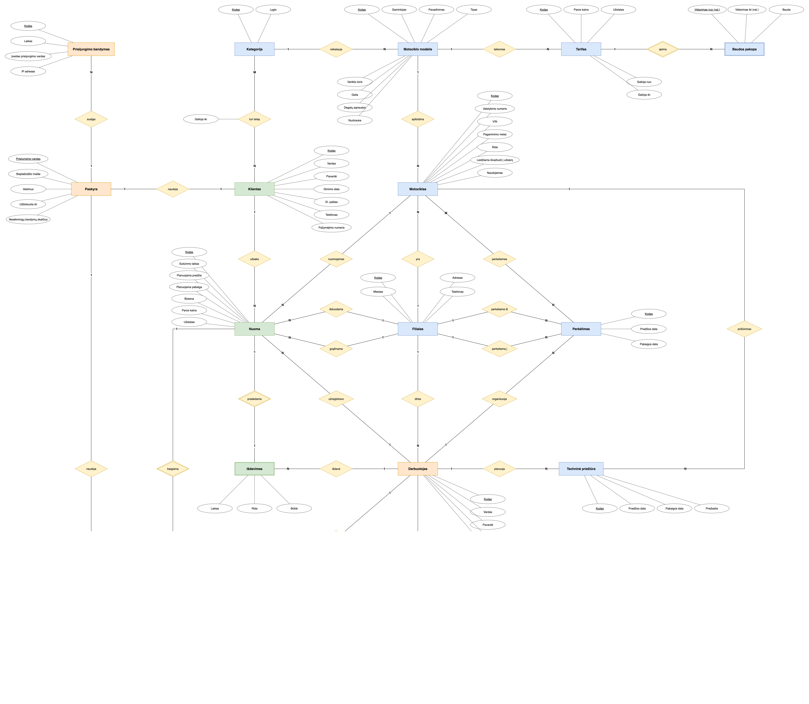

# 8. Loginė ER diagrama

Medžiaga ataskaitos skyriui 1.5.2 „ER loginio lygmens diagrama“.

**Būsena:** baigta 2026-11-18.

Duomenų modelis sudarytas pagal funkcinius reikalavimus 1.2.1–1.2.5 ir su duomenimis susijusius nefunkcinius reikalavimus (1.3.1.3, 1.3.4.2, 1.3.5.1, 1.3.5.2). Laboratorinio darbo ER diagrama naudota tik kaip idėjų šaltinis. Diagrama nubraižyta Cheno žymėjimu, kaip 5 paskaitos skaidrėse: esybė – stačiakampis, atributas – elipsė, ryšys – rombas, silpna esybė – dvigubas stačiakampis, silpnas ryšys – dvigubas rombas. Ryšio kardinalumas žymimas 1, N ir M. Esybės nuspalvintos pagal sritį (5 paskaitos patarimas): parkas ir filialai, klientai ir nuomos, personalas ir saugumas.

Šaltinis: `diagramos/08-loginis-er.drawio`, paveikslas: `diagramos/08-loginis-er.png`.

*Motociklų nuomos IS loginė ER diagrama* (paveikslo numeris bus suteiktas surenkant ataskaitą)

Išoriniai raktai loginiame lygmenyje nevaizduojami: juos atstoja ryšiai. Atributų tipai, išoriniai raktai ir apribojimai bus apibrėžti fizinėje ER diagramoje (10 žingsnis).

## Esybės

| Esybė | Atributai (raktas pabrauktas) | Paskirtis | Reikalavimai |
|---|---|---|---|
| Filialas | <u>Kodas</u>, Miestas, Adresas, Telefonas | Įmonės filialas (Vilnius, Kaunas, Klaipėda) | 1.2.1, 1.2.3, 1.2.5 |
| Kategorija | <u>Kodas</u> (AM, A1, A2, A), Lygis | Vairuotojo pažymėjimo kategorija; lygis rodo, kurios kategorijos apima kitas (A1 < A2 < A) | 1.2.1, 1.2.2 |
| Motociklo modelis | <u>Kodas</u>, Gamintojas, Pavadinimas, Tipas, Variklio tūris, Galia, Degalų sąnaudos, Nuotrauka | Charakteristikos paieškai ir motociklo kortelei | 1.2.1, 1.2.5, 1.3.1.3 |
| Motociklas | <u>Kodas</u>, Valstybinis numeris, VIN, Pagaminimo metai, Rida, Leidžiama išvažiuoti į užsienį, Naudojamas | Konkretus parko motociklas | 1.2.1, 1.2.3, 1.2.5 |
| Tarifas | <u>Kodas</u>, Paros kaina, Užstatas, Galioja nuo, Galioja iki | Modelio kaina ir užstatas tam tikru laikotarpiu | 1.2.2, 1.2.3, 1.2.5 |
| Baudos pakopa (silpna) | Vėlavimas nuo (val.), Vėlavimas iki (val.), Bauda | Baudų už pavėluotą grąžinimą tarifų lentelės eilutė | 1.2.2, 1.2.3 |
| Techninė priežiūra | <u>Kodas</u>, Pradžios data, Pabaigos data, Priežastis | Laikotarpis, kai motociklas prižiūrimas ir neprieinamas | 1.2.4 |
| Perkėlimas | <u>Kodas</u>, Pradžios data, Pabaigos data | Vieno ar kelių motociklų pervežimas į kitą filialą | 1.2.5 |
| Klientas | <u>Kodas</u>, Vardas, Pavardė, Gimimo data, El. paštas, Telefonas, Pažymėjimo numeris | Nuomininkas ir jo vairuotojo pažymėjimo duomenys | 1.2.2 |
| Nuoma | <u>Kodas</u>, Sukūrimo laikas, Planuojama pradžia, Planuojama pabaiga, Būsena, Paros kaina, Užstatas | Rezervacija, kuri vėliau tampa nuoma | 1.2.2, 1.2.3, 1.3.4.2 |
| Išdavimas (silpna) | Laikas, Rida, Būklė | Motociklo išdavimo klientui faktas | 1.2.3 |
| Grąžinimas (silpna) | Laikas, Rida, Būklė, Galutinė kaina, Bauda | Motociklo grąžinimo faktas ir galutinis atsiskaitymas | 1.2.3 |
| Darbuotojas | <u>Kodas</u>, Vardas, Pavardė, El. paštas, Telefonas | Filialo darbuotojas arba administratorius | 1.2.3, 1.2.4, 1.2.5 |
| Paskyra | <u>Prisijungimo vardas</u>, Slaptažodžio maiša, Vaidmuo, Užblokuota iki, Nesėkmingų bandymų skaičius | Prisijungimo duomenys ir vaidmuo | 1.3.5.1, 1.3.5.2 |
| Prisijungimo bandymas | <u>Kodas</u>, Laikas, Įvestas prisijungimo vardas, IP adresas | Saugumo žurnalo įrašas apie nesėkmingą prisijungimą | 1.3.5.2 |

## Ryšiai

| Ryšys | Esybės ir kardinalumas | Paaiškinimas |
|---|---|---|
| reikalauja | Kategorija 1 : N Motociklo modelis | Modeliui vairuoti reikalinga kategorija |
| turi teisę | Klientas N : M Kategorija; ryšio atributas „Galioja iki“ | Kategorijos kliento pažymėjime; kiekvienos kategorijos galiojimo data saugoma atskirai |
| apibūdina | Motociklo modelis 1 : N Motociklas | Kiekvienas motociklas priklauso vienam modeliui |
| taikomas | Motociklo modelis 1 : N Tarifas | Modelio tarifai skirtingais laikotarpiais |
| apima (silpnas) | Tarifas 1 : N Baudos pakopa | Baudų tarifų lentelė priklauso tarifui |
| yra | Filialas 1 : N Motociklas | Filialas, kuriame motociklas yra dabar |
| nuomojamas | Motociklas 1 : N Nuoma | Kuris motociklas nuomojamas |
| užsako | Klientas 1 : N Nuoma | Kieno rezervacija |
| išduodama, grąžinama | Filialas 1 : N Nuoma (du ryšiai) | Išdavimo ir grąžinimo filialai, pasirenkami rezervuojant |
| užregistravo | Darbuotojas 1 : N Nuoma | Darbuotojas, užregistravęs rezervaciją kliento vardu (jei rezervavo pats klientas, ryšio nėra) |
| pradedama, baigiama (silpni) | Nuoma 1 : 1 Išdavimas, Nuoma 1 : 1 Grąžinimas | Išdavimas ir grąžinimas egzistuoja tik kartu su nuoma |
| išdavė, priėmė | Darbuotojas 1 : N Išdavimas, Darbuotojas 1 : N Grąžinimas | Kas išdavė ir kas priėmė motociklą |
| prižiūrimas | Motociklas 1 : N Techninė priežiūra | Motociklo priežiūros laikotarpiai |
| planuoja | Darbuotojas 1 : N Techninė priežiūra | Kas suplanavo priežiūrą |
| perkeliamas | Motociklas M : N Perkėlimas | Vienu perkėlimu vežamas vienas ar keli motociklai |
| perkeliama iš, perkeliama į | Filialas 1 : N Perkėlimas (du ryšiai) | Iš kurio ir į kurį filialą perkeliama |
| organizuoja | Darbuotojas 1 : N Perkėlimas | Administratorius, suplanavęs perkėlimą |
| dirba | Filialas 1 : N Darbuotojas | Darbuotojo filialas (administratorius gali būti nepriskirtas filialui) |
| naudoja | Klientas 1 : 1 Paskyra, Darbuotojas 1 : 1 Paskyra | Prisijungimo paskyra |
| susijęs | Paskyra 1 : N Prisijungimo bandymas | Nesėkmingi bandymai prisijungti prie paskyros |

## Modelio sprendimai

- **Rezervacija ir nuoma – viena esybė Nuoma.** Jos būsena: rezervuota, aktyvi, užbaigta arba atšaukta. Užbaigtos nuomos netrinamos (1.3.4.2), todėl iš jų formuojamos statistinės ataskaitos ir parko užimtumas (1.2.5); atskiros ataskaitų esybės nereikia.
- **Kaina fiksuojama rezervuojant.** Nuomoje saugoma paros kaina ir užstatas, galioję rezervacijos metu, todėl vėlesnis tarifo pakeitimas nekeičia ankstesnių nuomų. Galutinė kaina ir bauda apskaičiuojamos grąžinant ir saugomos Grąžinime (1.2.3).
- **Išdavimas ir Grąžinimas – silpnos esybės.** Jos neturi savo rakto ir identifikuojamos per nuomą (kiekviena nuoma turi ne daugiau kaip vieną išdavimą ir vieną grąžinimą). Taip nuomoje nėra tuščių laukų, kol motociklas neišduotas, ir matyti, kas išdavė ir kas priėmė motociklą.
- **Baudos pakopa – silpna esybė.** Pakopa identifikuojama tarifu ir daliniu raktu „Vėlavimas nuo (val.)“. Pavyzdys: vėluojant iki 1 val. – 0 Eur, nuo 1 iki 3 val. – 20 Eur, daugiau nei 3 val. – 60 Eur (sumos – tik pavyzdys). Didesniems motociklams baudos gali būti didesnės.
- **Pažymėjimo kategorijos.** Kliento kategorijos saugomos ryšiu „turi teisę“, kiekviena su savo galiojimo data. Rezervuoti leidžiama, jei kliento pažymėjime yra kategorija, kurios lygis ne žemesnis nei modelio reikalaujamos kategorijos, ir ji galioja visą nuomos laikotarpį (1.2.2). Pavyzdžiui, A kategorija leidžia vairuoti ir A2 modelį.
- **Techninė priežiūra ir perkėlimas – laikotarpiai, o ne motociklo būsena.** Motociklas taip pat turi požymį „Naudojamas“: nurašytas motociklas netrinamas, nes reikalingas istorijai, bet nerodomas paieškoje.
- **Nuotrauka ir charakteristikos priskirtos modeliui**, nes paieškos kortelėje rodomas modelis (1.3.1.3). **Pagaminimo metai ir leidimas išvažiuoti į užsienį priskirti motociklui**, nes leidimas priklauso nuo konkretaus motociklo draudimo.
- **Klientas be paskyros.** Kliento kodas nepriklauso nuo paskyros. Skambinančiam klientui darbuotojas sukuria kliento įrašą (vardas, telefonas, pažymėjimo duomenys) ir jam registruoja rezervaciją. Jei klientas vėliau užsiregistruoja svetainėje tuo pačiu el. paštu, paskyra susiejama su esamu kliento įrašu. Todėl klientas gali neturėti paskyros, o darbuotojas paskyrą turi visada.
- **Saugumo žurnalas.** Kiekvienas nesėkmingas prisijungimas įrašomas į Prisijungimo bandymą; jei įvestas vardas neatitinka jokios paskyros, įrašas su paskyra nesusiejamas. Paskyroje skaičiuojami nesėkmingi bandymai iš eilės („Nesėkmingų bandymų skaičius“; po sėkmingo prisijungimo skaitiklis nunulinamas). Po 5 bandymų iš eilės paskyra užblokuojama 15 minučių: tam įrašomas laikas „Užblokuota iki“ (1.3.5.2).

## Motociklo buvimo vietos taisyklė

Kadangi galimas grąžinimas į kitą filialą, motociklas ne visada lieka ten, kur buvo išduotas. Nuoma, perkėlimas ir techninė priežiūra yra motociklo užimtumo laikotarpiai: nuoma prasideda išdavimo filiale ir baigiasi grąžinimo filiale, perkėlimas – „iš“ ir „į“ filialuose, o priežiūra vyksta ten, kur motociklas tuo metu yra. Naują laikotarpį galima įrašyti tik tada, kai:

1. jis nesutampa su kitais to motociklo užimtumo laikotarpiais;
2. jo pradžioje motociklas bus tame filiale, kuriame laikotarpis prasideda (pagal ankstesnio laikotarpio pabaigos filialą arba, jei jo nėra, pagal filialą, kuriame motociklas yra dabar);
3. jo pabaigoje motociklas bus tame filiale, kuriame prasideda kitas jo laikotarpis (jei toks yra).

Pavyzdys: motociklas rezervuotas dienai T Vilniuje. Klientas nori jį išsinuomoti dienai T−1 Vilniuje ir grąžinti Klaipėdoje. Pažeidžiama 3 taisyklė, todėl sistema leidžia tik grąžinimą į tą patį filialą ir nurodo priežastį (1.3.2.4).

Taisyklę įgyvendins prieinamumo tikrinimo funkcija (žr. 12 žingsnį), ji atitinka panaudos atvejį „Tikrinti motociklo užimtumą“. Modelyje tam pakanka esamų duomenų: nuomos išdavimo ir grąžinimo filialų, perkėlimo filialų ir dabartinio motociklo filialo. Kai perkėlimas baigiasi ar įforminamas grąžinimas, sistema pakeičia motociklo filialą (ryšys „yra“).

## Palyginimas su laboratoriniu darbu

Laboratorinio darbo diagramoje buvo 5 esybės (Filialas, Motociklo modelis, Motociklas, Nuoma, Klientas). Šioje diagramoje jų 15:

- pridėtos esybės Kategorija, Tarifas, Baudos pakopa, Techninė priežiūra, Perkėlimas, Išdavimas, Grąžinimas, Darbuotojas, Paskyra ir Prisijungimo bandymas;
- naudojamos silpnos esybės, silpni ryšiai, M:N ryšiai ir ryšio atributas;
- paros kaina perkelta iš modelio į Tarifą, o nuomoje fiksuojama rezervavimo metu;
- motociklo atributas „Būsena“ pakeistas laikotarpiais (Techninė priežiūra, Perkėlimas, Nuomos būsena) ir požymiu „Naudojamas“;
- vietoj „Pilna nuomos kaina“ / „Galutinė kaina“ visur vartojamas vienas terminas „Galutinė kaina“ (kaip 1.2.3).

## Aprėpties patikrinimas

| Reikalavimas | Esybės |
|---|---|
| 1.2.1 Motociklų paieška | Motociklas, Motociklo modelis, Kategorija, Filialas, Nuoma, Techninė priežiūra, Perkėlimas |
| 1.2.2 Rezervacija ir jos valdymas | Klientas, Kategorija (ryšys „turi teisę“), Nuoma, Tarifas, Baudos pakopa, Darbuotojas |
| 1.2.3 Išdavimas ir grąžinimas | Nuoma, Išdavimas, Grąžinimas, Darbuotojas, Filialas, Tarifas, Baudos pakopa |
| 1.2.4 Techninė priežiūra | Techninė priežiūra, Motociklas, Darbuotojas |
| 1.2.5 Parko administravimas ir ataskaitos | Filialas, Motociklo modelis, Motociklas, Tarifas, Darbuotojas, Paskyra, Perkėlimas, Nuoma (ataskaitoms) |
| 1.3.1.3 Motociklo kortelė | Motociklo modelis (Nuotrauka) |
| 1.3.4.2 Istoriniai duomenys | Nuoma, Išdavimas, Grąžinimas |
| 1.3.5.1 Prieiga pagal vaidmenis | Paskyra (Vaidmuo) |
| 1.3.5.2 Prisijungimas ir duomenų apsauga | Paskyra, Prisijungimo bandymas |

Kiekviena esybė susijusi bent su vienu reikalavimu, o kiekvienas funkcinis reikalavimas turi bent vieną esybę. Perspektyvinių reikalavimų 1.6.1–1.6.3 duomenys (mokėjimai, pažeidimai, perdavimas į apskaitą) į modelį sąmoningai neįtraukti.
