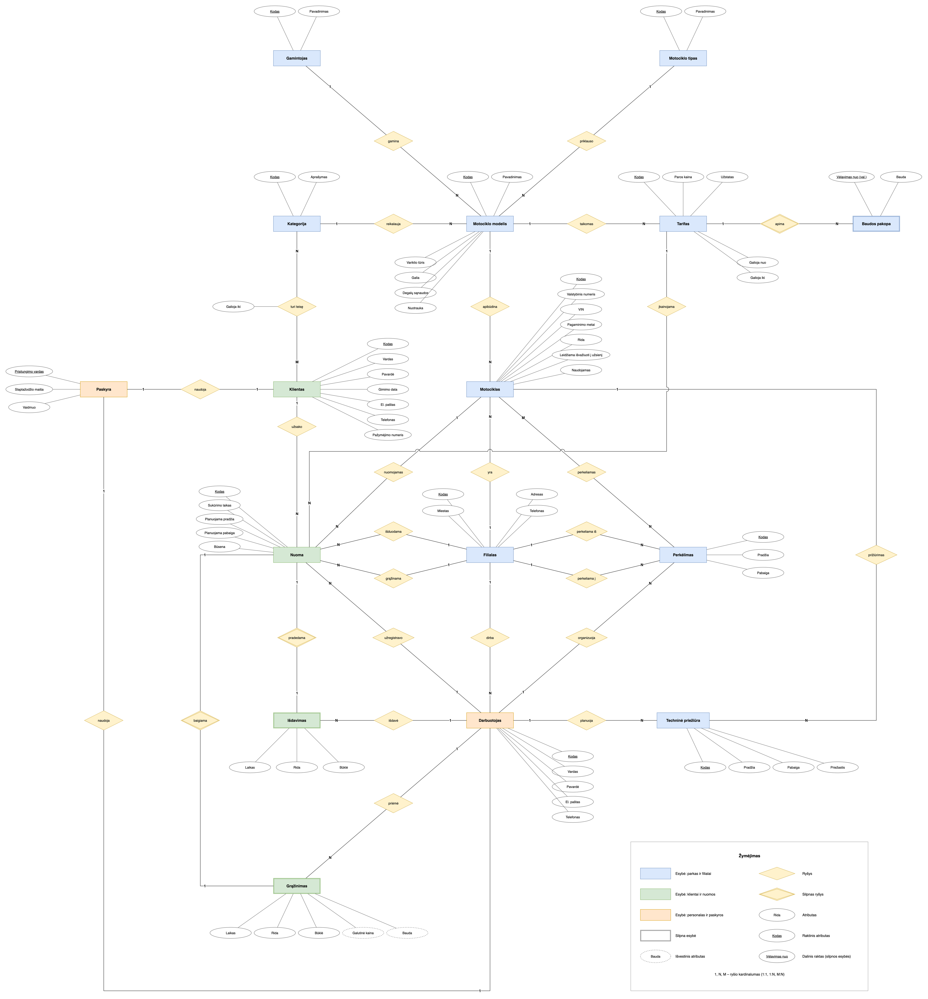

# 8. Loginė ER diagrama

Medžiaga ataskaitos skyriui 1.5.2 „ER loginio lygmens diagrama“.

**Būsena:** baigta 2026-11-18. Patikslinta 2026-11-18 rengiant duomenų srautų diagramą (9 žingsnis): pašalinta esybė Prisijungimo bandymas ir paskyros blokavimo atributai, nes prisijungimas į darbą neįtraukiamas. Esybės Kategorija atributas „Lygis“ pakeistas atributu „Aprašymas“ (kategorijų apimtis – verslo proceso dalis). Po 1 kontrolinio taško (2026-11-19): pridėtas ryšys „įkainojama“ (Tarifas `1:N` Nuoma), o Nuomos atributai „Paros kaina“ ir „Užstatas“ pašalinti; Kategorija aprašyta kaip klasifikatorius; papildyta aprėpties lentelė. Aptarus diagramą (2026-11-19): Galutinė kaina ir Bauda pažymėtos kaip išvestiniai atributai, iš Baudos pakopos pašalintas atributas „Vėlavimas iki (val.)“. Rengiant fizinę ER diagramą (10 žingsnis, 2026-11-19): Motociklo modelio atributai „Gamintojas“ ir „Tipas“ pakeisti klasifikatoriais – esybėmis Gamintojas ir Motociklo tipas (esybių – 16); Techninės priežiūros ir Perkėlimo atributai „Pradžios data“, „Pabaigos data“ pervadinti „Pradžia“, „Pabaiga“, nes laikotarpiai saugomi minutės tikslumu. Aprašant funkcijas (12 žingsnis, 2026-11-19): pridėta nuoroda į užimtumo laikotarpio apibrėžimą.

Duomenų modelis sudarytas pagal funkcinius reikalavimus FR 1.2.1–FR 1.2.5 ir su duomenimis susijusius nefunkcinius reikalavimus (NFR 1.3.1.3, NFR 1.3.4.2, NFR 1.3.5.1, NFR 1.3.5.2). Laboratorinio darbo ER diagrama naudota tik kaip idėjų šaltinis. Diagrama nubraižyta Cheno žymėjimu: esybė – stačiakampis, atributas – elipsė, ryšys – rombas, silpna esybė – dvigubas stačiakampis, silpnas ryšys – dvigubas rombas. Papildomai naudojamas išvestinio atributo ženklas – punktyrinė elipsė (žymėjimas pagal [GeeksforGeeks, „Introduction of ER Model“](https://www.geeksforgeeks.org/dbms/introduction-of-er-model/)). Ryšio kardinalumas žymimas 1, N ir M. Esybės nuspalvintos pagal sritį: parkas ir filialai, klientai ir nuomos, personalas ir paskyros.

Šaltinis: `artefaktai/08-loginis-er.drawio`, paveikslas: `artefaktai/08-loginis-er.png`.

*Motociklų nuomos IS loginė ER diagrama* (paveikslo numeris bus suteiktas surenkant ataskaitą)

Išoriniai raktai loginiame lygmenyje nevaizduojami: juos atstoja ryšiai. Atributų tipai, išoriniai raktai ir apribojimai bus apibrėžti fizinėje ER diagramoje (10 žingsnis).

## Esybės

| Esybė | Atributai (raktas pabrauktas) | Paskirtis | Reikalavimai |
|---|---|---|---|
| Filialas | <u>Kodas</u>, Miestas, Adresas, Telefonas | Įmonės filialas (Vilnius, Kaunas, Klaipėda) | FR 1.2.1, FR 1.2.3, FR 1.2.5 |
| Kategorija | <u>Kodas</u> (AM, A1, A2, A), Aprašymas | Vairuotojo pažymėjimo kategorija (klasifikatorius); aprašymas paaiškina kategoriją klientui (pvz., „A2 – vidutinės galios motociklai“) | FR 1.2.1, FR 1.2.2 |
| Gamintojas | <u>Kodas</u>, Pavadinimas | Motociklų gamintojas (klasifikatorius, pvz., Honda, BMW) | FR 1.2.5 |
| Motociklo tipas | <u>Kodas</u>, Pavadinimas | Motociklo tipas paieškai ir kortelei (klasifikatorius, pvz., turistinis, enduro) | FR 1.2.1, FR 1.2.5, NFR 1.3.1.3 |
| Motociklo modelis | <u>Kodas</u>, Pavadinimas, Variklio tūris, Galia, Degalų sąnaudos, Nuotrauka | Charakteristikos paieškai ir motociklo kortelei | FR 1.2.1, FR 1.2.5, NFR 1.3.1.3 |
| Motociklas | <u>Kodas</u>, Valstybinis numeris, VIN, Pagaminimo metai, Rida, Leidžiama išvažiuoti į užsienį, Naudojamas | Konkretus parko motociklas | FR 1.2.1, FR 1.2.3, FR 1.2.5 |
| Tarifas | <u>Kodas</u>, Paros kaina, Užstatas, Galioja nuo, Galioja iki | Modelio paros kaina, užstatas ir baudų pakopos rezervacijoms, sudarytoms tam tikru laikotarpiu | FR 1.2.2, FR 1.2.3, FR 1.2.5 |
| Baudos pakopa (silpna) | Vėlavimas nuo (val.), Bauda | Baudų už pavėluotą grąžinimą tarifų lentelės eilutė | FR 1.2.2, FR 1.2.3 |
| Techninė priežiūra | <u>Kodas</u>, Pradžia, Pabaiga, Priežastis | Laikotarpis, kai motociklas prižiūrimas ir neprieinamas | FR 1.2.4 |
| Perkėlimas | <u>Kodas</u>, Pradžia, Pabaiga | Vieno ar kelių motociklų pervežimas į kitą filialą | FR 1.2.5 |
| Klientas | <u>Kodas</u>, Vardas, Pavardė, Gimimo data, El. paštas, Telefonas, Pažymėjimo numeris | Nuomininkas ir jo vairuotojo pažymėjimo duomenys | FR 1.2.2 |
| Nuoma | <u>Kodas</u>, Sukūrimo laikas, Planuojama pradžia, Planuojama pabaiga, Būsena | Rezervacija, kuri vėliau tampa nuoma | FR 1.2.2, FR 1.2.3, NFR 1.3.4.2 |
| Išdavimas (silpna) | Laikas, Rida, Būklė | Motociklo išdavimo klientui faktas | FR 1.2.3 |
| Grąžinimas (silpna) | Laikas, Rida, Būklė, Galutinė kaina (išvestinis), Bauda (išvestinis) | Motociklo grąžinimo faktas ir galutinis atsiskaitymas | FR 1.2.3 |
| Darbuotojas | <u>Kodas</u>, Vardas, Pavardė, El. paštas, Telefonas | Filialo darbuotojas arba administratorius | FR 1.2.3, FR 1.2.4, FR 1.2.5 |
| Paskyra | <u>Prisijungimo vardas</u>, Slaptažodžio maiša, Vaidmuo | Prisijungimo duomenys ir vaidmuo | NFR 1.3.5.1, NFR 1.3.5.2 |

## Ryšiai

Kiekvieno ryšio kardinalumo pagrindimas ir privalomumas (ar ryšio pusėje gali būti nulis įrašų) aprašyti `10-lenteles.md` skyriuje „Ryšiai“, nes privalomumas parodytas fizinėje ER diagramoje.

| Ryšys | Esybės ir kardinalumas | Paaiškinimas |
|---|---|---|
| reikalauja | Kategorija `1:N` Motociklo modelis | Modeliui vairuoti reikalinga kategorija |
| gamina | Gamintojas `1:N` Motociklo modelis | Modelio gamintojas |
| priklauso | Motociklo tipas `1:N` Motociklo modelis | Modelio tipas |
| turi teisę | Klientas `M:N` Kategorija; ryšio atributas „Galioja iki“ | Kategorijos kliento pažymėjime; kiekvienos kategorijos galiojimo data saugoma atskirai |
| apibūdina | Motociklo modelis `1:N` Motociklas | Kiekvienas motociklas priklauso vienam modeliui |
| taikomas | Motociklo modelis `1:N` Tarifas | Modelio tarifai skirtingais laikotarpiais |
| apima (silpnas) | Tarifas `1:N` Baudos pakopa | Baudų tarifų lentelė priklauso tarifui |
| įkainojama | Tarifas `1:N` Nuoma | Tarifas, galiojęs rezervavimo dieną; pagal jį apskaičiuojama nuomos kaina, užstatas ir bauda |
| yra | Filialas `1:N` Motociklas | Filialas, kuriame motociklas yra dabar |
| nuomojamas | Motociklas `1:N` Nuoma | Kuris motociklas nuomojamas |
| užsako | Klientas `1:N` Nuoma | Kieno rezervacija |
| išduodama, grąžinama | Filialas `1:N` Nuoma (du ryšiai) | Išdavimo ir grąžinimo filialai, pasirenkami rezervuojant |
| užregistravo | Darbuotojas `1:N` Nuoma | Darbuotojas, užregistravęs rezervaciją kliento vardu (jei rezervavo pats klientas, ryšio nėra) |
| pradedama, baigiama (silpni) | Nuoma `1:1` Išdavimas, Nuoma `1:1` Grąžinimas | Išdavimas ir grąžinimas egzistuoja tik kartu su nuoma |
| išdavė, priėmė | Darbuotojas `1:N` Išdavimas, Darbuotojas `1:N` Grąžinimas | Kas išdavė ir kas priėmė motociklą |
| prižiūrimas | Motociklas `1:N` Techninė priežiūra | Motociklo priežiūros laikotarpiai |
| planuoja | Darbuotojas `1:N` Techninė priežiūra | Kas suplanavo priežiūrą |
| perkeliamas | Motociklas `M:N` Perkėlimas | Vienu perkėlimu vežamas vienas ar keli motociklai |
| perkeliama iš, perkeliama į | Filialas `1:N` Perkėlimas (du ryšiai) | Iš kurio ir į kurį filialą perkeliama |
| organizuoja | Darbuotojas `1:N` Perkėlimas | Administratorius, suplanavęs perkėlimą |
| dirba | Filialas `1:N` Darbuotojas | Darbuotojo filialas (administratorius gali būti nepriskirtas filialui) |
| naudoja | Klientas `1:1` Paskyra, Darbuotojas `1:1` Paskyra | Prisijungimo paskyra |

## Modelio sprendimai

- **Rezervacija ir nuoma – viena esybė Nuoma.** Jos būsena: rezervuota, aktyvi, užbaigta arba atšaukta. Užbaigtos nuomos netrinamos (NFR 1.3.4.2), todėl iš jų formuojamos statistinės ataskaitos ir parko užimtumas (FR 1.2.5); atskiros ataskaitų esybės nereikia.
- **Tarifas parenkamas rezervuojant.** Nuoma susieta su motociklo modelio tarifu, galiojusiu rezervavimo dieną (ryšys „įkainojama“). Iš jo imama paros kaina ir užstatas, o grąžinant – baudų pakopos, todėl baudą galima apskaičiuoti pagal tuos pačius tarifus, kuriuos klientas matė patvirtinime (FR 1.2.2). Tarifas, pagal kurį jau yra rezervacijų, nekeičiamas: jo galiojimas baigiamas data „Galioja iki“ ir sukuriamas naujas tarifas. Vienam modeliui tą pačią dieną galioja tik vienas tarifas. Todėl Nuomoje paros kainos ir užstato kopijuoti nereikia. Galutinė kaina ir bauda apskaičiuojamos grąžinant ir saugomos Grąžinime (FR 1.2.3).
- **Išdavimas ir Grąžinimas – silpnos esybės.** Jos neturi savo rakto ir identifikuojamos per nuomą (kiekviena nuoma turi ne daugiau kaip vieną išdavimą ir vieną grąžinimą). Taip nuomoje nėra tuščių laukų, kol motociklas neišduotas, ir matyti, kas išdavė ir kas priėmė motociklą.
- **Baudos pakopa – silpna esybė.** Pakopa neturi savo kodo: ji identifikuojama tarifu ir daliniu raktu „Vėlavimas nuo (val.)“, o kitos esybės į ją nenurodo (Grąžinime saugoma baudos suma). Pakopa turi tik apatinę ribą: ji galioja nuo savo „Vėlavimas nuo (val.)“ iki kitos pakopos pradžios, o paskutinė pakopa – be viršutinės ribos. Taikoma pakopa su didžiausia „Vėlavimas nuo (val.)“ reikšme, kuri neviršija vėlavimo (vėlavimas ≥ „Vėlavimas nuo (val.)“). Bauda nesumuojama: imama tik tos pakopos suma. Jei pakopos su „Vėlavimas nuo (val.)“ = 0 nėra, iki pirmosios pakopos bauda lygi 0; jei tarifas pakopų neturi, baudos nėra. Pavyzdys: pakopos „nuo 1 val. – 20 Eur“ ir „nuo 3 val. – 60 Eur“ reiškia, kad vėluojant iki 1 val. bauda – 0 Eur, 2 val. – 20 Eur, 50 val. – 60 Eur (sumos – tik pavyzdys). Didesniems motociklams baudos gali būti didesnės. Viršutinė riba nesaugoma, todėl pakopos negali persidengti ir tarp jų negali likti tarpų.
- **Išvestiniai atributai.** Grąžinimo „Galutinė kaina“ ir „Bauda“ apskaičiuojamos iš tarifo, nuomos datų, grąžinimo laiko ir baudų pakopų, todėl diagramoje pažymėtos punktyrine elipse. Jos vis tiek saugomos kaip užfiksuotas atsiskaitymo su klientu rezultatas: skaičiavimo taisyklės (pvz., kaip skaičiuojamos paros) gali keistis, o perskaičiavus senas nuomas sumos nebesutaptų su sumokėtomis. Fizinėje ER diagramoje (10 žingsnis) tai bus sąmoningas nukrypimas nuo normalizacijos. Kiti atributai išvestiniais nelaikomi: Nuomos „Būsena“ neišvedama, nes būsenos „atšaukta“ negalima nustatyti iš kitų duomenų; Motociklo „Rida“ turi pradinę reikšmę iki pirmosios nuomos; Tarifo „Galioja iki“ reikalinga, nes tarifas gali būti uždarytas be įpėdinio, o tarp tarifų gali būti tarpų.
- **Pažymėjimo kategorijos.** Kliento kategorijos saugomos ryšiu „turi teisę“, kiekviena su savo galiojimo data. Rezervuoti leidžiama, jei kliento pažymėjime yra būtent ta kategorija, kurios reikalauja modelis, ir ji galioja visą nuomos laikotarpį (FR 1.2.2). Kurios kategorijos apima kitas, sistema nesaugo: tai verslo proceso dalis. Registruojant pažymėjimą (klientas rezervuodamas arba darbuotojas kliento vardu) pažymimos visos kategorijos, kurias suteikia pažymėjimas; pavyzdžiui, turinčiam A kategoriją pažymimos ir A1, A2. Taip sistemoje nereikia saugoti kategorijų apimties taisyklių, kurios skirtingose šalyse gali skirtis, o naujas kategorijas galima pridėti kaip įrašus. Kategorija yra klasifikatorius: jo įrašai (AM, A1, A2, A) įvedami diegiant sistemą, todėl atskiro reikalavimo ir panaudos atvejo jiems tvarkyti nėra.
- **Klasifikatoriai.** Gamintojas ir Motociklo tipas yra atskiros esybės, o ne Motociklo modelio teksto atributai: tipu ieškoma (FR 1.2.1) ir jis rodomas kortelėje (NFR 1.3.1.3), o pagal gamintoją ir tipą grupuojama statistika (FR 1.2.5). Įvedant tekstą, ta pati reikšmė gali būti užrašyta skirtingai (pvz., „Enduro“ ir „enduro“), ir paieškos filtras bei ataskaitos ją laikytų dviem skirtingomis reikšmėmis. Šiuos klasifikatorius tvarko administratorius kartu su motociklų modeliais (FR 1.2.5, panaudos atvejis „Tvarkyti motociklų modelius ir motociklus“). Kategorija taip pat klasifikatorius, bet jos įrašai įvedami diegiant sistemą, nes kategorijas nustato teisės aktai, o ne įmonė. Klasifikatoriais nelaikomi šie atributai. Nuomos „Būsena“ ir Paskyros „Vaidmuo“: jų reikšmių sąrašą nustato ne įmonė, o pati sistema – nuo kiekvienos būsenos priklauso nuomos eiga, o nuo vaidmens – leidžiami veiksmai (NFR 1.3.5.1), todėl naujos reikšmės be programos pakeitimų nebūtų naudingos, o atskira esybė suteiktų tik tariamą lankstumą. Filialo „Miestas“: kiekvienas iš trijų filialų yra skirtingame mieste, todėl reikšmės nesikartoja. Techninės priežiūros „Priežastis“: tai laisvas aprašymas, o ne reikšmė iš sąrašo.
- **Techninė priežiūra ir perkėlimas – laikotarpiai, o ne motociklo būsena.** Motociklas taip pat turi požymį „Naudojamas“: nurašytas motociklas netrinamas, nes reikalingas istorijai, bet nerodomas paieškoje.
- **Nuotrauka ir charakteristikos priskirtos modeliui**, nes paieškos kortelėje rodomas modelis (NFR 1.3.1.3). **Pagaminimo metai ir leidimas išvažiuoti į užsienį priskirti motociklui**, nes leidimas priklauso nuo konkretaus motociklo draudimo.
- **Klientas be paskyros.** Kliento kodas nepriklauso nuo paskyros. Skambinančiam klientui darbuotojas sukuria kliento įrašą (vardas, telefonas, pažymėjimo duomenys) ir jam registruoja rezervaciją. Jei klientas vėliau užsiregistruoja svetainėje tuo pačiu el. paštu, paskyra susiejama su esamu kliento įrašu. Todėl klientas gali neturėti paskyros, o darbuotojas paskyrą turi visada.
- **Paskyra.** Prisijungimas laikomas bazine funkcija ir į darbą neįtraukiamas, todėl nesėkmingų prisijungimų žurnalo ir paskyros blokavimo modelyje nėra. Paskyroje saugomas prisijungimo vardas, slaptažodžio maiša (NFR 1.3.5.2) ir vaidmuo, pagal kurį ribojami leidžiami veiksmai (NFR 1.3.5.1).

## Motociklo buvimo vietos taisyklė

Kadangi galimas grąžinimas į kitą filialą, motociklas ne visada lieka ten, kur buvo išduotas. Nuoma, perkėlimas ir techninė priežiūra yra motociklo užimtumo laikotarpiai (kada jie prasideda ir baigiasi, apibrėžta `12-funkcijos.md`): nuoma prasideda išdavimo filiale ir baigiasi grąžinimo filiale, perkėlimas – „iš“ ir „į“ filialuose, o priežiūra vyksta ten, kur motociklas tuo metu yra. Naują laikotarpį galima įrašyti tik tada, kai:

1. jis nesutampa su kitais to motociklo užimtumo laikotarpiais;
2. jo pradžioje motociklas bus tame filiale, kuriame laikotarpis prasideda (pagal ankstesnio laikotarpio pabaigos filialą arba, jei jo nėra, pagal filialą, kuriame motociklas yra dabar);
3. jo pabaigoje motociklas bus tame filiale, kuriame prasideda kitas jo laikotarpis (jei toks yra).

Pavyzdys: motociklas rezervuotas dienai T Vilniuje. Klientas nori jį išsinuomoti dienai T−1 Vilniuje ir grąžinti Klaipėdoje. Pažeidžiama 3 taisyklė, todėl sistema leidžia tik grąžinimą į tą patį filialą ir nurodo priežastį (NFR 1.3.2.4).

Kaip taisyklė taikoma motociklui, kuris yra Vilniuje ir rezervuotas 2027-05-12 10:00 – 2027-05-15 10:00 su grąžinimu į Klaipėdą, parodyta paveiksle `08-buvimo-vietos-taisykle.png` (šis pavyzdys aprašytas ir `12-funkcijos.md`).

Šaltinis: `artefaktai/08-buvimo-vietos-taisykle.drawio`, paveikslas: `artefaktai/08-buvimo-vietos-taisykle.png`.

Taisyklę įgyvendina užimtumo tikrinimo funkcija `tikrintiUzimtuma` (`12-funkcijos.md`), ji atitinka panaudos atvejį „Tikrinti motociklo užimtumą“. Modelyje tam pakanka esamų duomenų: nuomos išdavimo ir grąžinimo filialų, perkėlimo filialų ir dabartinio motociklo filialo. Kai perkėlimas baigiasi ar įforminamas grąžinimas, sistema pakeičia motociklo filialą (ryšys „yra“).

## Palyginimas su laboratoriniu darbu

Laboratorinio darbo diagramoje buvo 5 esybės (Filialas, Motociklo modelis, Motociklas, Nuoma, Klientas). Šioje diagramoje jų 16:

- pridėtos esybės Kategorija, Gamintojas, Motociklo tipas, Tarifas, Baudos pakopa, Techninė priežiūra, Perkėlimas, Išdavimas, Grąžinimas, Darbuotojas ir Paskyra;
- naudojamos silpnos esybės, silpni ryšiai, `M:N` ryšiai ir ryšio atributas;
- paros kaina perkelta iš modelio į Tarifą, o nuoma susieta su rezervavimo dieną galiojusiu tarifu;
- motociklo atributas „Būsena“ pakeistas laikotarpiais (Techninė priežiūra, Perkėlimas, Nuomos būsena) ir požymiu „Naudojamas“;
- vietoj „Pilna nuomos kaina“ / „Galutinė kaina“ visur vartojamas vienas terminas „Galutinė kaina“ (kaip FR 1.2.3).

## Aprėpties patikrinimas

| Reikalavimas | Esybės |
|---|---|
| FR 1.2.1 Motociklų paieška | Motociklas, Motociklo modelis, Motociklo tipas, Kategorija, Filialas, Nuoma, Techninė priežiūra, Perkėlimas |
| FR 1.2.2 Rezervacija ir jos valdymas | Klientas, Kategorija (ryšys „turi teisę“), Nuoma, Motociklas, Filialas, Tarifas, Baudos pakopa, Techninė priežiūra, Perkėlimas, Darbuotojas |
| FR 1.2.3 Išdavimas ir grąžinimas | Nuoma, Išdavimas, Grąžinimas, Motociklas, Klientas, Darbuotojas, Filialas, Tarifas, Baudos pakopa |
| FR 1.2.4 Techninė priežiūra | Techninė priežiūra, Motociklas, Nuoma, Perkėlimas, Darbuotojas |
| FR 1.2.5 Parko administravimas ir ataskaitos | Filialas, Gamintojas, Motociklo tipas, Motociklo modelis, Motociklas, Tarifas, Darbuotojas, Paskyra, Perkėlimas, Nuoma, Techninė priežiūra (ataskaitoms ir perkėlimo patikrinimui) |
| NFR 1.3.1.3 Motociklo kortelė | Motociklo modelis (Nuotrauka), Motociklo tipas, Kategorija, Tarifas (Paros kaina) |
| NFR 1.3.4.2 Istoriniai duomenys | Nuoma, Išdavimas, Grąžinimas |
| NFR 1.3.5.1 Prieiga pagal vaidmenis | Paskyra (Vaidmuo) |
| NFR 1.3.5.2 Duomenų apsauga | Paskyra (Slaptažodžio maiša) |

Kiekviena esybė susijusi bent su vienu reikalavimu, o kiekvienas funkcinis reikalavimas turi bent vieną esybę. Perspektyvinių reikalavimų PR 1.6.1–PR 1.6.4 duomenys (mokėjimai, pažeidimai, perdavimas į apskaitą, nuolaidos) į modelį sąmoningai neįtraukti.
