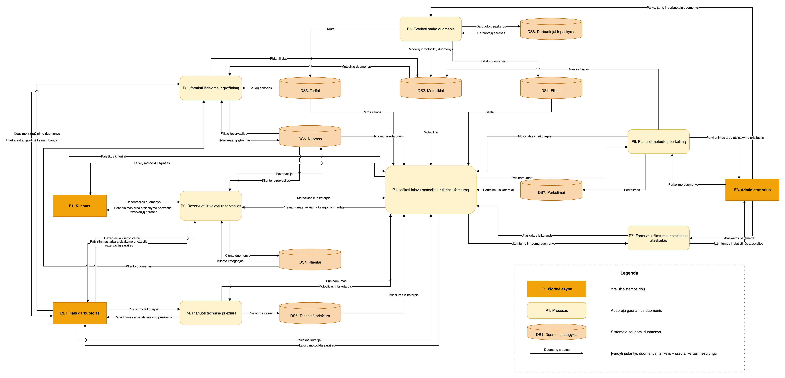

# 9. Duomenų srautų diagrama

Medžiaga ataskaitos skyriui 1.5.1 „Duomenų srautų diagrama“.

**Būsena:** baigta 2026-11-19. Po 1 kontrolinio taško (2026-11-19) pridėti srautai DS2 → P3 ir DS4 → P3 (srautų – 49), patikslinta, kada P6 įrašo naują motociklo filialą.

Diagrama nubraižyta viename lygyje („0 lygis“) su procesais, kaip dėstytojo anksčiau priimtame pavyzdyje (`saltiniai/lab-DSD-diagrama.png`): atskiros konteksto diagramos ir gilesnių lygių nėra. Žymėjimas – kaip 2 paskaitos 22 skaidrėje: išorinė esybė – stačiakampis, procesas – suapvalintas stačiakampis, duomenų saugykla – cilindras, duomenų srautas – rodyklė su pavadinimu. Elementai numeruojami E (išorinės esybės), P (procesai) ir DS (saugyklos); diagramoje yra legenda. Kai srautai kertasi nesujungti, kirtimo vietoje piešiamas lankelis.

Šaltinis: `diagramos/09-dsd.drawio`, paveikslas: `diagramos/09-dsd.png`.

*Motociklų nuomos IS duomenų srautų diagrama (0 lygis)* (paveikslo numeris bus suteiktas surenkant ataskaitą)

## Išorinės esybės

| Nr. | Esybė | Atitinka vartotoją (`02-vartotojai.md`) |
|---|---|---|
| E1 | Klientas | Klientas |
| E2 | Filialo darbuotojas | Filialo darbuotojas |
| E3 | Administratorius | Administratorius (vadovas) |

## Procesai

| Nr. | Procesas | Reikalavimas | Panaudos atvejai |
|---|---|---|---|
| P1 | Ieškoti laisvų motociklų ir tikrinti užimtumą | 1.2.1 (ir užimtumo tikrinimas 1.2.2, 1.2.4, 1.2.5) | PA1, PA6 |
| P2 | Rezervuoti ir valdyti rezervacijas | 1.2.2 | PA2, PA3, PA4, PA5, PA7 |
| P3 | Įforminti išdavimą ir grąžinimą | 1.2.3 | PA8, PA9, PA10, PA12, PA13, PA14, PA15 |
| P4 | Planuoti techninę priežiūrą | 1.2.4 | PA11 |
| P5 | Tvarkyti parko duomenis | 1.2.5 | PA16, PA17, PA18, PA19 |
| P6 | Planuoti motociklų perkėlimą | 1.2.5 | PA22 |
| P7 | Formuoti užimtumo ir statistines ataskaitas | 1.2.5 | PA20, PA21 |

## Duomenų saugyklos

Saugyklos sudarytos iš loginės ER diagramos esybių (`08-loginis-er.md`); su savo pagrindine esybe sujungtos silpnos esybės ir ją aprašančios esybės. Kategorija yra klasifikatorius, kurio įrašai įvedami diegiant sistemą, todėl jos joks procesas nerašo.

| Nr. | Saugykla | ER esybės | Rašo | Skaito |
|---|---|---|---|---|
| DS1 | Filialai | Filialas | P5 | P1 |
| DS2 | Motociklai | Motociklas, Motociklo modelis, Kategorija | P3, P5, P6 | P1, P3 |
| DS3 | Tarifai | Tarifas, Baudos pakopa | P5 | P1, P3 |
| DS4 | Klientai | Klientas (su ryšiu „turi teisę“ ir jo atributu „Galioja iki“) | P2 | P2, P3 |
| DS5 | Nuomos | Nuoma, Išdavimas, Grąžinimas | P2, P3 | P1, P2, P3 |
| DS6 | Techninė priežiūra | Techninė priežiūra | P4 | P1 |
| DS7 | Perkėlimai | Perkėlimas (su ryšiu „perkeliamas“) | P6 | P1 |
| DS8 | Darbuotojai ir paskyros | Darbuotojas, Paskyra | P5 | P5 |

## Duomenų srautai

| Procesas | Gauna | Perduoda |
|---|---|---|
| P1 | iš E1 ir E2 – paieškos kriterijus; iš P2, P4, P6 – motociklą ir laikotarpį; iš P7 – ataskaitos laikotarpį; iš DS1 – filialus; iš DS2 – motociklus; iš DS3 – paros kainas; iš DS5, DS6, DS7 – nuomų, priežiūros ir perkėlimų laikotarpius | E1 ir E2 – laisvų motociklų sąrašą; P2 – prieinamumą, reikiamą kategoriją ir tarifą; P4 ir P6 – prieinamumą; P7 – užimtumo ir nuomų duomenis |
| P2 | iš E1 – rezervacijos duomenis (nauja rezervacija, pakeitimas ar atšaukimas); iš E2 – rezervaciją kliento vardu; iš P1 – prieinamumą, reikiamą kategoriją ir tarifą; iš DS4 – kliento kategorijas; iš DS5 – kliento rezervacijas | E1 ir E2 – patvirtinimą arba atsisakymo priežastį ir rezervacijų sąrašą; P1 – motociklą ir laikotarpį; DS4 – kliento duomenis; DS5 – rezervaciją (naują, pakeistą ar atšauktą) |
| P3 | iš E2 – išdavimo ir grąžinimo duomenis (rida, būklė); iš DS2 – motociklų duomenis; iš DS3 – baudų pakopas; iš DS4 – kliento duomenis; iš DS5 – filialo rezervacijas | E2 – tvarkaraštį, galutinę kainą ir baudą; DS5 – išdavimą ir grąžinimą; DS2 – ridą ir dabartinį filialą |
| P4 | iš E2 – priežiūros laikotarpį; iš P1 – prieinamumą | E2 – patvirtinimą arba atsisakymo priežastį; P1 – motociklą ir laikotarpį; DS6 – priežiūros įrašą |
| P5 | iš E3 – parko, tarifų ir darbuotojų duomenis; iš DS8 – darbuotojų sąrašą | DS1, DS2, DS3, DS8 – filialų, modelių ir motociklų, tarifų, darbuotojų paskyrų duomenis |
| P6 | iš E3 – perkėlimo duomenis; iš P1 – prieinamumą | E3 – patvirtinimą arba atsisakymo priežastį; P1 – motociklą ir laikotarpį; DS7 – perkėlimą; DS2 – naują motociklo filialą |
| P7 | iš E3 – ataskaitos parametrus; iš P1 – užimtumo ir nuomų duomenis | E3 – užimtumą ir statistines ataskaitas; P1 – ataskaitos laikotarpį |

## Modelio sprendimai

- **Užimtumą tikrina tik P1.** Rezervacija (P2), techninės priežiūros planavimas (P4) ir perkėlimo planavimas (P6) siunčia P1 motociklą ir laikotarpį, o P1 grąžina, ar jis laisvas. Taip pat sudarytas 2 paskaitos 22 skaidrės pavyzdys („Patikrinti prieinamumą“ → „Įtraukti studentą“), o panaudos atvejų diagramoje tam atitinka PA6 „Tikrinti motociklo užimtumą“, įtraukiamas į PA1, PA2, PA4, PA11 ir PA22. Todėl nuomų, priežiūros ir perkėlimų laikotarpius (DS5, DS6, DS7) skaito vienas procesas, o motociklo buvimo vietos taisyklė (`08-loginis-er.md`) įgyvendinama vienoje vietoje.
- **P2 tarifą ir reikiamą kategoriją gauna iš P1.** P1 vis tiek skaito motociklus ir tarifus, todėl kartu su prieinamumu grąžina motociklo reikiamą kategoriją (P2 ją palygina su kliento kategorijomis iš DS4, PA7) ir tarifą (paros kaina, užstatas ir baudų pakopos rodomi patvirtinime, 1.2.2).
- **P7 užimtumo ir nuomų duomenis gauna iš P1**, nes tik P1 skaito visus užimtumo laikotarpius. Taip išvengiama dar kelių srautų iš saugyklų, kurie kirstų daugelį kitų.
- **P3 skaito motociklų ir klientų duomenis.** Tvarkaraštyje ir išduodant darbuotojas turi matyti, kuris motociklas (valstybinis numeris) ir kuriam klientui (vardas, pažymėjimo numeris) išduodamas, todėl P3 skaito DS2 ir DS4. Baudų pakopas P3 ima iš DS3 pagal tarifą, su kuriuo susieta nuoma (ryšys „įkainojama“, `08-loginis-er.md`). Grąžinimo filialas pasirenkamas rezervuojant (P2), todėl grąžinant jis neįvedamas, o P3 įrašo jį į DS2 kaip naują motociklo filialą.
- **Naujas filialas po perkėlimo.** P6 įrašo naują motociklo filialą į DS2, kai baigiasi perkėlimo laikotarpis, o ne planuodamas perkėlimą; iki tol motociklo buvimo vietą nusako motociklo buvimo vietos taisyklė (`08-loginis-er.md`).
- **Neplanuota techninė priežiūra** atskiru procesu nevaizduojama: darbuotojas per P2 perkelia rezervaciją į kitą motociklą arba ją atšaukia, o tada per P4 suplanuoja priežiūrą (1.2.4). Susisiekimas su klientu vyksta už sistemos ribų.
- **Prisijungimas nevaizduojamas** (laikomas bazine funkcija). Todėl paskyrų saugyklą DS8 skaito tik P5 (darbuotojų paskyrų tvarkymas), o kliento paskyros sukūrimas registruojantis diagramoje nerodomas.
- **Perspektyviniai reikalavimai 1.6.1–1.6.3** (mokėjimai, pažeidimai, buhalterinė apskaita) neįtraukti, kaip ir ER diagramoje.

## Aprėpties patikrinimas

- Kiekvienas funkcinis reikalavimas 1.2.1–1.2.5 turi bent vieną procesą, o kiekvienas panaudos atvejis PA1–PA22 – procesą (žr. lentelę „Procesai“).
- Kiekviena loginės ER diagramos esybė (14) priklauso vienai saugyklai, o kiekviena saugykla turi bent vieną rašantį ir bent vieną skaitantį procesą.
- Kiekviena išorinė esybė atitinka vartotoją iš `02-vartotojai.md` ir aktorių panaudos atvejų diagramoje; procesai, su kuriais ji susijusi, atitinka jos panaudos atvejus (E1 – P1, P2; E2 – P1, P2, P3, P4; E3 – P5, P6, P7).
