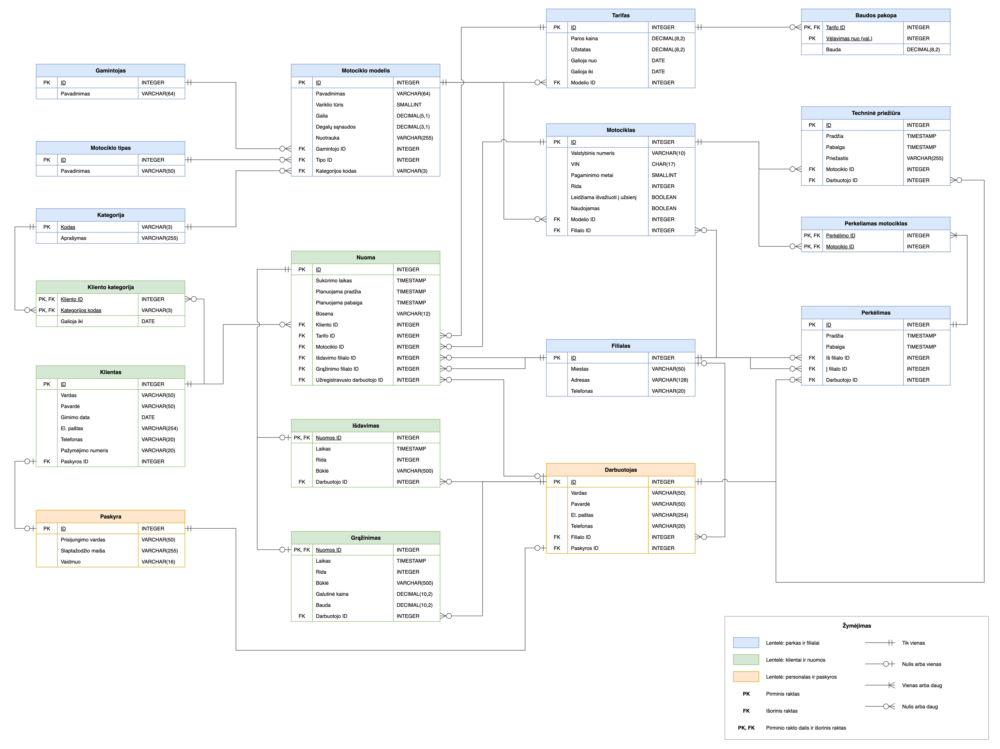

# 10. Fizinė ER diagrama ir lentelių aprašymas

Medžiaga ataskaitos skyriams 2.1.2 „Duomenų modelis“ ir 2.2.2 „Duomenų modelio aprašymas“.

**Būsena:** baigta 2026-11-19.

Fizinė ER diagrama sudaryta iš loginės ER diagramos (`08-loginis-er.md`). Kiekviena esybė tapo lentele, M:N ryšiai – atskiromis lentelėmis, o 1:N ir 1:1 ryšiai – išoriniais raktais. Diagrama nubraižyta varnos pėdos žymėjimu, kaip 5 paskaitos 17–20 skaidrėse: lentelė vaizduojama trimis stulpeliais (raktas, atributas, duomenų tipas), ryšys jungia pirminio rakto eilutę su išorinio rakto eilute, o linijos galai rodo, kiek įrašų gali būti kiekvienoje ryšio pusėje (kodėl kiekvienas ryšys toks – skyrius „Ryšiai“). Lentelės nuspalvintos pagal tas pačias sritis kaip loginėje diagramoje. Diagramoje rodomi tik pirminiai ir išoriniai raktai, atributų pavadinimai ir duomenų tipai; kiti apribojimai (NOT NULL, UNIQUE, CHECK, numatytosios reikšmės) aprašyti lentelių aprašyme.

Šaltinis: `diagramos/10-fizinis-er.drawio`, paveikslas: `diagramos/10-fizinis-er.png`.

*Motociklų nuomos IS fizinė ER diagrama* (paveikslo numeris bus suteiktas surenkant ataskaitą)

Savikontrolei parašytas SQL skriptas `darbas/schema.sql`, kuris sukuria šią schemą (ataskaitoje nepateikiamas). Jis patikrintas PostgreSQL 18: sukuriamos 18 lentelių ir 29 išoriniai raktai, teisingi pavyzdiniai duomenys įrašomi, o 12 apribojimus pažeidžiančių įrašų atmetami. Diagramos ir skripto lentelės, atributai, tipai ir raktai sutampa. Schemai sukurti bandomieji (išgalvoti) duomenys `darbas/duomenys.sql` – 2025–2026 m. sezonų nuomos ir 2027 m. rezervacijos – ir užklausos `darbas/patikra.sql`, kurios tikrina skyriuje „Taisyklės, kurias tikrina sistemos funkcijos“ išvardytas taisykles; su bandomaisiais duomenimis pažeidimų nerasta. Kaip paleisti duomenų bazę – `README.md`.

## Bendri sprendimai

- **Duomenų bazių valdymo sistema nepasirinkta.** Naudojami tik SQL standarto duomenų tipai: INTEGER, SMALLINT, DECIMAL, VARCHAR, CHAR, DATE, TIMESTAMP, BOOLEAN. Pavadinimai tokie pat kaip loginėje diagramoje, o išorinio rakto pavadinime nurodoma lentelė, į kurią jis rodo (pvz., „Filialo ID“).
- **Pirminiai raktai.** Loginio modelio „Kodas“ tampa sveikojo skaičiaus pirminiu raktu „ID“, kurį sistema sugeneruoja automatiškai. Toks raktas nesikeičia (5 paskaita, 22 skaidrė) ir yra trumpas išoriniuose raktuose. Išimtis – Kategorija: jos raktas yra pati kategorijos žymė „Kodas“ (AM, A1, A2, A), nes ji trumpa, nekinta ir suprantama be papildomos užklausos. Paskyros raktas taip pat „ID“, o loginio modelio raktas „Prisijungimo vardas“ tapo unikaliu atributu, kad jį būtų galima pakeisti nekeičiant susijusių įrašų.
- **Laikas ir datos.** Visi motociklo užimtumo laikotarpiai – nuomos planuojama pradžia ir pabaiga, išdavimo ir grąžinimo laikas, techninės priežiūros ir perkėlimo pradžia ir pabaiga – saugomi kaip TIMESTAMP, nes prieinamumą reikia rodyti tiksliai, o vėlavimas skaičiuojamas valandomis. DATE naudojama tik kalendorinėms datoms, nesusijusioms su užimtumu: tarifo galiojimui (tarifas parenkamas pagal rezervavimo dieną), kategorijos galiojimui ir gimimo datai.
- **Pinigų sumos** saugomos kaip DECIMAL eurais (ne slankiojo kablelio skaičiai), kad nebūtų apvalinimo klaidų.
- **Silpnos esybės.** Išdavimo ir Grąžinimo pirminis raktas kartu yra išorinis raktas į Nuomą („Nuomos ID“), todėl kiekviena nuoma turi ne daugiau kaip vieną išdavimą ir vieną grąžinimą. Baudos pakopos pirminis raktas sudėtinis: tarifas ir dalinis raktas „Vėlavimas nuo (val.)“.
- **M:N ryšiai** tapo lentelėmis su sudėtiniu pirminiu raktu: Kliento kategorija (ryšys „turi teisę“ su atributu „Galioja iki“) ir Perkeliamas motociklas (ryšys „perkeliamas“). Kiekvieno ryšio kardinalumas ir privalomumas paaiškintas skyriuje „Ryšiai“.
- **Ryšiai 1:1 su Paskyra.** Išorinis raktas „Paskyros ID“ yra Kliento ir Darbuotojo lentelėse ir yra unikalus. Klientui jis neprivalomas (klientą be paskyros gali užregistruoti darbuotojas), darbuotojui privalomas.
- **Įrašų trynimas.** Kartu su pagrindiniu įrašu ištrinami tik nuo jo priklausantys įrašai: tarifo baudų pakopos, kliento kategorijos ir perkėlimo motociklai. Kitų įrašų, į kuriuos yra nuorodų, ištrinti negalima: užbaigtos nuomos ir jų istorija saugomos ne trumpiau kaip 5 metus (1.3.4.2), o nebenaudojamas motociklas pažymimas požymiu „Naudojamas“, o ne trinamas.
- **Normalizacija.** Lentelės atitinka trečiąją normalinę formą (5 paskaita, 7–13 skaidrės): reikšmės atominės, o neraktiniai atributai priklauso tik nuo viso pirminio rakto. Sąmoningas nukrypimas – Grąžinimo „Galutinė kaina“ ir „Bauda“. Tai išvestiniai atributai, kuriuos galima apskaičiuoti iš tarifo, nuomos laikų ir baudų pakopų, bet jie saugomi kaip užfiksuotas atsiskaitymo su klientu rezultatas: skaičiavimo taisyklės gali keistis, o perskaičiuotos senų nuomų sumos nebesutaptų su sumokėtomis.
- **Klasifikatoriai.** Gamintojas, Motociklo tipas ir Kategorija – atskiros lentelės, nes jų reikšmės kartojasi daugelyje modelių, pagal jas ieškoma ir grupuojamos ataskaitos, o įvedant tekstą ta pati reikšmė galėtų būti užrašyta skirtingai. Gamintojus ir tipus tvarko administratorius kartu su modeliais (1.2.5), kategorijos įvedamos diegiant sistemą. Nuomos „Būsena“ ir Paskyros „Vaidmuo“ atskiromis lentelėmis nedaromi: jų reikšmių sąrašą nustato ne įmonė, o pati sistema (nuo būsenos priklauso nuomos eiga, nuo vaidmens – leidžiami veiksmai, 1.3.5.1), todėl nauja reikšmė be programos pakeitimų nebūtų naudinga. Šių atributų leistinos reikšmės apribotos CHECK sąlyga. Filialo „Miestas“ nesikartoja (kiekvienas filialas kitame mieste), o techninės priežiūros „Priežastis“ – laisvas aprašymas.
- **Išplečiamumas.** Kadangi kategorijų apimties taisyklės nesaugomos, naujas pažymėjimo kategorijas (pvz., B, C, D) ir naujus motociklų tipus galima pridėti kaip įrašus, nekeičiant schemos. Kitų transporto priemonių nuomai reikėtų tik apibendrinti lentelę „Motociklo modelis“.

### Taisyklės, kurias tikrina sistemos funkcijos

Kai kurių taisyklių duomenų bazės apribojimais (PK, FK, UNIQUE, NOT NULL, CHECK) išreikšti negalima, nes jos apima kelias lenteles ar kelis įrašus. Jas tikrina sistemos funkcijos (12 žingsnis) prieš įrašydamos duomenis:

- motociklo užimtumo laikotarpiai (nuomos, techninė priežiūra, perkėlimai) nepersidengia ir atitinka motociklo buvimo vietos taisyklę (`08-loginis-er.md`) – funkcija `tikrintiUzimtuma`; ji vykdoma toje pačioje transakcijoje, kurioje įrašoma rezervacija, todėl iš dviejų vienu metu pateiktų tos pačios rezervacijos bandymų įrašomas tik vienas (1.3.3.3);
- vieno modelio tarifų galiojimo laikotarpiai nepersidengia, o tarifas, pagal kurį jau yra rezervacijų, nekeičiamas (uždaromas data „Galioja iki“);
- nuomos tarifas priklauso nuomojamo motociklo modeliui ir galiojo rezervavimo dieną;
- perkėlimas turi bent vieną motociklą (diagramoje – „vienas arba daug“);
- klientas turi modeliui reikiamą kategoriją, galiojančią visą nuomos laikotarpį – funkcija `tikrintiKlientoTeise`;
- rida grąžinant ne mažesnė nei išduodant, o Galutinė kaina ir Bauda apskaičiuojamos pagal nuomos tarifą ir baudų pakopas – funkcija `skaiciuotiKaina`;
- paskyros vaidmuo atitinka, kam ji priklauso (kliento paskyra – vaidmuo „klientas“, darbuotojo – „darbuotojas“ arba „administratorius“).

### Ryšys su loginiu modeliu ir duomenų srautų diagrama

| Saugykla (`09-dsd.md`) | Loginės ER esybės | Lentelės |
|---|---|---|
| DS1 Filialai | Filialas | Filialas |
| DS2 Motociklai | Motociklas, Motociklo modelis, Gamintojas, Motociklo tipas, Kategorija | Motociklas, Motociklo modelis, Gamintojas, Motociklo tipas, Kategorija |
| DS3 Tarifai | Tarifas, Baudos pakopa | Tarifas, Baudos pakopa |
| DS4 Klientai | Klientas, ryšys „turi teisę“ | Klientas, Kliento kategorija |
| DS5 Nuomos | Nuoma, Išdavimas, Grąžinimas | Nuoma, Išdavimas, Grąžinimas |
| DS6 Techninė priežiūra | Techninė priežiūra | Techninė priežiūra |
| DS7 Perkėlimai | Perkėlimas, ryšys „perkeliamas“ | Perkėlimas, Perkeliamas motociklas |
| DS8 Darbuotojai ir paskyros | Darbuotojas, Paskyra | Darbuotojas, Paskyra |

Kiekviena lentelė priklauso vienai saugyklai, todėl duomenų srautų diagramos keisti nereikia.

## Ryšiai

Diagramoje yra 29 ryšiai. Kiekvienas jungia tėvinės lentelės pirminį raktą su vaikinės lentelės išoriniu raktu. Ryšių pavadinimai tokie pat kaip loginėje ER diagramoje (`08-loginis-er.md`); M:N ryšiai „turi teisę“ ir „perkeliamas“ fizinėje diagramoje išskaidyti į du 1:N ryšius per tarpinę lentelę.

Kaip skaityti linijos galus (5 paskaita, 19 skaidrė):

- **Ženklas prie tėvinės lentelės** rodo, su kiek tėvinės lentelės įrašų susijęs vienas vaikinės lentelės įrašas. „Tik vienas“ reiškia, kad išorinis raktas privalomas (NOT NULL). „Nulis arba vienas“ reiškia, kad išorinis raktas gali būti tuščias.
- **Ženklas prie vaikinės lentelės** rodo, kiek vaikinės lentelės įrašų gali turėti vienas tėvinės lentelės įrašas. „Nulis arba daug“ reiškia, kad tėvinis įrašas gali egzistuoti be vaikinių; „vienas arba daug“ – kad be bent vieno vaikinio įrašo jis neturi prasmės. 1:1 ryšiuose prie vaikinės lentelės yra „nulis arba vienas“: išorinis raktas yra unikalus arba kartu yra pirminis raktas, todėl antro įrašo būti negali.

Pavyzdys: ryšys „apibūdina“ (Motociklo modelis – Motociklas) pažymėtas „tik vienas“ prie Motociklo modelio ir „nulis arba daug“ prie Motociklo. Tai reiškia: kiekvienas motociklas turi lygiai vieną modelį, o modelis gali turėti daug motociklų arba nė vieno.

Lentelėse: **ryšys** – loginės diagramos ryšio pavadinimas; **tėvinė → vaikinė (FK)** – kuri lentelė į kurią rodo; **kardinalumas**; **ženklai** – prie tėvinės / prie vaikinės lentelės.

### Parkas, klasifikatoriai ir tarifai

| Ryšys | Tėvinė → vaikinė (FK) | Kard. | Ženklai | Kodėl taip |
|---|---|---|---|---|
| reikalauja | Kategorija → Motociklo modelis (Kategorijos kodas) | 1 : N | tik vienas / nulis arba daug | Modeliui vairuoti reikia vienos konkrečios kategorijos, be jos negalima patikrinti kliento teisės (1.2.2), todėl raktas privalomas. Ta pati kategorija tinka daugeliui modelių, o kategorija gali būti įvesta, nors parke dar nėra jai priskirto modelio. |
| gamina | Gamintojas → Motociklo modelis (Gamintojo ID) | 1 : N | tik vienas / nulis arba daug | Modelį gamina vienas gamintojas, o gamintojas – daug modelių. Gamintojas įvedamas anksčiau nei jo modeliai. |
| priklauso | Motociklo tipas → Motociklo modelis (Tipo ID) | 1 : N | tik vienas / nulis arba daug | Modelis priskiriamas vienam tipui, kad paieškoje jį būtų galima atrinkti pagal tipą (1.2.1); tipui gali priklausyti daug modelių arba dar nė vieno. |
| apibūdina | Motociklo modelis → Motociklas (Modelio ID) | 1 : N | tik vienas / nulis arba daug | Charakteristikos, nuotrauka ir reikiama kategorija saugomos modelyje, todėl motociklas be modelio neturėtų šių duomenų. Parke yra keli to paties modelio motociklai; modelis įvedamas anksčiau nei motociklai. |
| taikomas | Motociklo modelis → Tarifas (Modelio ID) | 1 : N | tik vienas / nulis arba daug | Tarifas visada nustatomas konkrečiam modeliui. Modelis turi kelis tarifus skirtingiems laikotarpiams (pasikeitus kainai, senas tarifas uždaromas ir sukuriamas naujas); ką tik įvestas modelis tarifo dar neturi. |
| apima | Tarifas → Baudos pakopa (Tarifo ID) | 1 : N | tik vienas / nulis arba daug | Baudos pakopa be tarifo neegzistuoja (silpna esybė). Tarifas gali turėti kelias pakopas arba nė vienos – tada bauda už vėlavimą neskaičiuojama. |
| yra | Filialas → Motociklas (Filialo ID) | 1 : N | tik vienas / nulis arba daug | Motociklas visada yra lygiai viename filiale – tame, iš kurio išduodamas ar kuriame laukia kitos nuomos. Saugomas tik dabartinis filialas (ankstesnės vietos matyti iš nuomų ir perkėlimų), todėl ryšys 1 : N, o ne M : N. Filiale gali nebūti nė vieno motociklo. |
| prižiūrimas | Motociklas → Techninė priežiūra (Motociklo ID) | 1 : N | tik vienas / nulis arba daug | Priežiūros laikotarpis visada skirtas vienam motociklui; motociklas prižiūrimas daug kartų arba dar nė karto. |
| perkeliamas (1) | Motociklas → Perkeliamas motociklas (Motociklo ID) | 1 : N | tik vienas / nulis arba daug | Loginio M : N ryšio dalis: motociklas per savo naudojimo laiką gali būti perkeltas daug kartų arba nė karto. |
| perkeliamas (2) | Perkėlimas → Perkeliamas motociklas (Perkėlimo ID) | 1 : N | tik vienas / vienas arba daug | Vienu perkėlimu (vienu reisu) vežamas vienas ar keli motociklai, todėl ryšys loginiame modelyje M : N. Perkėlimas be motociklų neturi prasmės, todėl „vienas arba daug“; šią sąlygą tikrina perkėlimo planavimo funkcija, nes duomenų bazės apribojimu jos išreikšti negalima. |
| perkeliama iš | Filialas → Perkėlimas (Iš filialo ID) | 1 : N | tik vienas / nulis arba daug | Kiekvienas perkėlimas turi lygiai vieną pradžios filialą. Du ryšiai su ta pačia lentele reikalingi, nes filialas perkėlime atlieka dvi skirtingas roles. |
| perkeliama į | Filialas → Perkėlimas (Į filialo ID) | 1 : N | tik vienas / nulis arba daug | Kiekvienas perkėlimas turi lygiai vieną tikslo filialą, kuris skiriasi nuo pradžios filialo (CHECK). |

### Klientai ir nuomos

| Ryšys | Tėvinė → vaikinė (FK) | Kard. | Ženklai | Kodėl taip |
|---|---|---|---|---|
| turi teisę (1) | Klientas → Kliento kategorija (Kliento ID) | 1 : N | tik vienas / nulis arba daug | Loginio M : N ryšio dalis: kliento pažymėjime gali būti kelios kategorijos, ir kiekvienos galiojimo data skirtinga, todėl „Galioja iki“ priklauso porai klientas–kategorija ir saugoma tarpinėje lentelėje. Klientas gali neturėti nė vienos sistemoje esančios kategorijos (pvz., turi tik B kategorijos pažymėjimą) – tada motociklo rezervacija atmetama (1.3.2.4). |
| turi teisę (2) | Kategorija → Kliento kategorija (Kategorijos kodas) | 1 : N | tik vienas / nulis arba daug | Ta pati kategorija yra daugelio klientų pažymėjimuose arba dar nė viename. |
| užsako | Klientas → Nuoma (Kliento ID) | 1 : N | tik vienas / nulis arba daug | Kiekviena rezervacija yra lygiai vieno kliento – net jei ją registravo darbuotojas, ji priskiriama klientui. Klientas gali turėti daug nuomų (užbaigtos saugomos, 1.3.4.2) arba dar nė vienos. |
| įkainojama | Tarifas → Nuoma (Tarifo ID) | 1 : N | tik vienas / nulis arba daug | Nuomai taikomas lygiai vienas tarifas – galiojęs rezervavimo dieną; pagal jį skaičiuojama kaina, užstatas ir bauda. Pagal vieną tarifą sudaroma daug nuomų, o naujas tarifas gali būti dar nepanaudotas. |
| nuomojamas | Motociklas → Nuoma (Motociklo ID) | 1 : N | tik vienas / nulis arba daug | Rezervuojamas konkretus motociklas, o ne modelis, nes užimtumas tikrinamas kiekvienam motociklui. Motociklas nuomojamas daug kartų (laikotarpiai nepersidengia) arba dar nė karto. |
| išduodama | Filialas → Nuoma (Išdavimo filialo ID) | 1 : N | tik vienas / nulis arba daug | Išdavimo filialas pasirenkamas rezervuojant ir yra privalomas (1.2.2). |
| grąžinama | Filialas → Nuoma (Grąžinimo filialo ID) | 1 : N | tik vienas / nulis arba daug | Grąžinimo filialas taip pat pasirenkamas rezervuojant; jis gali skirtis nuo išdavimo filialo (grąžinimas į kitą filialą), todėl tai atskiras ryšys. |
| pradedama | Nuoma → Išdavimas (Nuomos ID) | 1 : 1 | tik vienas / nulis arba vienas | Motociklas pagal nuomą išduodamas ne daugiau kaip vieną kartą: Išdavimo pirminis raktas yra nuomos raktas. Kol rezervacija neįvykdyta ar jei ji atšaukta, išdavimo nėra, todėl „nulis arba vienas“. Išdavimas be nuomos neegzistuoja (silpna esybė). |
| baigiama | Nuoma → Grąžinimas (Nuomos ID) | 1 : 1 | tik vienas / nulis arba vienas | Tas pats kaip išdavimui: grąžinimas įforminamas vieną kartą ir tik išduotai nuomai, o iki tol jo nėra. |

### Personalas ir paskyros

| Ryšys | Tėvinė → vaikinė (FK) | Kard. | Ženklai | Kodėl taip |
|---|---|---|---|---|
| dirba | Filialas → Darbuotojas (Filialo ID) | 1 : N | nulis arba vienas / nulis arba daug | Filialo darbuotojas dirba viename filiale, o administratorius gali būti nepriskirtas jokiam filialui (jis tvarko visą parką), todėl išorinis raktas neprivalomas. Filiale dirba keli darbuotojai. |
| užregistravo | Darbuotojas → Nuoma (Užregistravusio darbuotojo ID) | 1 : N | nulis arba vienas / nulis arba daug | Jei rezervaciją sudarė pats klientas svetainėje, darbuotojo nėra, todėl raktas neprivalomas; jei skambinusiam klientui rezervavo darbuotojas – nurodomas jis. |
| išdavė | Darbuotojas → Išdavimas (Darbuotojo ID) | 1 : N | tik vienas / nulis arba daug | Motociklą visada išduoda konkretus darbuotojas (atsakomybė už ridą ir būklę). Administratorius išdavimų gali neturėti. |
| priėmė | Darbuotojas → Grąžinimas (Darbuotojo ID) | 1 : N | tik vienas / nulis arba daug | Grąžintą motociklą visada priima konkretus darbuotojas. |
| planuoja | Darbuotojas → Techninė priežiūra (Darbuotojo ID) | 1 : N | tik vienas / nulis arba daug | Kiekvieną priežiūrą suplanuoja vienas darbuotojas (1.2.4). |
| organizuoja | Darbuotojas → Perkėlimas (Darbuotojo ID) | 1 : N | tik vienas / nulis arba daug | Perkėlimą suplanuoja vienas administratorius (1.2.5). |
| naudoja (klientas) | Paskyra → Klientas (Paskyros ID) | 1 : 1 | nulis arba vienas / nulis arba vienas | Klientas gali turėti ne daugiau kaip vieną paskyrą, bet gali neturėti ir jokios (jį telefonu užregistravo darbuotojas). Paskyra priklauso daugiausia vienam klientui (raktas unikalus) arba nė vienam, jei tai darbuotojo paskyra. |
| naudoja (darbuotojas) | Paskyra → Darbuotojas (Paskyros ID) | 1 : 1 | tik vienas / nulis arba vienas | Darbuotojas visada turi lygiai vieną paskyrą, nes be jos negalėtų dirbti sistemoje. Paskyra priklauso daugiausia vienam darbuotojui arba nė vienam, jei tai kliento paskyra. |

Ryšiai 1 : 1 su Paskyra nesujungti į vieną lentelę, nes paskyra klientui neprivaloma, o prisijungimo duomenys vienodi klientams ir darbuotojams. Išdavimas ir Grąžinimas nesujungti su Nuoma, kad kol motociklas neišduotas, nuomoje nebūtų tuščių laukų (`08-loginis-er.md`).

## Lentelių aprašymas

Žymėjimas: PK – pirminis raktas, FK – išorinis raktas (nurodoma lentelė, į kurią jis rodo), NOT NULL – privaloma reikšmė, UNIQUE – reikšmė nesikartoja, CHECK – reikšmės sąlyga, DEFAULT – numatytoji reikšmė. Atributai be NOT NULL gali neturėti reikšmės.

### Filialas

Įmonės filialai (Vilnius, Kaunas, Klaipėda): iš kur motociklai išduodami, kur grąžinami ir kur jie yra.

| Atributas | Duomenų tipas | Apribojimai |
|---|---|---|
| ID | INTEGER | PK, generuojamas automatiškai |
| Miestas | VARCHAR(50) | NOT NULL |
| Adresas | VARCHAR(128) | NOT NULL |
| Telefonas | VARCHAR(20) | NOT NULL |

### Kategorija

Vairuotojo pažymėjimo kategorijų klasifikatorius. Įrašai (AM, A1, A2, A) įvedami diegiant sistemą.

| Atributas | Duomenų tipas | Apribojimai |
|---|---|---|
| Kodas | VARCHAR(3) | PK |
| Aprašymas | VARCHAR(255) | NOT NULL; paaiškinimas klientui, pvz., „A2 – vidutinės galios motociklai“ |

### Gamintojas

Motociklų gamintojų klasifikatorius (pvz., Honda, BMW). Tvarko administratorius.

| Atributas | Duomenų tipas | Apribojimai |
|---|---|---|
| ID | INTEGER | PK, generuojamas automatiškai |
| Pavadinimas | VARCHAR(64) | NOT NULL, UNIQUE |

### Motociklo tipas

Motociklų tipų klasifikatorius paieškai ir kortelei (pvz., turistinis, enduro). Tvarko administratorius.

| Atributas | Duomenų tipas | Apribojimai |
|---|---|---|
| ID | INTEGER | PK, generuojamas automatiškai |
| Pavadinimas | VARCHAR(50) | NOT NULL, UNIQUE |

### Motociklo modelis

Modelio charakteristikos, rodomos paieškoje ir motociklo kortelėje (1.2.1, 1.3.1.3).

| Atributas | Duomenų tipas | Apribojimai |
|---|---|---|
| ID | INTEGER | PK, generuojamas automatiškai |
| Pavadinimas | VARCHAR(64) | NOT NULL; UNIQUE kartu su „Gamintojo ID“ |
| Variklio tūris | SMALLINT | NOT NULL, CHECK (> 0); cm³ |
| Galia | DECIMAL(5,1) | NOT NULL, CHECK (> 0); kW |
| Degalų sąnaudos | DECIMAL(3,1) | NOT NULL, CHECK (> 0); l/100 km |
| Nuotrauka | VARCHAR(255) | NOT NULL; nuotraukos failo kelias (pats failas saugomas ne duomenų bazėje) |
| Gamintojo ID | INTEGER | FK → Gamintojas, NOT NULL |
| Tipo ID | INTEGER | FK → Motociklo tipas, NOT NULL |
| Kategorijos kodas | VARCHAR(3) | FK → Kategorija, NOT NULL; kategorija, reikalinga modeliui vairuoti |

### Motociklas

Konkretus parko motociklas.

| Atributas | Duomenų tipas | Apribojimai |
|---|---|---|
| ID | INTEGER | PK, generuojamas automatiškai |
| Valstybinis numeris | VARCHAR(10) | NOT NULL, UNIQUE |
| VIN | CHAR(17) | NOT NULL, UNIQUE; transporto priemonės identifikavimo numeris visada turi 17 simbolių |
| Pagaminimo metai | SMALLINT | NOT NULL, CHECK (≥ 1900) |
| Rida | INTEGER | NOT NULL, CHECK (≥ 0); km, atnaujinama grąžinant |
| Leidžiama išvažiuoti į užsienį | BOOLEAN | NOT NULL, DEFAULT FALSE |
| Naudojamas | BOOLEAN | NOT NULL, DEFAULT TRUE; nurašytas motociklas netrinamas, o nerodomas paieškoje |
| Modelio ID | INTEGER | FK → Motociklo modelis, NOT NULL |
| Filialo ID | INTEGER | FK → Filialas, NOT NULL; filialas, kuriame motociklas yra dabar (keičiamas grąžinant ir pasibaigus perkėlimui) |

### Tarifas

Modelio paros kaina ir užstatas, galiojantys rezervacijoms, sudarytoms nurodytu laikotarpiu.

| Atributas | Duomenų tipas | Apribojimai |
|---|---|---|
| ID | INTEGER | PK, generuojamas automatiškai |
| Paros kaina | DECIMAL(8,2) | NOT NULL, CHECK (> 0) |
| Užstatas | DECIMAL(8,2) | NOT NULL, CHECK (≥ 0) |
| Galioja nuo | DATE | NOT NULL |
| Galioja iki | DATE | CHECK (≥ „Galioja nuo“); tuščia – galioja neribotai |
| Modelio ID | INTEGER | FK → Motociklo modelis, NOT NULL |

### Baudos pakopa

Baudų už pavėluotą grąžinimą lentelės eilutė. Pakopa galioja nuo savo „Vėlavimas nuo“ iki kitos pakopos pradžios; taikoma pakopa su didžiausia „Vėlavimas nuo“ reikšme, kuri neviršija vėlavimo.

| Atributas | Duomenų tipas | Apribojimai |
|---|---|---|
| Tarifo ID | INTEGER | PK (kartu su „Vėlavimas nuo (val.)“), FK → Tarifas; ištrinamas kartu su tarifu |
| Vėlavimas nuo (val.) | INTEGER | PK (kartu su „Tarifo ID“), CHECK (≥ 0) |
| Bauda | DECIMAL(8,2) | NOT NULL, CHECK (> 0) |

### Klientas

Nuomininkas ir jo vairuotojo pažymėjimo duomenys.

| Atributas | Duomenų tipas | Apribojimai |
|---|---|---|
| ID | INTEGER | PK, generuojamas automatiškai |
| Vardas | VARCHAR(50) | NOT NULL |
| Pavardė | VARCHAR(50) | NOT NULL |
| Gimimo data | DATE | NOT NULL |
| El. paštas | VARCHAR(254) | UNIQUE; gali būti tuščias, jei klientą telefonu užregistravo darbuotojas; pagal jį paskyra susiejama su klientu |
| Telefonas | VARCHAR(20) | NOT NULL |
| Pažymėjimo numeris | VARCHAR(20) | NOT NULL, UNIQUE |
| Paskyros ID | INTEGER | FK → Paskyra, UNIQUE; tuščias, jei klientas neturi paskyros |

### Kliento kategorija

Kliento pažymėjimo kategorijos su kiekvienos galiojimo data (loginio modelio ryšys „turi teisę“).

| Atributas | Duomenų tipas | Apribojimai |
|---|---|---|
| Kliento ID | INTEGER | PK (kartu su „Kategorijos kodas“), FK → Klientas; ištrinamas kartu su klientu |
| Kategorijos kodas | VARCHAR(3) | PK (kartu su „Kliento ID“), FK → Kategorija |
| Galioja iki | DATE | NOT NULL |

### Nuoma

Rezervacija, kuri išdavus motociklą tampa nuoma.

| Atributas | Duomenų tipas | Apribojimai |
|---|---|---|
| ID | INTEGER | PK, generuojamas automatiškai |
| Sukūrimo laikas | TIMESTAMP | NOT NULL, DEFAULT dabartinis laikas |
| Planuojama pradžia | TIMESTAMP | NOT NULL |
| Planuojama pabaiga | TIMESTAMP | NOT NULL, CHECK (> „Planuojama pradžia“) |
| Būsena | VARCHAR(12) | NOT NULL, DEFAULT 'rezervuota', CHECK (reikšmė iš sąrašo: rezervuota, aktyvi, užbaigta, atšaukta) |
| Kliento ID | INTEGER | FK → Klientas, NOT NULL |
| Tarifo ID | INTEGER | FK → Tarifas, NOT NULL; rezervavimo dieną galiojęs motociklo modelio tarifas |
| Motociklo ID | INTEGER | FK → Motociklas, NOT NULL |
| Išdavimo filialo ID | INTEGER | FK → Filialas, NOT NULL |
| Grąžinimo filialo ID | INTEGER | FK → Filialas, NOT NULL; gali skirtis nuo išdavimo filialo |
| Užregistravusio darbuotojo ID | INTEGER | FK → Darbuotojas; tuščias, jei rezervavo pats klientas |

### Išdavimas

Motociklo išdavimo klientui faktas.

| Atributas | Duomenų tipas | Apribojimai |
|---|---|---|
| Nuomos ID | INTEGER | PK, FK → Nuoma |
| Laikas | TIMESTAMP | NOT NULL |
| Rida | INTEGER | NOT NULL, CHECK (≥ 0) |
| Būklė | VARCHAR(500) | NOT NULL; trumpas motociklo būklės aprašymas |
| Darbuotojo ID | INTEGER | FK → Darbuotojas, NOT NULL; kas išdavė |

### Grąžinimas

Motociklo grąžinimo faktas ir galutinis atsiskaitymas.

| Atributas | Duomenų tipas | Apribojimai |
|---|---|---|
| Nuomos ID | INTEGER | PK, FK → Nuoma |
| Laikas | TIMESTAMP | NOT NULL |
| Rida | INTEGER | NOT NULL, CHECK (≥ 0) |
| Būklė | VARCHAR(500) | NOT NULL |
| Galutinė kaina | DECIMAL(10,2) | NOT NULL, CHECK (≥ 0); išvestinis atributas, saugomas sąmoningai (žr. „Normalizacija“) |
| Bauda | DECIMAL(10,2) | NOT NULL, DEFAULT 0, CHECK (≥ 0); išvestinis atributas, saugomas sąmoningai |
| Darbuotojo ID | INTEGER | FK → Darbuotojas, NOT NULL; kas priėmė |

### Techninė priežiūra

Laikotarpis, kai motociklas prižiūrimas ir negali būti rezervuotas.

| Atributas | Duomenų tipas | Apribojimai |
|---|---|---|
| ID | INTEGER | PK, generuojamas automatiškai |
| Pradžia | TIMESTAMP | NOT NULL |
| Pabaiga | TIMESTAMP | NOT NULL, CHECK (> „Pradžia“) |
| Priežastis | VARCHAR(255) | NOT NULL |
| Motociklo ID | INTEGER | FK → Motociklas, NOT NULL |
| Darbuotojo ID | INTEGER | FK → Darbuotojas, NOT NULL; kas suplanavo |

### Perkėlimas

Vieno ar kelių motociklų pervežimas į kitą filialą.

| Atributas | Duomenų tipas | Apribojimai |
|---|---|---|
| ID | INTEGER | PK, generuojamas automatiškai |
| Pradžia | TIMESTAMP | NOT NULL |
| Pabaiga | TIMESTAMP | NOT NULL, CHECK (> „Pradžia“) |
| Iš filialo ID | INTEGER | FK → Filialas, NOT NULL |
| Į filialo ID | INTEGER | FK → Filialas, NOT NULL, CHECK (≠ „Iš filialo ID“) |
| Darbuotojo ID | INTEGER | FK → Darbuotojas, NOT NULL; administratorius, suplanavęs perkėlimą |

### Perkeliamas motociklas

Kurie motociklai vežami perkėlimu (loginio modelio ryšys „perkeliamas“). Perkėlimas turi bent vieną motociklą.

| Atributas | Duomenų tipas | Apribojimai |
|---|---|---|
| Perkėlimo ID | INTEGER | PK (kartu su „Motociklo ID“), FK → Perkėlimas; ištrinamas kartu su perkėlimu |
| Motociklo ID | INTEGER | PK (kartu su „Perkėlimo ID“), FK → Motociklas |

### Darbuotojas

Filialo darbuotojas arba administratorius.

| Atributas | Duomenų tipas | Apribojimai |
|---|---|---|
| ID | INTEGER | PK, generuojamas automatiškai |
| Vardas | VARCHAR(50) | NOT NULL |
| Pavardė | VARCHAR(50) | NOT NULL |
| El. paštas | VARCHAR(254) | NOT NULL, UNIQUE |
| Telefonas | VARCHAR(20) | NOT NULL |
| Filialo ID | INTEGER | FK → Filialas; tuščias administratoriui, nepriskirtam filialui |
| Paskyros ID | INTEGER | FK → Paskyra, NOT NULL, UNIQUE |

### Paskyra

Prisijungimo duomenys ir vaidmuo, pagal kurį ribojami leidžiami veiksmai (1.3.5.1).

| Atributas | Duomenų tipas | Apribojimai |
|---|---|---|
| ID | INTEGER | PK, generuojamas automatiškai |
| Prisijungimo vardas | VARCHAR(50) | NOT NULL, UNIQUE |
| Slaptažodžio maiša | VARCHAR(255) | NOT NULL; saugoma tik slaptažodžio maiša, ne pats slaptažodis (1.3.5.2) |
| Vaidmuo | VARCHAR(16) | NOT NULL, CHECK (reikšmė iš sąrašo: klientas, darbuotojas, administratorius) |

## Palyginimas su laboratoriniu darbu

Laboratorinio darbo fizinėje diagramoje buvo 5 lentelės. Šioje – 18: pridėti klasifikatoriai, tarifai su baudų pakopomis, techninė priežiūra, perkėlimai, išdavimas ir grąžinimas, darbuotojai ir paskyros, M:N ryšių lentelės. Diagramoje parodytas ryšių privalomumas (nulis arba vienas, tik vienas, nulis arba daug, vienas arba daug), o lentelių aprašyme – visi apribojimai. Būsena saugoma kaip VARCHAR(12) su leistinų reikšmių sąrašu, o ne VARCHAR(128); motociklo būsenos atributo nėra – jį pakeitė užimtumo laikotarpiai ir požymis „Naudojamas“.
