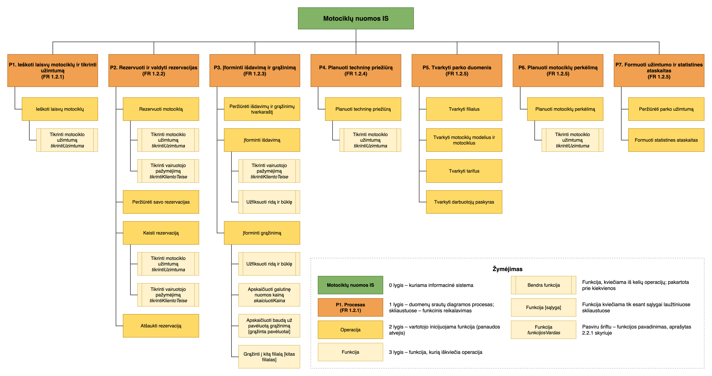

# 11. Struktūrinė schema

Medžiaga ataskaitos skyriui 2.1.1 „Sistemos struktūros modelis“.

**Būsena:** baigta 2026-11-19. Funkcijos `tikrintiUzimtuma`, `tikrintiKlientoTeise` ir `skaiciuotiKaina` išsamiai aprašytos 12 žingsnyje (`12-funkcijos.md`). Papildyta 2026-11-28: „Įforminti išdavimą“ kviečia „Tikrinti vairuotojo pažymėjimą“.

Struktūrinė schema rodo, iš kokių funkcijų sudaryta sistema ir kaip jos skaidomos į smulkesnes. Ji nubraižyta medžio pavidalu, kurio viršuje – sistema, kiekvienas lygis nuspalvintas sava spalva (žalia, oranžinė, geltona, šviesiai geltona), funkcijos pavadintos veiksmažodžio bendratimi.

Šaltinis: `artefaktai/11-strukturine-schema.drawio`, paveikslas: `artefaktai/11-strukturine-schema.png`.

*Motociklų nuomos IS funkcijų struktūrinė schema* (paveikslo numeris bus suteiktas surenkant ataskaitą)

## Schemos lygiai

| Lygis | Kas pavaizduota | Iš kur paimta |
|---|---|---|
| 0 | Motociklų nuomos IS | – |
| 1 | Procesai P1–P7, skliaustuose – funkcinis reikalavimas | Duomenų srautų diagrama (`09-dsd.md`), tie patys numeriai ir pavadinimai |
| 2 | Operacijos, kurias inicijuoja vartotojas | Panaudos atvejai, kurie nėra įtraukiami į kitus ryšiu «include» ir nepapildo kitų ryšiu «extend» (`07-panaudos-atvejai.md`) |
| 3 | Funkcijos, kurias iškviečia operacija | Panaudos atvejai, įtraukiami ryšiu «include» arba papildantys ryšiu «extend» |

Taip kiekvienas panaudos atvejis PA1–PA22 schemoje yra funkcija tuo pačiu pavadinimu, o grandinė „reikalavimas → panaudos atvejis → procesas → funkcija“ skaitoma be pavadinimų vertimo.

## Žymėjimas

- Linija jungia funkciją su ją sudarančiomis (iškviečiamomis) funkcijomis.
- **Bendra funkcija** – funkcija, kurią kviečia kelios operacijos. Ji pakartota prie kiekvienos kviečiančios operacijos ir pažymėta stačiakampiu su dvigubomis šoninėmis linijomis – taip blokinėse schemose žymimas iš anksto apibrėžtas procesas (paprogramė), aprašytas kitoje vietoje.
- **[sąlyga]** – funkcija kviečiama tik esant sąlygai laužtiniuose skliaustuose (kaip «extend» sąlygos panaudos atvejų diagramoje).
- **Pasviru šriftu** – funkcijos pavadinimas programoje; šios funkcijos išsamiai aprašytos 2.2.1 skyriuje (`12-funkcijos.md`, 12 žingsnis).
- Diagramoje yra žymėjimo legenda.

## Funkcijos

| Funkcija | Lygis | Procesas | Panaudos atvejis | Reikalavimas | Kviečia |
|---|---|---|---|---|---|
| Ieškoti laisvų motociklų | 2 | P1 | PA1 | FR 1.2.1 | Tikrinti motociklo užimtumą |
| Tikrinti motociklo užimtumą (`tikrintiUzimtuma`) | 3 | P1 | PA6 | FR 1.2.1, FR 1.2.2, FR 1.2.4, FR 1.2.5 | – |
| Rezervuoti motociklą | 2 | P2 | PA2 | FR 1.2.2 | Tikrinti motociklo užimtumą, Tikrinti vairuotojo pažymėjimą |
| Peržiūrėti savo rezervacijas | 2 | P2 | PA3 | FR 1.2.2 | – |
| Keisti rezervaciją | 2 | P2 | PA4 | FR 1.2.2 | Tikrinti motociklo užimtumą, Tikrinti vairuotojo pažymėjimą |
| Atšaukti rezervaciją | 2 | P2 | PA5 | FR 1.2.2 | – |
| Tikrinti vairuotojo pažymėjimą (`tikrintiKlientoTeise`) | 3 | P2, P3 | PA7 | FR 1.2.2, FR 1.2.3 | – |
| Peržiūrėti išdavimų ir grąžinimų tvarkaraštį | 2 | P3 | PA8 | FR 1.2.3 | – |
| Įforminti išdavimą | 2 | P3 | PA9 | FR 1.2.3 | Tikrinti vairuotojo pažymėjimą, Užfiksuoti ridą ir būklę |
| Įforminti grąžinimą | 2 | P3 | PA10 | FR 1.2.3 | Užfiksuoti ridą ir būklę, Apskaičiuoti galutinę nuomos kainą, Apskaičiuoti baudą už pavėluotą grąžinimą [grąžinta pavėluotai], Grąžinti į kitą filialą [kitas filialas] |
| Užfiksuoti ridą ir būklę | 3 | P3 | PA12 | FR 1.2.3 | – |
| Apskaičiuoti galutinę nuomos kainą (`skaiciuotiKaina`) | 3 | P3 | PA13 | FR 1.2.3 | – |
| Apskaičiuoti baudą už pavėluotą grąžinimą | 3 | P3 | PA14 | FR 1.2.3 | – |
| Grąžinti į kitą filialą | 3 | P3 | PA15 | FR 1.2.3 | – |
| Planuoti techninę priežiūrą | 2 | P4 | PA11 | FR 1.2.4 | Tikrinti motociklo užimtumą |
| Tvarkyti filialus | 2 | P5 | PA16 | FR 1.2.5 | – |
| Tvarkyti motociklų modelius ir motociklus | 2 | P5 | PA17 | FR 1.2.5 | – |
| Tvarkyti tarifus | 2 | P5 | PA18 | FR 1.2.5 | – |
| Tvarkyti darbuotojų paskyras | 2 | P5 | PA19 | FR 1.2.5 | – |
| Planuoti motociklų perkėlimą | 2 | P6 | PA22 | FR 1.2.5 | Tikrinti motociklo užimtumą |
| Peržiūrėti parko užimtumą | 2 | P7 | PA20 | FR 1.2.5 | – |
| Formuoti statistines ataskaitas | 2 | P7 | PA21 | FR 1.2.5 | – |

Lentelėje kiekviena funkcija nurodyta vieną kartą; „Tikrinti motociklo užimtumą“ priskirta P1, nes duomenų srautų diagramoje užimtumą tikrina tik P1, o P2, P4 ir P6 kreipiasi į jį.

## Modelio sprendimai

- **Šakos – pagal duomenų srautų diagramos procesus P1–P7**, o ne pagal funkcinius reikalavimus FR 1.2.1–FR 1.2.5. Reikalavimą FR 1.2.5 įgyvendina trys skirtingi procesai (P5, P6, P7), o P1 tikrina užimtumą keliems reikalavimams, todėl šakos pagal reikalavimus nesutaptų su duomenų srautų diagrama. Reikalavimo numeris vis tiek nurodytas kiekviename procese.
- **2 ir 3 lygiai sudaryti pagal panaudos atvejų ryšius.** Operacija (2 lygis) – panaudos atvejis, kurį tiesiogiai inicijuoja aktorius; jos iškviečiamos funkcijos (3 lygis) – panaudos atvejai, kuriuos ji įtraukia («include») arba kurie ją papildo («extend»). Funkcijų pavadinimai sutampa su panaudos atvejų pavadinimais.
- **Bendros funkcijos pakartotos.** „Tikrinti motociklo užimtumą“ kviečia penkios operacijos (kaip PA6 «include» – PA1, PA2, PA4, PA11, PA22), „Tikrinti vairuotojo pažymėjimą“ – trys (PA2, PA4, PA9), „Užfiksuoti ridą ir būklę“ – dvi (PA9, PA10). Jei funkcija būtų nubraižyta tik vieną kartą, schemoje nesimatytų, kad, pavyzdžiui, rezervacija tikrina užimtumą. Kad būtų aišku, jog tai ta pati funkcija, visi jos pasikartojimai pažymėti dvigubomis šoninėmis linijomis.
- **Funkcijų pavadinimai programoje** (`tikrintiUzimtuma`, `tikrintiKlientoTeise`, `skaiciuotiKaina`) nurodyti tų funkcijų, kurios išsamiai aprašomos 2.2.1 skyriuje (12 žingsnis), kad 2.1.1 ir 2.2.1 skyrius būtų galima susieti. `skaiciuotiKaina` apskaičiuoja galutinę kainą kartu su bauda, todėl pavadinimas parašytas prie „Apskaičiuoti galutinę nuomos kainą“, o baudos apskaičiavimas, kaip PA14, lieka atskira sąlygine funkcija.
- **Taisyklės be panaudos atvejo atskiromis funkcijomis nevaizduojamos.** Tarifų galiojimo nepersidengimas ir naudoto tarifo nekeičiamumas, bent vienas motociklas perkėlime, paskyros vaidmens atitiktis savininkui, išdavimas tik grąžinus ankstesnę nuomą ir nurašyto motociklo būsimi laikotarpiai (`10-lenteles.md`, „Taisyklės, kurias tikrina sistemos funkcijos“) – tai operacijų „Tvarkyti tarifus“, „Planuoti motociklų perkėlimą“, „Tvarkyti darbuotojų paskyras“, „Įforminti išdavimą“ ir „Tvarkyti motociklų modelius ir motociklus“ vidiniai patikrinimai. Atskiros funkcijos jiems būtų funkcijos be panaudos atvejo.
- **Neplanuota techninė priežiūra** atskira funkcija nevaizduojama, kaip ir panaudos atvejų bei duomenų srautų diagramose: darbuotojas naudoja „Keisti rezervaciją“ arba „Atšaukti rezervaciją“, tada „Planuoti techninę priežiūrą“ (FR 1.2.4). Taip pat ir **pavėluotas grąžinimas**: kito kliento rezervacija keičiama arba atšaukiama tomis pačiomis operacijomis (`12-funkcijos.md`).
- **Prisijungimas ir registracija** nevaizduojami (laikomi bazine funkcija), **perspektyviniai reikalavimai PR 1.6.1–PR 1.6.4** neįtraukti.
- **Išdėstymas.** Procesai išdėstyti septyniais vienodo pločio stulpeliais, sistema – virš jų centre. 2 ir 3 lygio funkcijos po procesu surašytos vertikaliai su įtrauka, kaip darbų išskaidymo schemoje: išdėsčius 16 operacijų horizontaliai, schema būtų per plati ataskaitos puslapiui.

## Aprėpties patikrinimas

- Kiekvienas funkcinis reikalavimas FR 1.2.1–FR 1.2.5 turi bent vieną šaką (procesą), o kiekvienas duomenų srautų diagramos procesas P1–P7 – vieną šaką.
- Kiekvienas panaudos atvejis PA1–PA22 schemoje yra lygiai viena funkcija tuo pačiu pavadinimu (22 funkcijos: 16 operacijų ir 6 iškviečiamos funkcijos); kiekvienas «include» ir «extend» ryšys panaudos atvejų diagramoje atitinka iškvietimą schemoje.
- Visos trys 2.2.1 skyriuje išsamiai aprašytos funkcijos (`tikrintiUzimtuma`, `tikrintiKlientoTeise`, `skaiciuotiKaina`, `12-funkcijos.md`) yra schemoje. Užraktus ir transakciją valdo 2 lygio operacijos, o 3 lygio funkcijos tik tikrina ar skaičiuoja.
