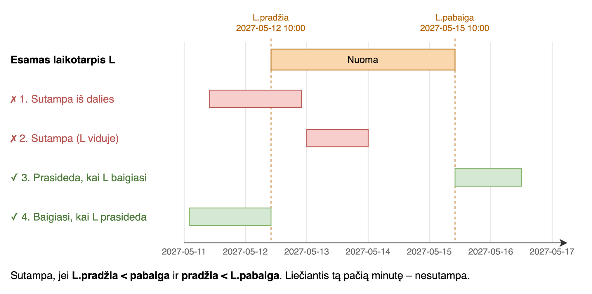
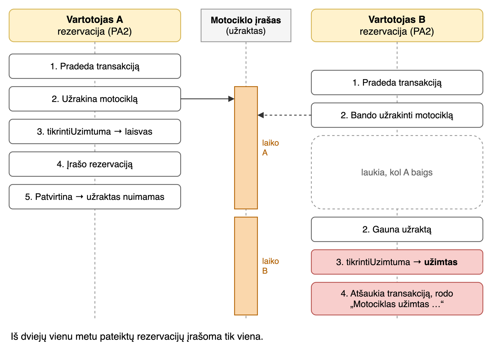
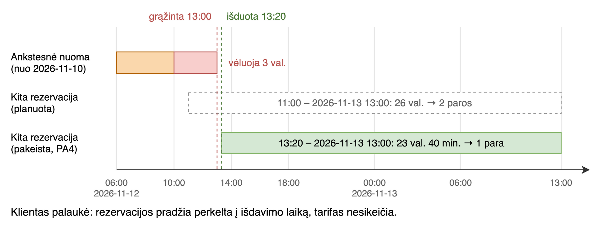

# 12. Funkcijų aprašymas

Medžiaga ataskaitos skyriui 2.2.1 „Sistemos struktūros aprašymas“.

**Būsena:** baigta 2026-11-19.

Šablonas prašo išsamiai aprašyti 2–3 sistemos funkcijas. Aprašomos trys funkcijos, kurios tikrina ir skaičiuoja tai, ko duomenų bazės apribojimais išreikšti negalima (`10-lenteles.md`, „Taisyklės, kurias tikrina sistemos funkcijos“):

| Funkcija programoje | Pavadinimas (panaudos atvejis) | Procesas | Struktūrinės schemos lygis | Reikalavimai |
|---|---|---|---|---|
| `tikrintiUzimtuma` | Tikrinti motociklo užimtumą (PA6) | P1 | 3, kviečia PA1, PA2, PA4, PA11, PA22 | FR 1.2.1, FR 1.2.2, FR 1.2.4, FR 1.2.5, NFR 1.3.2.4, NFR 1.3.3.3 |
| `tikrintiKlientoTeise` | Tikrinti vairuotojo pažymėjimą (PA7) | P2 | 3, kviečia PA2, PA4 | FR 1.2.2, NFR 1.3.2.4 |
| `skaiciuotiKaina` | „Apskaičiuoti galutinę nuomos kainą“ (PA13) ir „Apskaičiuoti baudą už pavėluotą grąžinimą“ (PA14) | P3 | 3, kviečia PA10 | FR 1.2.3 |

Funkcijų pavadinimai programoje tokie pat kaip struktūrinėje schemoje (`11-strukturine-schema.md`), todėl 2.1.1 ir 2.2.1 skyrius galima susieti. Kintamųjų tipai – tie patys SQL standarto tipai kaip duomenų bazės lentelėse (`10-lenteles.md`). Abi tikrinimo funkcijos grąžina ne tik atsakymą, bet ir atsisakymo priežastį, kurią sistema parodo vartotojui (NFR 1.3.2.4). Algoritmai aprašyti sunumeruotais žingsniais (šablonas leidžia laisvą formą).

## Bendros sąvokos

**Motociklo užimtumo laikotarpis** – laikas, kai motociklo negalima išnuomoti kitam klientui:

- **Nuoma** prasideda planuojama pradžia, net jei klientas motociklą pasiima anksčiau: kaina ir grąžinimo laikas nuo to nesikeičia. Rezervuota nuoma baigiasi planuojama pabaiga. Grąžinta nuoma baigiasi grąžinimo laiku – ir grąžinus anksčiau, ir pavėlavus. Vykstanti nuoma baigiasi vėlesniu iš dviejų laikų: planuojamos pabaigos ir dabartinio laiko. Taip vėluojanti nuoma lieka užimtumo laikotarpiu tol, kol motociklas negrąžintas. Nuoma prasideda išdavimo filiale ir baigiasi grąžinimo filiale. Atšaukta nuoma laiko neužima.
- **Techninė priežiūra** trunka nuo „Pradžia“ iki „Pabaiga“. Ji vyksta ten, kur motociklas yra, ir jo vietos nekeičia.
- **Perkėlimas** trunka nuo „Pradžia“ iki „Pabaiga“, prasideda filiale „iš“ ir baigiasi filiale „į“.

Laikotarpiai sutampa, jei vienas prasideda anksčiau, nei baigiasi kitas, ir atvirkščiai. Kai vienas baigiasi tą pačią minutę, kai prasideda kitas, jie nesutampa (paveikslas `12-sutapimas.png`). Motociklo buvimo vietos taisyklė aprašyta `08-loginis-er.md`.

Šaltinis: `artefaktai/12-sutapimas.drawio`, paveikslas: `artefaktai/12-sutapimas.png`.

**Dabartinis laikas** – sistemos laikrodžio reikšmė. Funkcijos jo negauna kaip įėjimo.

## 1. tikrintiUzimtuma – Tikrinti motociklo užimtumą

**Paskirtis.** Patikrina, ar motociklas norimu laikotarpiu užimtas: ar laikotarpis sutampa su kitu to motociklo užimtumo laikotarpiu ir ar pažeidžiama motociklo buvimo vietos taisyklė. Funkcija duomenų nekeičia. Ją kviečia:

- paieška (PA1): kiekvienam motociklui, o išdavimo ir grąžinimo filialas – paieškoje pasirinktas filialas; rezultatuose rodomi tik neužimti motociklai (FR 1.2.1);
- rezervacijos sukūrimas ir keitimas (PA2, PA4);
- techninės priežiūros planavimas (PA11);
- perkėlimo planavimas (PA22): kiekvienam perkeliamam motociklui atskirai.

**Įėjimai.**

| Kintamasis | Tipas | Reikšmė |
|---|---|---|
| motociklasId | INTEGER | Tikrinamas motociklas |
| pradzia | TIMESTAMP | Naujo laikotarpio pradžia |
| pabaiga | TIMESTAMP | Naujo laikotarpio pabaiga |
| pradziosFilialasId | INTEGER, gali būti tuščias | Nuomos išdavimo filialas arba perkėlimo filialas „iš“; techninei priežiūrai tuščias |
| pabaigosFilialasId | INTEGER, gali būti tuščias | Nuomos grąžinimo filialas arba perkėlimo filialas „į“; techninei priežiūrai tuščias |
| keiciamaNuomaId | INTEGER, gali būti tuščias | Keičiama rezervacija (PA4); jos senasis laikotarpis netikrinamas |

**Algoritmas.**

1. Nuskaityti motociklą. Jei jis nebenaudojamas, grąžinti (true, „Motociklas nebenaudojamas“).
2. Surinkti dar nesibaigusius motociklo užimtumo laikotarpius:
   - rezervuotas ir vykstančias nuomas, išskyrus `keiciamaNuomaId`;
   - techninę priežiūrą ir perkėlimus, kurių pabaiga vėlesnė už dabartinį laiką.

   Pasibaigusių laikotarpių nereikia: grąžinant ir baigiantis perkėlimui sistema įrašo naują motociklo filialą, todėl jų rezultatas jau yra motociklo duomenyse.
3. Jei kuris nors laikotarpis L sutampa su naujuoju (L.pradžia < pabaiga ir pradzia < L.pabaiga), grąžinti (true, „Motociklas užimtas {L.pradžia} – {L.pabaiga} ({nuoma / techninė priežiūra / perkėlimas})“).
4. Jei `pradziosFilialasId` tuščias (techninė priežiūra), grąžinti (false, –): priežiūra motociklo vietos nekeičia.
5. Rasti ankstesnį laikotarpį – paskutinę 2 žingsnio nuomą ar perkėlimą, kurio pabaiga ≤ pradzia. Motociklo filialas laikotarpio pradžioje yra ankstesnio laikotarpio pabaigos filialas, o jei tokio laikotarpio nėra – dabartinis motociklo filialas.
6. Jei šis filialas ≠ `pradziosFilialasId`, grąžinti (true, „Laikotarpio pradžioje motociklas bus filiale {filialas}“).
7. Rasti kitą laikotarpį – pirmą 2 žingsnio nuomą ar perkėlimą, kurio pradžia ≥ pabaiga. Jei toks yra ir jo pradžios filialas ≠ `pabaigosFilialasId`, grąžinti (true, „Motociklą reikia grąžinti į filialą {filialas}, nes {data} ten prasideda kita jo nuoma“; jei kitas laikotarpis – perkėlimas, pabaiga „… kitas jo perkėlimas“).
8. Grąžinti (false, –).

**Išėjimas.** `uzimtas` BOOLEAN – true, jei laikotarpio įrašyti negalima; `priezastis` VARCHAR(255) – kodėl motociklas užimtas (tuščia, kai jis laisvas).

**Pavyzdžiai** (bandomieji duomenys). Motociklas CB500 Hornet yra Vilniuje ir rezervuotas 2027-05-12 10:00 – 2027-05-15 10:00 su grąžinimu į Klaipėdą (paveikslai `12-sutapimas.png` ir `08-buvimo-vietos-taisykle.png`):

- nuoma 2027-05-13 – 2027-05-14 → „Motociklas užimtas 2027-05-12 10:00 – 2027-05-15 10:00 (nuoma)“;
- nuoma 2027-05-20 – 2027-05-22 Vilniuje → „Laikotarpio pradžioje motociklas bus filiale Klaipėda“;
- nuoma 2027-05-05 – 2027-05-08 su grąžinimu į Kauną → „Motociklą reikia grąžinti į filialą Vilnius, nes 2027-05-12 10:00 ten prasideda kita jo nuoma“; su grąžinimu į Vilnių – motociklas laisvas.

### Naudojimas įrašant laikotarpį (NFR 1.3.3.3)

Funkcija tik tikrina ir užraktų nevaldo, todėl pati negali užtikrinti, kad tarp patikrinimo ir įrašymo kitas vartotojas neužims to paties motociklo. Tai užtikrina ją kviečianti operacija – rezervacijos sukūrimas ar keitimas (PA2, PA4), techninės priežiūros planavimas (PA11), perkėlimo planavimas (PA22). Viską ji atlieka vienoje transakcijoje:

1. pradeda transakciją;
2. užrakina motociklo įrašą (perkėlime – visų perkeliamų motociklų įrašus didėjančia ID tvarka, kad dvi operacijos neužblokuotų viena kitos), o rezervuodama – ir taikomo tarifo įrašą bendru užraktu;
3. iškviečia `tikrintiUzimtuma` (rezervuodama – ir `tikrintiKlientoTeise`);
4. jei motociklas užimtas, atšaukia transakciją ir parodo priežastį (NFR 1.3.2.4), kitaip įrašo laikotarpį;
5. patvirtina transakciją – tik tada užraktai nuimami.

Antroji operacija su tuo pačiu motociklu laukia 2 žingsnyje. Gavusi užraktą, ji tikrina jau matydama pirmosios įrašytą rezervaciją ir gauna „Motociklas užimtas“. Taip iš dviejų vienu metu pateiktų rezervacijų įrašoma tik viena, o antrajam vartotojui pranešama, kad motociklas užimtas (NFR 1.3.3.3, paveikslas `12-lygiagreti-rezervacija.png`). Užraktas laikomas tik vienos transakcijos metu, todėl atsako laikui (NFR 1.3.3.1) įtakos neturi. Paieška (PA1) motociklų neužrakina: jos rezultatas gali pasenti, bet galutinai užimtumas patikrinamas rezervuojant.

Šaltinis: `artefaktai/12-lygiagreti-rezervacija.drawio`, paveikslas: `artefaktai/12-lygiagreti-rezervacija.png`.

Užraktas nėra duomenų srautas, todėl duomenų srautų diagramoje (`09-dsd.md`) nevaizduojamas: ten P2, P4 ir P6 siunčia P1 motociklą ir laikotarpį, gauna atsakymą ir patys įrašo duomenis į saugyklą.

### Pavėluotas grąžinimas

Funkcija neleidžia suplanuoti laikotarpio, kuris sutampa su jau suplanuotu, bet vėlavimo iš anksto žinoti negalima: klientas gali negrąžinti motociklo laiku, kai po jo motociklas jau rezervuotas. Todėl:

1. išduoti motociklą (PA9) galima tik tada, kai jis yra išdavimo filiale ir neturi vykstančios nuomos, techninės priežiūros ar perkėlimo, t. y. ankstesnė nuoma jau užbaigta (motociklas grąžintas);
2. filialo tvarkaraštyje (PA8) vėluojanti nuoma pažymima, o šalia parodomas kitas to motociklo laikotarpis;
3. darbuotojas susisiekia su kitu klientu, kaip ir neplanuotos techninės priežiūros atveju (FR 1.2.4), ir perkelia rezervaciją į kitą laisvą motociklą (PA4) arba ją atšaukia (PA5). Jei klientas sutinka palaukti, motociklą grąžinus darbuotojas pakeičia rezervacijos pradžią į išdavimo laiką (PA4), todėl kaina skaičiuojama už trumpesnį laikotarpį; tarifas nesikeičia. Ar laukusiam klientui taikoma kompensacija, sprendžia įmonės verslo taisyklės – pirmoje versijoje nuolaidų nėra (perspektyvinis reikalavimas PR 1.6.4);
4. pavėlavęs klientas moka baudą pagal baudų pakopas (`skaiciuotiKaina`).

Jei po vėluojančios nuomos suplanuota techninė priežiūra ar perkėlimas, juos perplanuoja darbuotojas arba administratorius.

Pavyzdys (bandomieji duomenys, G 310 R Vilniuje): nuoma 2026-11-10 10:00 – 2026-11-12 10:00 grąžinta 13:00, t. y. 3 val. pavėluotai. Kito kliento rezervacija buvo suplanuota nuo 11:00 iki 2026-11-13 13:00 (26 val., 2 paros). Klientas palaukė, todėl jo rezervacijos pradžia pakeista į išdavimo laiką 13:20 (23 val. 40 min., 1 para; paveikslas `12-pavelavimas.png`).

Šaltinis: `artefaktai/12-pavelavimas.drawio`, paveikslas: `artefaktai/12-pavelavimas.png`.

## 2. tikrintiKlientoTeise – Tikrinti vairuotojo pažymėjimą

**Paskirtis.** Patikrina, ar klientas turi motociklo modeliui reikiamą vairuotojo pažymėjimo kategoriją, galiojančią visą nuomos laikotarpį (FR 1.2.2). Kviečiama rezervuojant ir keičiant rezervaciją (PA2, PA4) toje pačioje transakcijoje kaip `tikrintiUzimtuma`.

**Įėjimai.**

| Kintamasis | Tipas | Reikšmė |
|---|---|---|
| klientasId | INTEGER | Klientas, kuriam rezervuojama |
| motociklasId | INTEGER | Rezervuojamas motociklas |
| pabaiga | TIMESTAMP | Planuojama nuomos pabaiga |

**Algoritmas.**

1. Reikiama kategorija – motociklo modelio „Kategorijos kodas“.
2. Rasti kliento kategoriją su šiuo kodu. Jei jos nėra, grąžinti (false, „Vairuotojo pažymėjime nėra {kodas} kategorijos“).
3. Jei kategorijos „Galioja iki“ data ankstesnė už nuomos pabaigos datą, grąžinti (false, „{kodas} kategorija galioja iki {data}, o nuoma baigiasi {data}“). Kategorija, kuri baigia galioti nuomos pabaigos dieną, dar tinka.
4. Grąžinti (true, –).

**Išėjimas.** `turiTeise` BOOLEAN – true, jei klientas turi teisę vairuoti motociklą visą nuomos laikotarpį; `priezastis` VARCHAR(255) – kodėl neturi (tuščia, kai turi).

Nuomos pradžios funkcijai nereikia: kategorija neturi pradžios datos, todėl jei ji galioja nuomos pabaigoje, galioja ir pradžioje. Tikrinamas tik tikslus kategorijos kodas: kuri kategorija apima kurią, sistema nesaugo, o registruojant pažymėjimą pažymimos visos kategorijos, kurias jis suteikia (pvz., turint A – ir A1, A2; `08-loginis-er.md`).

**Pavyzdžiai.** Klientas, kurio A kategorija galioja iki 2027-05-10, gali išsinuomoti F 900 R 2027-04-14 – 2027-04-18, bet ne iki 2027-05-12 („A kategorija galioja iki 2027-05-10, o nuoma baigiasi 2027-05-12“). Klientui, turinčiam tik A1, Panigale V2 neleidžiama („Vairuotojo pažymėjime nėra A kategorijos“).

## 3. skaiciuotiKaina – Apskaičiuoti galutinę nuomos kainą

**Paskirtis.** Grąžinant apskaičiuoja galutinę nuomos kainą ir baudą už pavėluotą grąžinimą pagal nuomai priskirtą tarifą ir jo baudų pakopas (FR 1.2.3). Tai tas pats tarifas, kurį klientas matė rezervacijos patvirtinime (FR 1.2.2). Funkciją kviečia grąžinimo įforminimas (PA10). Galutinę kainą ir baudą ši operacija įrašo į Grąžinimą, kur jos saugomos kaip užfiksuotas atsiskaitymo rezultatas (`10-lenteles.md`, „Normalizacija“).

**Įėjimai.**

| Kintamasis | Tipas | Reikšmė |
|---|---|---|
| nuomaId | INTEGER | Grąžinama nuoma |
| grazinimoLaikas | TIMESTAMP | Faktinis grąžinimo laikas |

**Algoritmas.**

1. Nuskaityti nuomos planuojamą pradžią ir pabaigą bei nuomos tarifo paros kainą.
2. paros = ⌈(planuojama pabaiga − planuojama pradžia) / 24 val.⌉ – parų skaičius, suapvalintas į viršų. Pabaiga visada vėlesnė už pradžią (CHECK apribojimas lentelėje Nuoma), todėl paros ≥ 1. Jei taip nėra, funkcija grąžina klaidą ir kainos neskaičiuoja.
3. nuomosKaina = paros × paros kaina.
4. velavimas = (grazinimoLaikas − planuojama pabaiga) valandomis.
5. Jei velavimas ≤ 0, bauda = 0: grąžinus anksčiau kaina nemažinama. Kitaip (PA14) imama tarifo baudos pakopa su didžiausia „Vėlavimas nuo (val.)“ reikšme, neviršijančia vėlavimo; bauda = jos suma. Jei tokios pakopos nėra (vėluojama mažiau nei pirmoji pakopa arba tarifas pakopų neturi), bauda = 0.
6. galutineKaina = nuomosKaina + bauda.

**Išėjimas.** `galutineKaina` DECIMAL(10,2) – visa suma eurais su bauda; `bauda` DECIMAL(10,2) – bauda už pavėluotą grąžinimą eurais.

Užstatas į galutinę kainą neįeina: jis sumokamas ir grąžinamas filiale atskirai. Bauda nesumuojama: vėluojant 30 val. taikoma tik pakopa „nuo 24 val.“. Paskutinė pakopa viršutinės ribos neturi, todėl įmonė ją nustato pakankamai didelę, o klientas visą baudų lentelę mato rezervacijos patvirtinime (FR 1.2.2). Kai rezervacijos laikotarpis pakeičiamas (PA4), funkcija skaičiuoja pagal naują laikotarpį.

**Pavyzdys.** NC750X, 2 paros po 84 €, baudų pakopos „nuo 0 val. – 10 €“, „nuo 2 val. – 30 €“, „nuo 24 val. – 84 €“:

- grąžinta laiku arba anksčiau → 168 €;
- 10 min. vėliau → 178 € (bauda 10 €);
- 3 val. 33 min. vėliau → 198 € (bauda 30 €).

## Kitos taisyklės, kurias tikrina operacijos

Šios taisyklės nėra atskiros funkcijos (`11-strukturine-schema.md`): jas tikrina pačios operacijos tuo pačiu principu – pirma užrakina įrašą, nuo kurio priklauso patikrinimas, tada tikrina, tada rašo.

- **Tarifo keitimas (PA18).** Tarifas, pagal kurį jau yra rezervacijų, nekeičiamas. Rezervuojant tarifo įrašas užrakinamas bendru užraktu: kelios rezervacijos viena kitai netrukdo, o tarifo keitimas laukia, kol jos baigsis, ir tik gavęs užraktą tikrina, ar yra rezervacijų.
- **Motociklo nurašymas (PA17).** Nebenaudojamas motociklas neturi būsimų užimtumo laikotarpių. Nurašymas užrakina motociklo įrašą ir tik tada patikrina, ar būsimų laikotarpių nėra; `tikrintiUzimtuma` 1 žingsnis tą patį užtikrina iš rezervacijos pusės.
- **Išdavimas (PA9).** Motociklas yra išdavimo filiale, o pagal ankstesnę nuomą jis jau grąžintas (žr. „Pavėluotas grąžinimas“).
- **Ridos fiksavimas (PA12).** Grąžinant rida ne mažesnė nei išduodant.

## Savikontrolė (ataskaitoje nepateikiama)

Funkcijos įgyvendintos PL/pgSQL kalba faile `darbas/funkcijos.sql` ir išbandytos su bandomąja duomenų baze:

- `darbas/funkciju_testai.sql` – 24 atvejai su tikėtinu ir gautu rezultatu; visi sutampa. Tarp jų: visi 2.2.1 skyriaus pavyzdžiai, keičiama rezervacija, techninė priežiūra, sutampanti su rezervacija, ir priežiūra tarp rezervacijų, perkėlimas, nebenaudojamas motociklas, kategorijos galiojimo riba, tarifas be pakopų, tarifo pasikeitimas sezono viduryje. `skaiciuotiKaina` rezultatas sutampa su visų 582 grąžinimų įrašyta kaina ir bauda.
- `darbas/lygiagreti_rezervacija.sh` – du klientai per dvi sesijas vienu metu rezervuoja tą patį motociklą. Su užraktu antrasis gauna „Motociklas užimtas“; be užrakto (tik palyginimui) įrašomos abi rezervacijos.
- `darbas/patikra.sql` naudoja tą patį užimtumo laikotarpio apibrėžimą; pridėta patikra Nr. 15 (išduota tik grąžinus ankstesnę nuomą). Bandomuosiuose duomenyse yra aukščiau aprašytas pavėluoto grąžinimo ir laukusio kliento atvejis.
