# 13. Sistemos dizainas

Medžiaga ataskaitos skyriams 2.3.1 „Panašių sistemų apžvalga ir pasirinkti dizaino sprendimai“ ir 2.3.2 „Kuriamos sistemos dizainas“.

**Būsena:** baigta 2026-11-19. E4 ekrano panaudos atvejų sąrašas papildytas PA9 per 2 kontrolinį tašką (2026-11-20).

Maketai sukurti kaip prototipas, kurį 3 paskaita (14–15 skaidrės) siūlo naudoti vartotojo sąsajai kurti ir trūkstamiems reikalavimams rasti. Jie padaryti statiniais HTML ir CSS puslapiais su vienu bendru stiliaus failu ir užfiksuoti ekrano nuotraukomis naršyklėje 360 px (siauras ekranas) ir 1280 px (platus ekranas) pločiu. Šaltiniai ir paveikslai – `artefaktai/13-dizainas/`, eksportas – `make dizainas`.

## 2.3.1. Panašių sistemų apžvalga ir pasirinkti dizaino sprendimai

Apžvelgtos trijų Lietuvos motociklų nuomos įmonių svetainės, aprašytos 1.1.4 skyriuje (`03-analogai.md`). Ekrano nuotraukos padarytos 2026-11-18 ir 2026-11-19, 1512 px pločio naršyklės lange (`darbas/ekrano-nuotraukos/`). Ketvirtojo analogo, SaaS sistemos RentSyst, rezervavimo ir administravimo sąsajos viešai nerodomos (svetainėje – tik pristatymas ir kainos), todėl apie jos dizainą duomenų nėra.

### Bikerent (bikerent.lt)

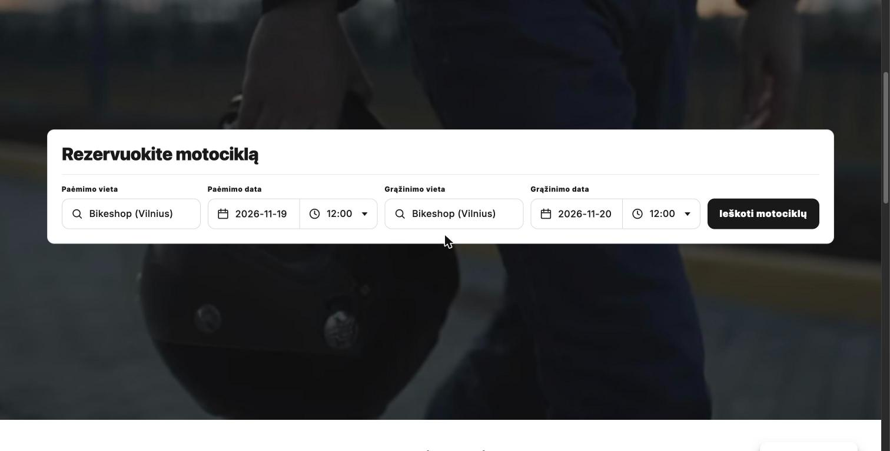

*Bikerent: paieškos forma pagrindiniame puslapyje (2026-11-18)*

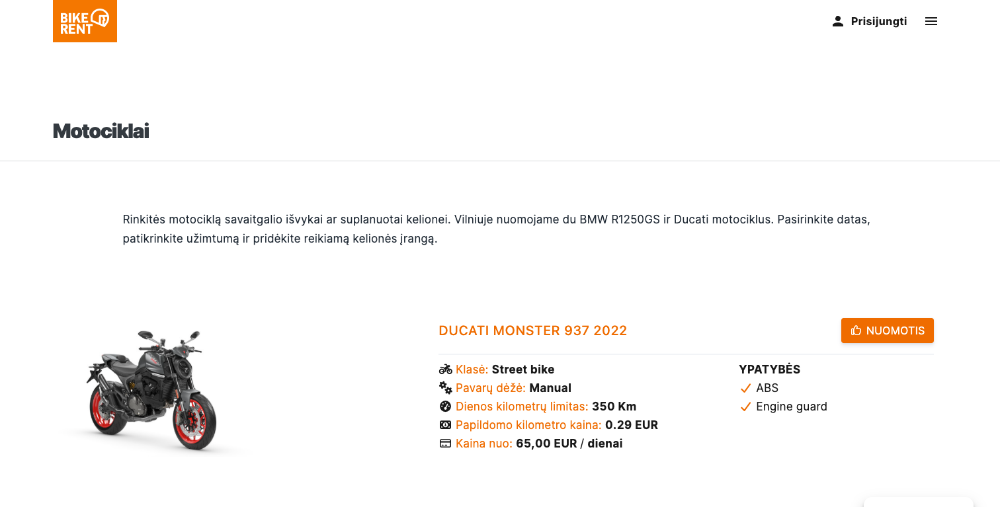

*Bikerent: motociklų sąrašas (2026-11-19)*

- **Pasiteisina.** Paieška – pirmas elementas puslapyje: vienoje eilutėje paėmimo vieta, data ir laikas, grąžinimo vieta, data ir laikas ir vienas mygtukas „Ieškoti motociklų“. Šviesus fonas, tamsus tekstas, viena akcento spalva (oranžinė).
- **Reikėtų keisti.** Sąraše kiekvienas motociklas užima visą ekrano plotį (nuotrauka kairėje, savybės dešinėje), todėl ekrane matomas tik vienas motociklas ir jų neįmanoma palyginti viename vaizde. Savybių mažai (klasė, pavarų dėžė, kilometrų limitas, kaina), nėra vairuotojo pažymėjimo kategorijos.

### KuBa Motors (kubamotors.lt)

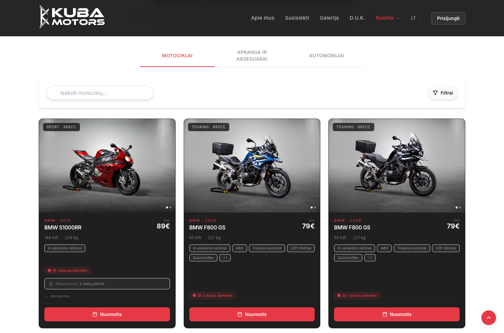

*KuBa Motors: motociklų sąrašas kortelėmis (2026-11-19)*

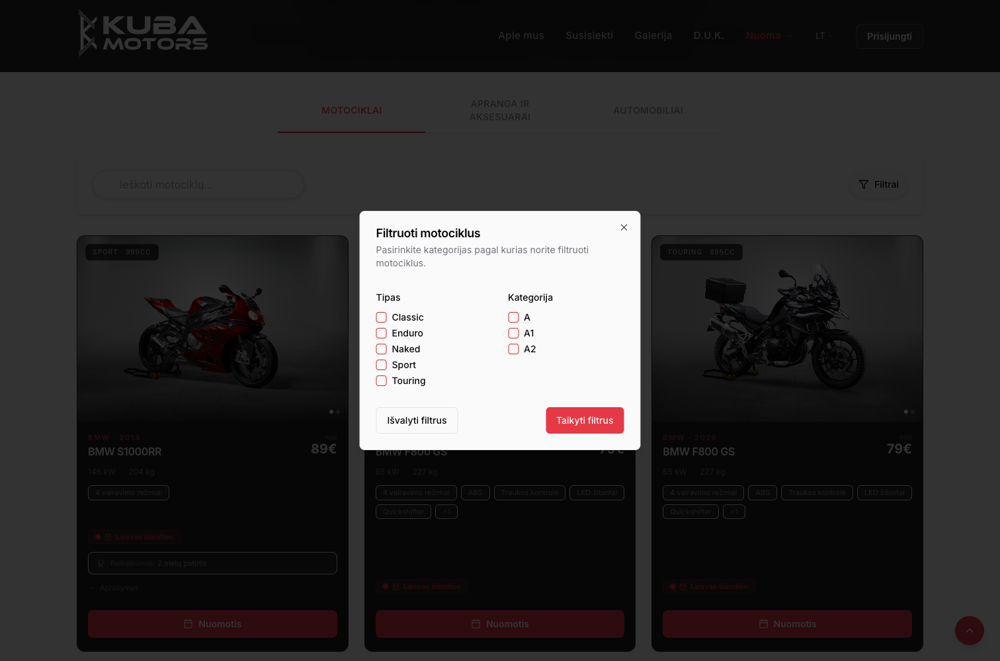

*KuBa Motors: filtrų langas (2026-11-19)*

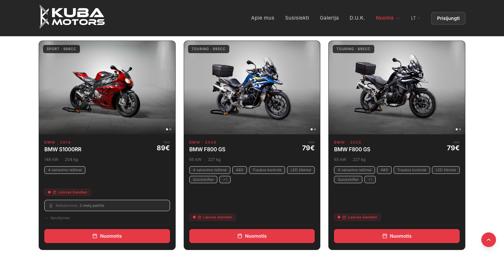

*KuBa Motors: kortelės su užimtumo žyma „Laisvas šiandien“ (2026-11-19)*

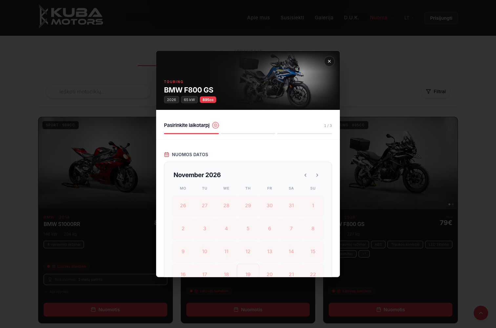

*KuBa Motors: rezervacijos langas, 1 žingsnis iš 3 (2026-11-19)*

- **Pasiteisina.** Motociklai rodomi kortelėmis po tris eilutėje: nuotrauka, tipo ir variklio tūrio žyma, gamintojas ir metai, pavadinimas, galia ir svoris, kaina. Filtras pagal vairuotojo pažymėjimo kategoriją (A, A1, A2). Rezervacijos lange rodomas žingsnių skaičius („1 / 3“) ir juosta, rodanti, kiek liko.
- **Reikėtų keisti.** Filtrai paslėpti atskirame lange, todėl nematyti, kurie taikomi. Užimtumas rodomas tik šiai dienai („Laisvas šiandien“), o ne pasirinktam laikotarpiui. Tamsiose kortelėse smulkus pilkas tekstas (galia, svoris, ypatybės) sunkiai įskaitomas. Kalendoriuje renkamos tik dienos, be laiko.

### RideRent (riderent.lt)

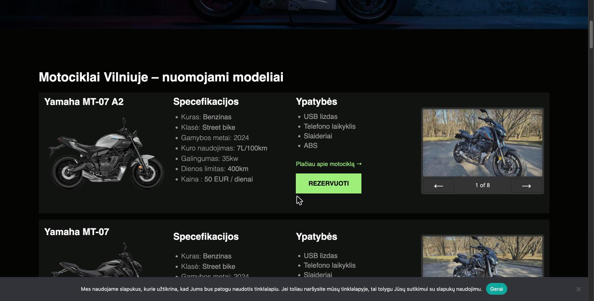

*RideRent: motociklų sąrašas (2026-11-18)*

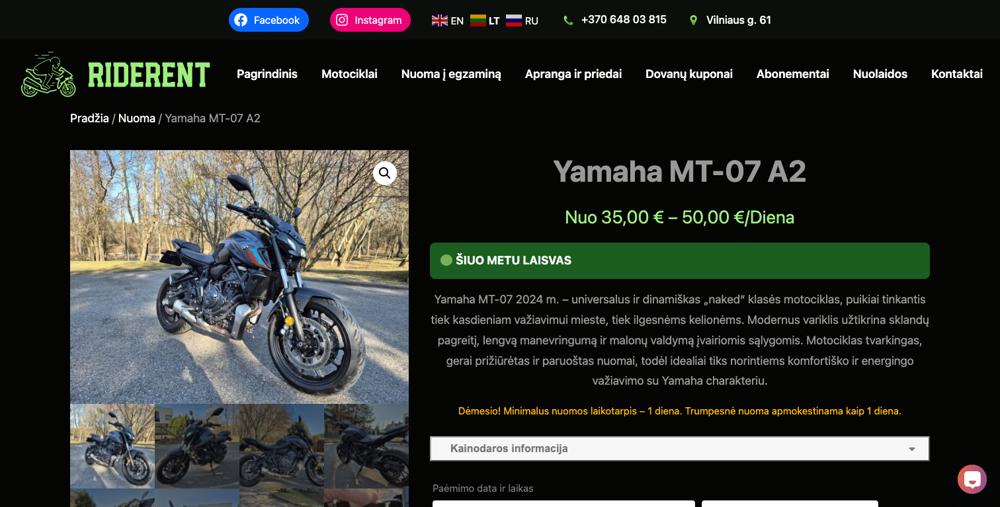

*RideRent: motociklo puslapis (2026-11-19)*

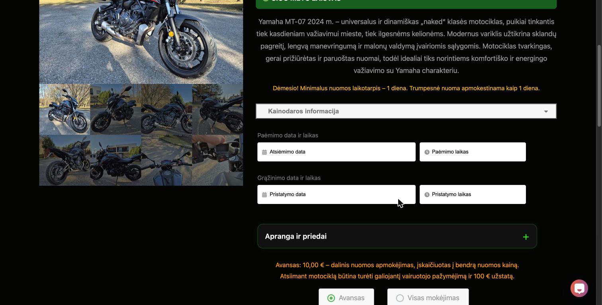

*RideRent: rezervacijos forma motociklo puslapyje (2026-11-18)*

- **Pasiteisina.** Išsamios charakteristikos; užimtumo žyma ryškiu fonu; svarbios sąlygos (minimalus nuomos laikotarpis, avansas, 100 € užstatas) parašytos prie pat formos, kitokia spalva.
- **Reikėtų keisti.** Nėra paieškos ir filtrų – visi modeliai viename ilgame puslapyje, kiekvienas per visą plotį. Kaina „Nuo 35,00 € – 50,00 €/Diena“ neaiški, kol nepasirinktos datos. Juodas fonas su pilku tekstu, slapukų juosta uždengia sąrašo apačią.

### Pasirinkti dizaino sprendimai

| Sprendimas | Iš kurios sistemos | Kaip pritaikome |
|---|---|---|
| Paieškos juosta – pirmas elementas | Bikerent | Išdavimo ir grąžinimo filialas, nuomos pradžia ir pabaiga, mygtukas „Ieškoti“ (E1) |
| Motociklų kortelės tinklelyje | KuBa Motors | Kortelė su nuotrauka, tipu, variklio tūriu, galia, kategorija ir paros kaina (1.3.1.3); 1–3 kortelės eilutėje pagal ekrano plotį |
| Filtras pagal kategoriją | KuBa Motors | Filtrai matomi šoniniame stulpelyje; papildomai – variklio tūris, galia, išvažiavimas į užsienį (1.2.1) |
| Rezervacijos žingsniai | KuBa Motors | Juosta „1. Motociklas – 2. Duomenys – 3. Patvirtinimas“ (1.3.2.3) |
| Sąlygos prie formos | RideRent | Kaina, užstatas ir baudų lentelė rodomi prieš patvirtinimą (1.2.2) |

Ko vengiame: tamsaus fono su smulkiu pilku tekstu, sąrašo „vienas motociklas per visą plotį“, filtrų atskirame lange, užimtumo „tik šiandien“ (rodome tik pasirinktam laikotarpiui laisvus motociklus) ir kainos intervalo be datų.

## 2.3.2. Kuriamos sistemos dizainas

### Dizaino principai

- **Dizaino tipas.** Prisitaikanti (angl. *responsive*) žiniatinklio sąsaja, projektuojama nuo siauro ekrano. Plokščias, minimalistinis stilius: balti blokai šviesiame fone, be šešėlių ir dekoracijų. Klientui – kortelės, darbuotojui ir administratoriui – lentelės ir laiko juosta.
- **Vienas stilius visiems puslapiams (1.3.1.2).** Spalvos, šriftai, tarpai ir mygtukai apibrėžti viename stiliaus faile (`artefaktai/13-dizainas/stilius.css`), kurį naudoja visi maketai.

### Spalvos

Šviesus fonas ir tamsus tekstas; konkurentų spalvų (oranžinės, raudonos, žalios) akcentui nenaudojame. Būsenų spalvos naudojamos tik būsenoms, ne puošybai.

| Paskirtis | Spalva |
|---|---|
| Pagrindinė: veiksmo mygtukai, nuorodos, pažymėti elementai | tamsiai žalsvai mėlyna `#0F766E` |
| Viršutinė juosta | grafitas `#1E293B` |
| Fonas / blokai | `#F8FAFC` / balta `#FFFFFF` |
| Tekstas / antrinis tekstas | `#0F172A` / `#475569` |
| Laisvas, patvirtinta | žalia `#15803D` |
| Vėluoja, įspėjimas, techninė priežiūra | gintarinė `#B45309` |
| Atsisakymas, klaida | raudona `#B91C1C` |
| Užimtumo juostose: nuoma / perkėlimas | mėlyna `#2563EB` / violetinė `#7C3AED` |

### Šriftas

Viena šriftų šeima **Inter** (Google Fonts, nemokama, palaiko lietuviškas raides). Dydžiai: 14 px – paaiškinimai, 16 px – tekstas, 20 px – bloko antraštė, 28 px – puslapio antraštė (siaurame ekrane 24 px). Skaičiai lygiapločiai, kad kainos ir datos lygiuotųsi stulpeliuose. Datos rašomos `yyyy-mm-dd`, laikas – 24 val. formatu, kainos – „100,00 €“.

### Tinklelis ir išdėstymas (1.3.1.1)

- Tarpai – 8 px žingsniu (8, 16, 24, 32 px).
- Plačiame ekrane turinys ne platesnis kaip 1200 px ir centruojamas, todėl neišsitempia; kortelių eilutėje – 3 (nuo 1200 px), 2 (nuo 768 px) arba 1.
- Siaurame ekrane (nuo 360 px) laukai išdėstomi vienas po kito, viršutinės juostos meniu paslepiamas, filtrai atidaromi mygtuku „Filtrai“. Horizontalios slinkties nėra.
- Darbuotojo ekrane šalia vienas kito – sąrašas ir pasirinkto įrašo forma, kad nereikėtų pereiti į kitą puslapį.

### Mygtukų išdėstymas

- **Pagrindinis veiksmas** – užpildytas pagrindinės spalvos mygtukas formos apačioje dešinėje. Siaurame ekrane jis per visą plotį ir pritvirtintas ekrano apačioje, kad būtų pasiekiamas neslenkant.
- **Antrinis veiksmas** („Atgal“, „Atšaukti“) – baltas mygtukas pilku kontūru kairėje nuo pagrindinio (siaurame ekrane – po juo).
- **Negrįžtamas veiksmas** („Atšaukti rezervaciją“) – baltas mygtukas raudonu kontūru, atskirai nuo kitų, su patvirtinimu.
- **Kalbos perjungiklis LT | EN** – kiekvieno puslapio viršutinėje juostoje dešinėje (1.3.2.1).

### Pranešimai ir žymos

- **Atsisakymo priežastis (1.3.2.4)** – raudonas blokas puslapio viršuje su konkrečia priežastimi iš funkcijos (`12-funkcijos.md`) ir patarimu, ką daryti; klaidingas laukas pažymimas raudonai.
- **Sėkmė** – žalias blokas; **įspėjimas** – gintarinis.
- **Būsenų žymos** – apvalūs ženkleliai: „Rezervuota“ (pilka), „Vėluoja 3 val.“ (gintarinė), „Laukia grąžinimo“ (raudona).

### Ekranai

| Nr. | Ekranas | Vartotojas | Panaudos atvejai | Reikalavimai | Plotis |
|---|---|---|---|---|---|
| E1 | Motociklų paieška | Klientas | PA1 | 1.2.1, 1.3.1.1, 1.3.1.3 | 360 ir 1280 px |
| E2 | Rezervacijos duomenys | Klientas | PA2, PA7 | 1.2.2, 1.3.2.3, 1.3.2.4 | 360 px |
| E3 | Rezervacija patvirtinta | Klientas | PA2 | 1.2.2, 1.3.2.3 | 360 px |
| E4 | Išdavimų ir grąžinimų tvarkaraštis | Filialo darbuotojas | PA8–PA10, PA12–PA14 | 1.2.3 | 1280 px |
| E5 | Parko užimtumas | Administratorius | PA20 | 1.2.5 | 1280 px |

Rezervacijos kelias: klientas pasirenka motociklą paieškos rezultatuose (E1), įveda pažymėjimo duomenis ir mato kainą (E2), gauna patvirtinimą (E3) – 3 ekranai (1.3.2.3). Visi maketuose rodomi duomenys paimti iš bandomosios duomenų bazės (`darbas/duomenys.sql`); nuotraukos vietoje rodomas schematinis motociklas.

#### E1. Motociklų paieška

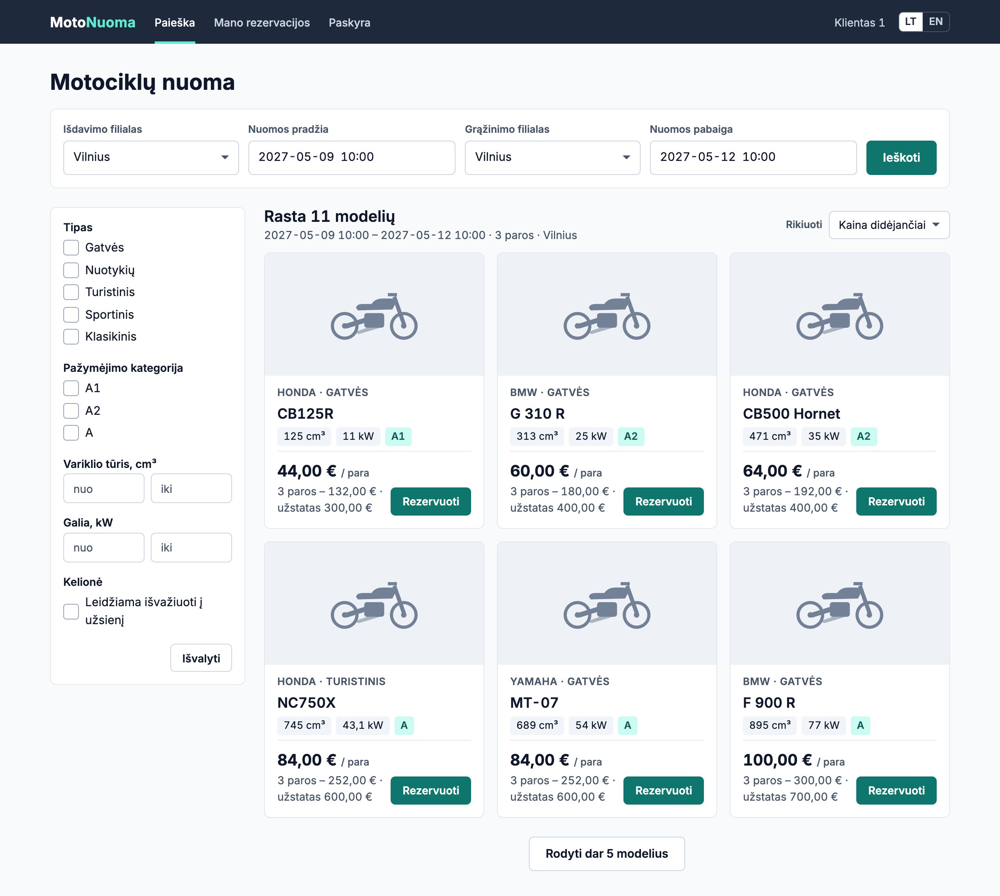

*E1 Motociklų paieška, platus ekranas (1280 px)*

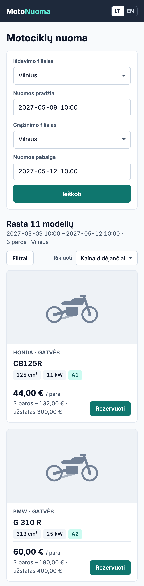

*E1 Motociklų paieška, siauras ekranas (360 px; parodyta puslapio pradžia)*

Paieška Vilniuje 2027-05-09 10:00 – 2027-05-12 10:00: laisvi 11 modelių, rodomi 6 pigiausi. Viena kortelė – vienas modelis (1.3.1.3); rezervuojant sistema parenka laisvą to modelio motociklą, atitinkantį paieškos sąlygas (pvz., leidimą išvažiuoti į užsienį). Kortelėje – paros kaina, kaina už visą laikotarpį ir užstatas, kad klientas juos matytų iš karto.

#### E2. Rezervacijos duomenys

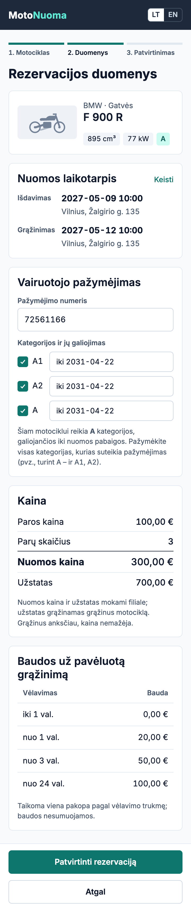

*E2 Rezervacijos duomenys (360 px)*

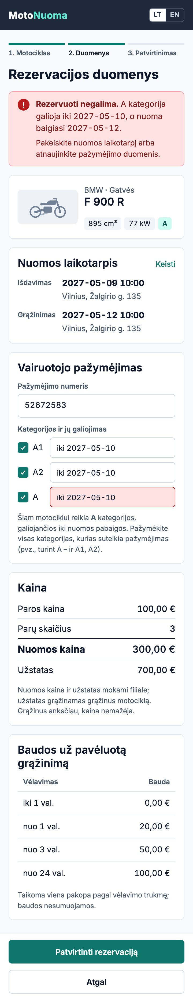

*E2 Rezervacija atmesta: pažymėjimo kategorija baigia galioti anksčiau nei nuoma (360 px)*

Klientas 1 rezervuoja BMW F 900 R: 3 paros × 100,00 € = 300,00 €, užstatas 700,00 €, baudų lentelė pagal tarifą. Antrame variante tą patį motociklą rezervuoja Klientas 26, kurio A kategorija galioja iki 2027-05-10, todėl rodoma funkcijos `tikrintiKlientoTeise` priežastis „A kategorija galioja iki 2027-05-10, o nuoma baigiasi 2027-05-12“. Užuomina prie kategorijų primena pažymėti visas pažymėjimo suteikiamas kategorijas (sprendimas dėl Kategorijos be „Lygio“, 2026-11-18).

#### E3. Rezervacija patvirtinta

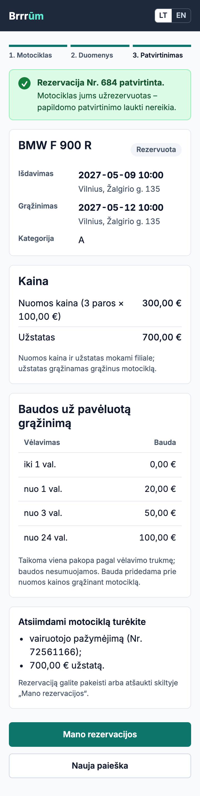

*E3 Rezervacija patvirtinta (360 px)*

Rezervacija patvirtinama iš karto (Nr. 684 – kitas laisvas numeris bandomojoje duomenų bazėje). Rodoma visa baudų lentelė, įskaitant numanomą pakopą „iki 1 val. – 0,00 €“, nes pirmoji tarifo pakopa prasideda nuo 1 val.

#### E4. Išdavimų ir grąžinimų tvarkaraštis

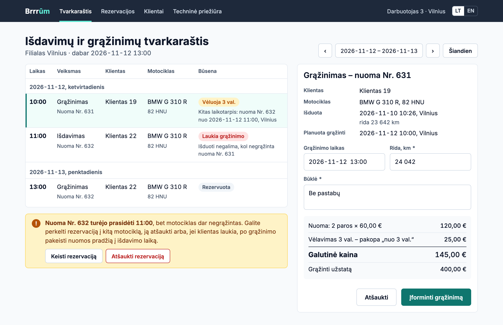

*E4 Išdavimų ir grąžinimų tvarkaraštis su grąžinimo forma (1280 px)*

Vilniaus filialas 2026-11-12 13:00 – pavėluoto grąžinimo atvejis iš bandomųjų duomenų (nuomos 631 ir 632, BMW G 310 R). Nuoma 631 turėjo būti grąžinta 10:00 – ji pažymėta „Vėluoja 3 val.“, šalia parodytas kitas motociklo laikotarpis (nuoma 632 nuo 11:00). Nuomos 632 išduoti negalima, kol 631 negrąžinta; įspėjime – trys galimi darbuotojo veiksmai (12 žingsnis, „Pavėluotas grąžinimas“). Grąžinimo formoje darbuotojas įveda ridą ir būklę, o sistema apskaičiuoja kainą: 2 paros × 60,00 € + bauda 25,00 € (pakopa „nuo 3 val.“) = 145,00 €, kaip įrašyta bandomuosiuose duomenyse.

#### E5. Parko užimtumas

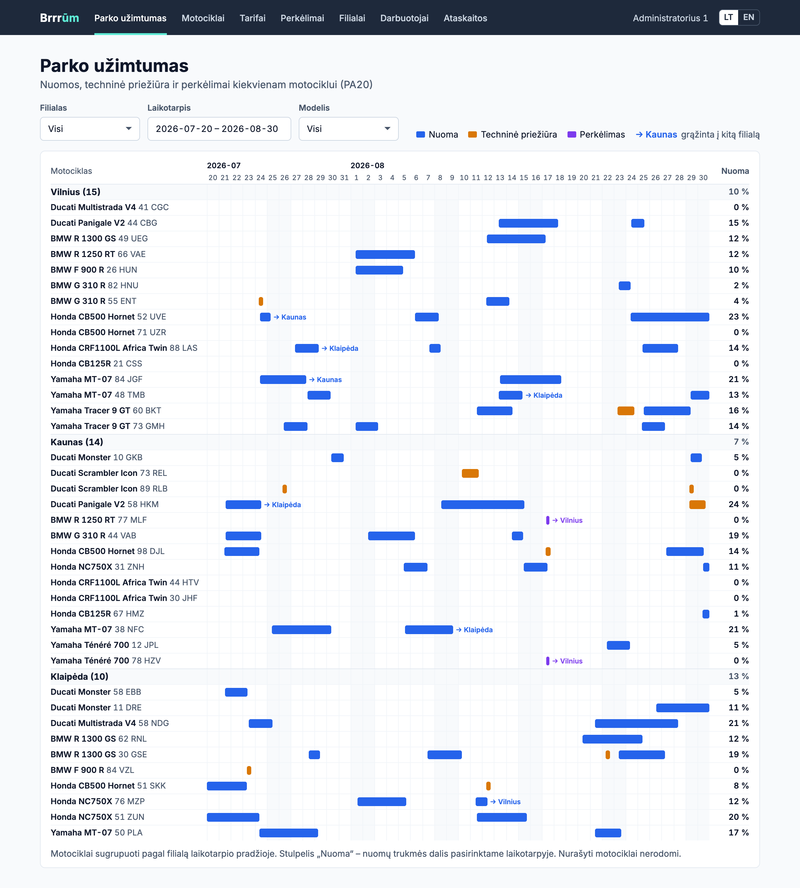

*E5 Parko užimtumas (1280 px)*

Laiko juosta 2026-07-20 – 2026-08-30 (sezono vidurys) visiems 39 naudojamiems motociklams, sugrupuotiems pagal filialą laikotarpio pradžioje. Mėlyna – nuomos, gintarinė – techninė priežiūra, violetinė – perkėlimas (2026-08-17 Kaunas → Vilnius); „→ Kaunas“ – nuoma grąžinta į kitą filialą. Dešiniajame stulpelyje – nuomų trukmės dalis laikotarpyje, grupės eilutėje – filialo vidurkis. Statistinės ataskaitos (PA21) nemaketuojamos, nes jų turinys dar nenustatytas.

### Atitiktis nefunkciniams reikalavimams

| Reikalavimas | Kaip įgyvendinta maketuose |
|---|---|
| 1.3.1.1 Prisitaikanti sąsaja | E1 parodytas 360 ir 1280 px pločio; turinys ne platesnis kaip 1200 px |
| 1.3.1.2 Vieningas stilius | Visi ekranai naudoja vieną stiliaus failą; paletė, šriftas ir mygtukai aprašyti šiame skyriuje |
| 1.3.1.3 Motociklo kortelė | E1 – po vieną kortelę kiekvienam tinkamam modeliui: nuotrauka, modelis, tipas, variklio tūris, galia, kategorija, paros kaina |
| 1.3.2.1 Kalbos | Perjungiklis LT \| EN kiekvieno ekrano viršuje dešinėje |
| 1.3.2.3 Trumpas rezervacijos kelias | E1 → E2 → E3, žingsnių juosta E2 ir E3 |
| 1.3.2.4 Aiški atsisakymo priežastis | E2 atmetimo variantas; E4 – priežastis, kodėl nuomos negalima išduoti |
