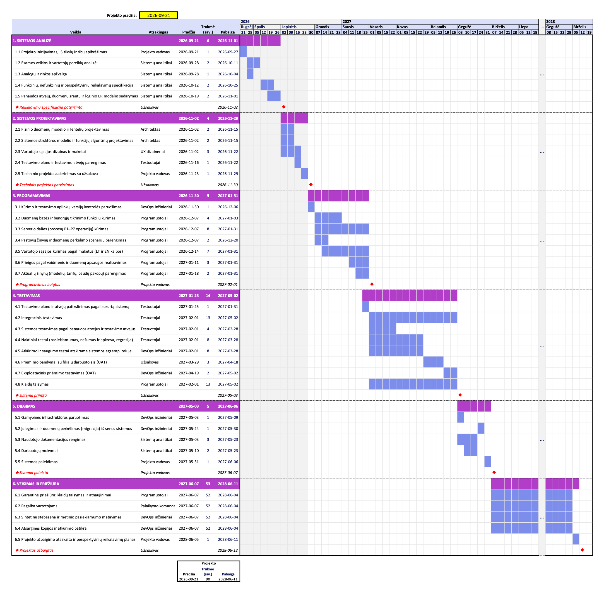

# 15. Sistemos kūrimo terminai (Ganto diagrama)

Medžiaga ataskaitos skyriui 1.1.5 „Sistemos kūrimo terminai“.

**Būsena:** baigta 2026-11-20.

Šaltinis: `artefaktai/15-ganto-diagrama.xlsx`, paveikslas: `artefaktai/15-ganto-diagrama.png`.

*Motociklų nuomos IS kūrimo kalendorinis grafikas (Ganto diagrama)* (paveikslo numeris bus suteiktas surenkant ataskaitą)

## Ataskaitos tekstas

Sistemos kūrimo grafikas apima visus šešis IS kūrimo etapus: analizę, projektavimą, programavimą, testavimą, diegimą, veikimą ir priežiūrą. Nors šiame darbe atliekami tik pirmieji du etapai, grafike parodyti ir likusių etapų terminai. Projektas pradedamas 2026-09-21 ir trunka 90 savaičių; techninis projektas suderinamas su užsakovu 2026-11-23 – 2026-11-29 savaitę.

Sistema sukuriama per 9 savaites (iki 2027-01-31). Testuojama 14 savaičių: sistemos testavimas pagal panaudos atvejus, naktiniai automatiniai testai, priėmimo bandymai su filialų darbuotojais (UAT) ir eksploatacinis priėmimo testavimas (OAT); programuotojai klaidas taiso nuo pirmos testavimo dienos iki OAT pabaigos. Žinynų ir duomenų perkėlimo scenarijai parengiami programuojant, todėl diegiant sistema įdiegiama ir duomenys iš senos sistemos (bendros filialų „Excel“ lentelės) perkeliami per vieną savaitę. Po to darbuotojai mokomi, o naudotojo dokumentacija rengiama nuo savaitės prieš mokymus iki jų pabaigos. Sistema paleidžiama 2027-05-31 – 2027-06-06, iš karto po mokymų. Po paleidimo 52 savaites vyksta garantinė priežiūra; ji apima visus metus, taigi ir visus nuomos sezono mėnesius (2027 m. birželį–spalį ir 2028 m. balandį–gegužę), todėl per ją patikrinamas metinis pasiekiamumas (1.3.3.2) ir klaidų taisymo bei atnaujinimų terminai (1.3.4.3).

Kiekvienas etapas baigiamas kontroliniu tašku (◆), kuris pažymėtas pirmojoje savaitėje po etapo pabaigos: užsakovas patvirtina reikalavimų specifikaciją, techninį projektą, priimtą sistemą ir projekto užbaigimą, o projekto vadovas – programavimo pabaigą ir sistemos paleidimą.

## Kaip sudaryta

- **Pagrindas** – dėstytojo patvirtintas pavyzdys `saltiniai/lab-GANTT-diagrama.xlsx`: tos pačios skiltys (Veikla, Atsakingas, Pradžia, Trukmė (sav.), Pabaiga), savaitiniai stulpeliai, spalvos, kontroliniai taškai ◆ ir projekto suvestinė apačioje. Ganto diagrama – 9 paskaitos 19–22 skaidrės, šeši etapai – 25 skaidrė.
- **Be savos antraštės:** pavyzdyje buvo pavadinimas ir eilutė „Atliko“. Grafikas yra ataskaitos dalis, todėl pavadinimas pateikiamas paveikslo pavadinime, o ne pačiame grafike.
- **Juostos piešiamos sąlyginiu formatavimu**, kaip pavyzdyje: darbo juosta (mėlyna) – kai trukmė įvesta skaičiumi, etapo juosta (violetinė) – kai trukmė apskaičiuojama formule. Kaip ir pavyzdyje, savaitės iki šios dienos (`TODAY()`) nuspalvintos pilkai, todėl paveikslas priklauso nuo eksporto dienos.
- **Ryšiai tarp darbų – pradžios datų formulėse.** Pabaiga = pradžia + trukmė × 7 − 1. Dažniausias ryšys – „pabaiga–pradžia“ (darbas pradedamas kitą dieną po ankstesnio pabaigos), lygiagretūs darbai turi tą pačią pradžią. Etapo pradžia ir pabaiga – mažiausia ir didžiausia jo darbų data. Pakeitus projekto pradžią arba kurio nors darbo trukmę, visos datos ir juostos persiskaičiuoja.
- **Kontrolinis taškas** – kitą dieną po etapo pabaigos (pirmadienį), todėl jo ženklas ◆ yra pirmojoje savaitėje po etapo. Ženklą deda formulė pagal taško datą (pavyzdyje jis buvo įrašytas ranka). Kontrolinio taško pavadinimas parašytas raudonai, kaip ir ženklas, kad taškai išsiskirtų iš darbų.
- **Laiko ašis su pertrauka „...“:** nuo 2026 m. rugsėjo iki 2027 m. liepos rodoma kiekviena savaitė, po pertraukos – paskutinės projekto savaitės (2028 m. gegužė–birželis). Taip grafikas telpa viename lape, o veikimo ir priežiūros etapo pabaiga matoma.
- **Atsakingi nurodyti vaidmenimis**, kaip pavyzdyje (projekto vadovas, sistemų analitikai, architektas ir kt.).

Ne iš eilės vienas po kito einantys ryšiai:

| Darbas | Pradžia | Kodėl |
|---|---|---|
| 1.5 | Savaite vėliau nei 1.4 | Panaudos atvejai ir diagramos braižomi, kai dalis reikalavimų jau suformuluota |
| 3.3, 3.4 | Kartu su 3.2 | Duomenų bazės schema jau suprojektuota (2.1), todėl operacijas ir scenarijus galima kurti iš karto |
| 3.5 | Savaite vėliau nei 3.2, baigiasi kartu su 3.3 | Sąsajai reikia serverio dalies sąsajų, kurias ji kviečia |
| 3.6 | Paskutinės trys 3.3 savaitės | Prieiga pagal vaidmenis ir duomenų apsauga diegiama į jau sukurtas operacijas |
| 3.7 | Paskutinės dvi 3.3 savaitės | Aktualūs duomenys parengiami programavimo pabaigoje, kad su jais vyktų testavimas ir priėmimo bandymai |
| 4.1 | Paskutinė 3.3 savaitė | Testavimo atvejai patikslinami pagal beveik baigtą sąsają, kad testavimas prasidėtų iš karto |
| 4.2, 4.3, 4.4, 4.5, 4.8 | Kitą dieną po 3.3 pabaigos | Testuojama sukurta sistema; programuotojai klaidas taiso nuo pirmos testavimo dienos |
| 4.6 | Po naktinių testų (4.4, 4.5) | Priėmimo bandymai – su sistema, kuri praėjo sistemos ir naktinius testus |
| 4.7 | Po 4.6 | Eksploatacinis priėmimas – kai naudotojai sistemą priėmė |
| 4.2, 4.8 | Baigiasi kartu su 4.7 | Integracinis testavimas ir klaidų taisymas tęsiasi, kol keičiama sistema – iki OAT pabaigos |
| 5.2 | Po 5.1 | Sistema įdiegiama į paruoštą gamybinę infrastruktūrą, kartu perkeliami duomenys iš senos sistemos |
| 5.4 | Po 5.2 | Darbuotojai mokomi su įdiegta sistema ir perkeltais duomenimis |
| 5.3 | Savaite anksčiau už 5.4, baigiasi kartu su ja | Dokumentacija pradedama prieš mokymus ir papildoma mokymuose išryškėjusiomis sudėtingomis vietomis |
| 5.5 | Po 5.3 ir 5.4 | Paleidžiama, kai darbuotojai apmokyti ir dokumentacija baigta |

## Kodėl tokie terminai

- **Projekto pradžia 2026-09-21** parinkta taip, kad techninio projekto suderinimas (2.5) būtų 2026-11-23 savaitę – kai pateikiama ši ataskaita.
- **Programavimas** (3.2–3.6) trunka 9 savaites, nes sistema nedidelė: 18 lentelių, 7 procesai, 22 panaudos atvejai. Serverio daliai skirta 8 savaitės, sąsajai – 7: maketai parengti 5 pagrindiniams ekranams (E1–E5), o formų reikia visiems panaudos atvejams, taip pat administratoriaus (PA16–PA22).
- **Vienetų testai ir kodo peržiūros** atskiru darbu nerodomi: tai neatskiriama programavimo dalis.

## Naktiniai testai

4.4 ir 4.5 vykdomi kartu su sistemos testavimu ir iki priėmimo bandymų (8 savaitės).

| Darbas | Kas tikrinama | Reikalavimas |
|---|---|---|
| 4.4 Naktiniai testai | Pasiekiamumas: kas minutę vykdomi paieškos ir rezervacijos scenarijai, ≥ 99 % sėkmingų per naktį | 1.3.3.2 |
| | Atsako laikas esant 300 vienu metu dirbančių vartotojų apkrovai | 1.3.3.1 |
| | Funkcinė regresija: automatizuoti testavimo atvejai TA1–TA4, įskaitant vienalaikes rezervacijas | 1.2.1–1.2.4, 1.3.3.3 |
| | Duomenų taisyklės, kurių neužtikrina duomenų bazės apribojimai (kaip `darbas/patikra.sql`) | 1.2.2–1.2.5 |
| | Prieiga pagal vaidmenis: klientas neatidaro kito kliento rezervacijos tiesiogine nuoroda | 1.3.5.1 |
| | Nukreipimas iš HTTP į HTTPS | 1.3.5.2 |
| | Sąsajos ekrano nuotraukos 360 ir 1280 px pločio, palyginamos su ankstesnės nakties; LT ir EN vertimų pilnumas | 1.3.1.1, 1.3.2.1 |
| 4.5 Atkūrimo ir saugumo testai atskirame sistemos egzemplioriuje | Atkūrimas iš paskutinės atsarginės kopijos ne ilgiau kaip per 4 val. | 1.3.4.1 |
| | Saugumo skenavimas: žinomos pažeidžiamumos naudojamose bibliotekose ir automatinis žiniatinklio pažeidžiamumų skenavimas | 1.3.5.2 |

Atkūrimas ir saugumo skenavimas vykdomi atskirame egzemplioriuje, nes pagrindiniame jie trukdytų pasiekiamumo matavimui: sistema būtų laikoma nepasiekiama ne dėl klaidos, o dėl paties testo. Naktiniais testais negalima patikrinti darbuotojo apmokymo (1.3.2.2), rezervacijos kelio ilgio (1.3.2.3) ir klaidų taisymo tvarkos (1.3.4.3).

## Darbai ir šio darbo skyriai

Analizės ir projektavimo darbai atitinka šios ataskaitos skyrius; vėlesnių etapų darbai remiasi suprojektuotais sprendimais ir reikalavimais.

| Darbas | Skyrius arba reikalavimas |
|---|---|
| 1.1 Projekto inicijavimas, IS tikslų ir ribų apibrėžimas | 1.1.1, 1.1.2 (su sistemos ribomis) |
| 1.2 Esamos veiklos ir vartotojų poreikių analizė | 1.1.1, 1.1.3; pokalbiai su filialų darbuotojais ir vadovu |
| 1.3 Analogų ir rinkos apžvalga | 1.1.4 |
| 1.4 Funkcinių, nefunkcinių ir perspektyvinių reikalavimų specifikacija | 1.2, 1.3, 1.6 |
| 1.5 Panaudos atvejų, duomenų srautų ir loginio ER modelio sudarymas | 1.4, 1.5.1, 1.5.2 |
| 2.1 Fizinio duomenų modelio ir lentelių projektavimas | 2.1.2, 2.2.2 |
| 2.2 Sistemos struktūros modelio ir funkcijų algoritmų projektavimas | 2.1.1, 2.2.1 |
| 2.3 Vartotojo sąsajos dizainas ir maketai | 2.3.1, 2.3.2 |
| 2.4 Testavimo plano ir testavimo atvejų parengimas | 3.1, 3.2 |
| 2.5 Techninio projekto suderinimas su užsakovu | Visa ataskaita |
| 3.2 Duomenų bazės ir bendrųjų tikrinimo funkcijų kūrimas | 2.2.2 lentelės; 2.2.1 funkcijos `tikrintiUzimtuma` (kviečia PA1, PA2, PA4, PA11, PA22), `tikrintiKlientoTeise` (PA2, PA4), `skaiciuotiKaina` (PA10); 1.3.3.3 |
| 3.3 Serverio dalies (procesų P1–P7 operacijų) kūrimas | 2.1.1: 16 operacijų, kurias inicijuoja aktorius, ir kitos jų kviečiamos funkcijos; ataskaitos (P7) |
| 3.4 Pastovių žinynų ir duomenų perkėlimo scenarijų parengimas | Vairuotojo pažymėjimo kategorijos, gamintojai, motociklų tipai; perkėlimas iš bendros filialų „Excel“ lentelės (1.1.1) |
| 3.5 Vartotojo sąsajos kūrimas pagal maketus (LT ir EN kalbos) | 2.3.2 (maketai E1–E5); 1.3.1.1–1.3.1.3, 1.3.2.1, 1.3.2.3 |
| 3.6 Prieigos pagal vaidmenis ir duomenų apsaugos realizavimas | 1.3.5.1, 1.3.5.2 |
| 3.7 Aktualių žinynų (modelių, tarifų, baudų pakopų) parengimas | Motociklų modeliai ir jų charakteristikos, tarifai ir baudų pakopos |
| 4.1 Testavimo plano ir atvejų patikslinimas pagal sukurtą sistemą | 3.1, 3.2: testavimo atvejų žingsniai aprašyti per sąsają, todėl patikslinami pagal sukurtą sistemą |
| 4.3 Sistemos testavimas pagal panaudos atvejus ir testavimo atvejus | 3.1.2, TA1–TA4 |
| 4.4, 4.5 Naktiniai testai | Žr. skyrių „Naktiniai testai“ |
| 4.6 Priėmimo bandymai su filialų darbuotojais (UAT) | 1.3.2.2 (naujas darbuotojas po ne ilgesnio kaip 3 val. mokymo dirba savarankiškai) |
| 4.7 Eksploatacinis priėmimo testavimas (OAT) | Pasirengimas eksploatacijai: dubliuojanti duomenų bazė, atsarginės kopijos ir atkūrimas (1.3.4.1), sintetinė stebėsena (1.3.3.2), atnaujinimų diegimo tvarka (1.3.4.3) |
| 4.8 Klaidų taisymas | 4.2–4.7 darbuose rastos klaidos |
| 5.1 Gamybinės infrastruktūros paruošimas | HTTPS (1.3.5.2), dubliuojanti duomenų bazė ir atsarginės kopijos (1.3.4.1) |
| 5.2 Įdiegimas ir duomenų perkėlimas (migracija) iš senos sistemos | Sistemos įdiegimas gamybinėje aplinkoje; 3.4 ir 3.7 scenarijais įkeliami žinynai, motociklai, tarifai, klientai ir būsimos rezervacijos iš bendros filialų „Excel“ lentelės (1.1.1) |
| 5.3 Naudotojo dokumentacijos rengimas | Papildoma vietomis, kurios mokymuose pasirodė sudėtingos |
| 5.4 Darbuotojų mokymai | 1.3.2.2 (ne ilgiau kaip 3 val. vienam darbuotojui) |
| 6.1 Garantinė priežiūra: klaidų taisymas ir atnaujinimai | 1.3.4.3 |
| 6.3 Sintetinė stebėsena ir metinio pasiekiamumo matavimas | 1.3.3.2 |
| 6.4 Atsarginės kopijos ir atkūrimo patikra | 1.3.4.1 |
| 6.5 Projekto užbaigimo ataskaita ir perspektyvinių reikalavimų planas | 1.6.1–1.6.4 |

**Ko grafike nėra:** integracijų su išorinėmis sistemomis (pavyzdyje – 3.4). Mokėjimas internetu ir integracija su buhalterinės apskaitos sistema į pirmąją versiją neįeina (sistemos ribos, 1.6.1, 1.6.3), todėl jų kūrimas planuojamas tik 6.5 darbe.

## Savikontrolė (ataskaitoje nepateikiama)

- Grafikas yra planas tikram užsakovo projektui. Su šiuo kursiniu darbu jis susietas tik techninio projekto suderinimu (2.5): ši savaitė sutampa su ataskaitos pateikimu (2026-11-23).
- Lentelė sukurta scenarijumi iš pavyzdžio failo: perimti stiliai ir sąlyginio formatavimo taisyklės, perskaičiuotos jų sritys, metų ir mėnesių antraštės, pertraukos stulpelis. Toliau lentelė taisoma „Excel“ programoje.
- Paveikslas eksportuotas iš „Excel“ į PDF ir paverstas PNG (4 kartus didesne raiška, apkarpytos paraštės). „macOS“ greitoji peržiūra (Quick Look) sąlyginio formatavimo nerodo, todėl juostos joje nematomos.
- Datos PDF faile sutikrintos su apskaičiuotomis: pradžia 2026-09-21, 2.5 – 2026-11-23 – 11-29, UAT 2027-03-29 – 04-18, OAT 2027-04-19 – 05-02, įdiegimas ir migracija 2027-05-10 – 05-16, mokymai 2027-05-17 – 05-30, paleidimas 2027-05-31 – 06-06, pabaiga 2028-06-11, trukmė 90 savaičių.
- Kategorijų žinynas, kaip ir `10-lenteles.md`, įvedamas diegiant sistemą: scenarijus parengiamas programuojant (3.4), o įkeliamas diegiant (5.2).
- 4.8 trukmė (13 savaičių) įvesta skaičiumi, kad juosta būtų mėlyna; pakeitus 4.6 ar 4.7 trukmę, ją reikia pataisyti ranka, kad 4.8 baigtųsi kartu su 4.7. Tas pats galioja 4.2.
