<!-- Ataskaitos tekstas. Šaltinis – artefaktai/*.md; surenkama: python3 ataskaita/irankiai/surinkti.py -->

# 1. Sistemos analizė

## 1.1. IS kūrimo pagrindas

### 1.1.1. Vartotojo poreikis ir sistemos pagrindimas

#### Užsakovas

UAB „MotoNuoma“ yra motociklų nuomos įmonė, turinti tris filialus: Vilniuje, Kaune ir Klaipėdoje. Įmonės parką sudaro apie 40 motociklų, priklausančių 15 modelių: nuo lengvų A2 kategorijos motociklų iki didelių turistinių. 
Pagrindinis nuomos sezonas trunka nuo balandžio iki spalio.

#### Dabartinė veikla

Klientai motociklus rezervuoja telefonu, el. paštu arba „Facebook“ žinutėmis. Filialo darbuotojas laisvus motociklus tikrina bendroje „Excel“ lentelėje, kurią pildo visi trys filialai. Išduodant motociklą pildoma popierinė nuomos sutartis, o nuomos kaina ir bauda už pavėluotą grąžinimą skaičiuojamos rankiniu būdu. Taikomas tik grąžinimas į tą patį filialą: motociklą reikia grąžinti ten, kur jis buvo paimtas.

Tokia praktika būdinga ir Lietuvos rinkai. Peržiūrėjus aštuonių Lietuvos motociklų nuomos įmonių svetaines, dauguma jų rezervacijas priima telefonu arba per formą, kurią vėliau rankiniu būdu patvirtina darbuotojas, todėl klientas neturi garantijos, kad motociklas bus laisvas. Paieška pagal datas yra tik keliose svetainėse, filtrus pagal motociklo tipą ir vairuotojo pažymėjimo kategoriją turi tik viena, o paieškos pagal kitas charakteristikas (variklio tūrį, galią ir pan.) nėra nė vienoje. Peržiūrėtos svetainės _[1]–[3]_, _[5]–[9]_. Išsami analogų apžvalga pateikta 1.1.4 skyriuje.

#### Problemos

- **Dvigubos rezervacijos.** Ta pati lentelė pildoma keliose vietose, todėl tas pats motociklas kartais rezervuojamas dviem klientams tam pačiam laikotarpiui.
- **Nėra momentinio patvirtinimo.** Klientas sužino, ar motociklas laisvas, tik darbuotojui atsakius į skambutį ar žinutę.
- **Didelės darbuotojų laiko sąnaudos.** Sezono metu didelę darbo laiko dalį darbuotojams tenka skirti atsakinėjimui į skambučius ir žinutes apie laisvus motociklus.
- **Klientas nemato pasiūlymo.** Jis negali pats rasti motociklo pagal datas, filialą ar charakteristikas (variklio tūrį, tipą, vairuotojo pažymėjimo kategoriją).
- **Kainos klaidos.** Kaina ir baudos skaičiuojamos ranka, todėl pasitaiko klaidų ir ginčų su klientais.
- **Nenuoseklus vairuotojo teisių tikrinimas.** Ne visada patikrinama, ar kliento vairuotojo pažymėjimo kategorija (A2 ar A) leidžia vairuoti pasirinktą motociklą ir ar pažymėjimas dar galioja.
- **Nėra grąžinimo į kitą filialą.** Klientas, keliaujantis, pavyzdžiui, iš Vilniaus į Klaipėdą, turi grįžti į pradinį filialą.
- **Vadovas neturi apžvalgos.** Parko užimtumą pagal filialus tenka skaičiuoti iš lentelės rankiniu būdu.

#### Sistemos pagrindimas ir pagrindinės funkcijos

Šioms problemoms spręsti kuriama internetinė motociklų nuomos informacinė sistema. Ji leis:

- klientui internetu rasti laisvą motociklą pagal datas, filialą, charakteristikas, vairuotojo pažymėjimo kategoriją ir galimybę išvažiuoti į užsienį;
- klientui (arba darbuotojui kliento vardu) rezervuoti motociklą, pasirinkus išdavimo ir grąžinimo filialus, su momentiniu patvirtinimu, iš karto matant nuomos kainą ir papildomus mokėjimus (užstatą ir baudų už pavėluotą grąžinimą tarifus);
- automatiškai neleisti rezervuoti motociklo, jei pasirinktos datos sutampa su kita nuoma, suplanuota technine priežiūra ar perkėlimu į kitą filialą arba jei motociklas tuo metu bus kitame filiale;
- rezervacijos metu užregistruoti kliento vairuotojo pažymėjimo duomenis ir patikrinti, ar jame yra motociklui tinkama kategorija ir ar ji galios visą nuomos laikotarpį;
- klientui asmeninėje paskyroje peržiūrėti, keisti ir atšaukti savo rezervacijas;
- filialo darbuotojui įforminti motociklo išdavimą ir grąžinimą (įskaitant grąžinimą į kitą filialą), užfiksuojant motociklo ridą ir būklę, matyti savo filialo išdavimų ir grąžinimų tvarkaraštį ir planuoti motociklų techninės priežiūros laikotarpius;
- automatiškai apskaičiuoti nuomos kainą ir baudą už pavėluotą grąžinimą;
- administratoriui tvarkyti filialus, motociklų modelius, motociklus, tarifus ir darbuotojų paskyras, planuoti motociklų perkėlimą tarp filialų, matyti esamą ir istorinį parko užimtumą bei formuoti statistines ataskaitas.

### 1.1.2. IS tikslai

1. **Panaikinti dvigubas rezervacijas ir užtikrinti momentinį patvirtinimą.** Motociklo užimtumas tikrinamas vienoje bendroje duomenų bazėje rezervacijos metu, todėl klientas iš karto gauna galutinį atsakymą.
2. **Sumažinti darbuotojų laiką, skiriamą rezervacijoms.** Dauguma rezervacijų atliekama ir keičiama internetu be darbuotojo dalyvavimo; darbuotojas tik išduoda ir priima motociklą.
3. **Užtikrinti skaidrią ir teisingą kainą.** Kaina, užstatas ir baudos skaičiuojami automatiškai pagal tarifus, o klientas prieš rezervuodamas mato kainą, užstatą ir aiškius baudų už pavėluotą grąžinimą tarifus.
4. **Padidinti paslaugos prieinamumą.** Rezervuoti galima visą parą iš bet kurio įrenginio, matant visų filialų pasiūlymą; be to, galimas grąžinimas į kitą filialą.
5. **Sumažinti riziką įmonei.** Motociklas neišduodamas klientui, kurio pažymėjime nėra tinkamos kategorijos arba ji negalioja visą nuomos laikotarpį.
6. **Suteikti vadovui duomenų sprendimams priimti.** Sistema rodo esamus ir istorinius parko užimtumo duomenis.

#### Sistemos ribos

Į pirmąją sistemos versiją **neįeina** (keturi iš jų aprašyti kaip perspektyviniai reikalavimai PR 1.6.1–PR 1.6.4):

- mokėjimas internetu ir integracija su mokėjimų sistema (šioje versijoje už nuomą sumokama filiale);
- mokėjimas dalimis;
- nuoma organizacijoms (juridiniams asmenims);
- integracija su buhalterinės apskaitos sistema;
- išsamus motociklo pažeidimų registravimas (šioje versijoje darbuotojas išdavimo ir grąžinimo metu tik užfiksuoja ridą ir trumpai aprašo būklę);
- nuolaidos ir kompensacijos klientams (šioje versijoje kompensaciją, pvz., klientui, kuris laukė pavėluotai grąžinto motociklo, įmonė suteikia už sistemos ribų);
- mobilioji programėlė.

### 1.1.3. Vartotojai

#### Klientas

- **Sprendžiami uždaviniai:**
    - ieško laisvo motociklo pagal nuomos datas, filialą, charakteristikas, vairuotojo pažymėjimo kategoriją ir galimybę išvažiuoti į užsienį;
    - rezervuoja motociklą, pasirinkdamas išdavimo ir grąžinimo filialus, ir iš karto mato nuomos kainą ir papildomus mokėjimus (užstatą ir baudų už pavėluotą grąžinimą tarifus);
    - pateikia vairuotojo pažymėjimo duomenis;
    - asmeninėje paskyroje peržiūri, keičia ir atšaukia savo rezervacijas.
- **Patirtis dalykinėje srityje:** nuo naujoko iki patyrusio.
- **Patirtis informacinėse technologijose:** nuo naujoko iki patyrusio.
- **Papildomos charakteristikos:**
    - turi vairuotojo pažymėjimą su tinkama kategorija, galiojančia visą nuomos laikotarpį;
    - dažniausiai rezervuoja išmaniuoju telefonu;
    - dalis klientų yra užsienio turistai, todėl reikalinga sąsaja lietuvių ir anglų kalbomis;
    - dalis klientų planuoja keliauti motociklu į užsienį.

#### Filialo darbuotojas

- **Sprendžiami uždaviniai:**
    - įformina motociklo išdavimą ir grąžinimą, įskaitant grąžinimą į kitą filialą;
    - išdavimo ir grąžinimo metu užfiksuoja motociklo ridą ir trumpai aprašo jo būklę;
    - patikrina kliento vairuotojo pažymėjimą;
    - registruoja rezervacijas klientams, kurie skambina arba atvyksta į filialą;
    - mato savo filialo išdavimų ir grąžinimų tvarkaraštį;
    - iš anksto planuoja motociklo techninę priežiūrą, nurodydamas jos laikotarpį; tuo laikotarpiu motociklas nerodomas paieškoje ir jo negalima rezervuoti;
    - neplanuotos techninės priežiūros atveju, jei motociklas jau rezervuotas, susisiekia su klientu, pasiūlo kitą motociklą ir perkelia arba atšaukia rezervaciją; tik tada sistema leidžia suplanuoti priežiūrą.
- **Patirtis dalykinėje srityje:** eilinis darbuotojas.
- **Patirtis informacinėse technologijose:** patyręs (bazinis kompiuterinis raštingumas).
- **Papildomos charakteristikos:**
    - dirba prie aptarnavimo stalo, dažnai priimamas tik sezonui;
    - todėl sistemą turi išmokti per trumpą laiką (per maždaug tris valandas), o kasdienes operacijas atlikti nedideliu veiksmų skaičiumi.

#### Administratorius (vadovas)

- **Sprendžiami uždaviniai:**
    - tvarko filialus, motociklų modelius, motociklus, tarifus ir darbuotojų paskyras;
    - planuoja vieno ar kelių motociklų perkėlimą į kitą filialą (pvz., kai po grąžinimų į kitą filialą viename filiale susikaupia per daug motociklų);
    - peržiūri esamus ir istorinius parko užimtumo duomenis, formuoja statistines ataskaitas.
- **Patirtis dalykinėje srityje:** srities specialistas.
- **Patirtis informacinėse technologijose:** patyręs.
- **Papildomos charakteristikos:**
    - dirba kompiuteriu biure;
    - jam svarbesnės apibendrintos ataskaitos nei atskiros operacijos.

### 1.1.4. Egzistuojantys sprendimai

Nagrinėjami keturi analogai: trys Lietuvos motociklų nuomos įmonių svetainės ir viena pasaulinė SaaS nuomos sistema. Visi duomenys patikrinti 2026-11-18 tiesiogiai svetainėse _[1]–[4]_; svetainių ekrano nuotraukos pateiktos 2.3.1 skyriuje.

#### Bikerent (bikerent.lt)

- **Gamintojas:** UAB „Motociklų nuoma“ (Vilnius); svetainė yra įmonės nuosava sistema.
- **Kaina:** produktas neparduodamas. Nuomos kaina nuo 65 € (Ducati) iki 89 € (BMW R1250 GS) per parą.
- **Funkcijos:**
    - paieška pagal paėmimo ir grąžinimo vietą, datą ir laiką; jei pasirinktam laikotarpiui laisvų motociklų nėra, rodomas pranešimas;
    - motociklų sąrašas: klasė, pavarų dėžė, kaina;
    - asmeninė paskyra („Prisijungti“, „Mano rezervacijos“);
    - sąsaja lietuvių ir anglų kalbomis;
    - aiškios nuomos taisyklės: užstatas blokuojamas kreditinėje kortelėje; vėluojant daugiau nei 1 val. skaičiuojama papildoma para; grąžinant ne darbo valandomis taikomas 25 € arba 40 € mokestis; leidžiama važiuoti į Baltijos šalis ir Lenkiją, į kitas ES šalis – tik suderinus.
- **Privalumai:** paieška pagal datas; asmeninė paskyra; aiškios vėlavimo ir kelionių į užsienį taisyklės.
- **Trūkumai:** vienas punktas ir tik grąžinimas į tą patį filialą (taisyklėse: „Nuomojamą motociklą galima grąžinti tik toje pačioje vietoje“); nėra filtrų pagal charakteristikas ar vairuotojo pažymėjimo kategoriją; mažai charakteristikų; užstato suma nenurodyta; sąraše tik trys motociklai.

#### KuBa Motors (kubamotors.lt)

- **Gamintojas:** KuBa Motors (Vilnius); svetainė yra įmonės nuosava sistema.
- **Kaina:** produktas neparduodamas. Nuomos kaina nuo 28 € (Yamaha MT125) iki 89 € (BMW S1000RR) per parą.
- **Funkcijos:**
    - motociklų kortelės: tipas, variklio tūris, gamintojas, metai, galia, svoris, ypatybės, kaina, aprašymas, reikalavimai (pvz., „2 metų patirtis“);
    - užimtumo žyma: „Laisvas šiandien“, „Netrukus“, „Nepasiekiamas“;
    - tekstinė paieška ir filtrai pagal tipą (Classic, Enduro, Naked, Sport, Touring) ir kategoriją (A, A1, A2);
    - trijų žingsnių rezervacijos forma su kalendoriumi;
    - prisijungimas, sąsaja lietuvių ir anglų kalbomis.
- **Privalumai:** filtrai pagal vairuotojo pažymėjimo kategoriją ir tipą; aiškios kortelės su aprašymais; rezervacijos kalendorius.
- **Trūkumai:** rezervaciją patvirtina darbuotojas („Laukite patvirtinimo… susisieksime su jumis“), todėl nėra garantijos; sąraše užimtumas rodomas tik šiai dienai; nėra paieškos pagal datas; vienas adresas Vilniuje (atsiėmimo ir grąžinimo vieta derinama individualiai).

#### RideRent (riderent.lt)

- **Gamintojas:** RideRent (Vilnius); svetainė yra įmonės nuosava sistema.
- **Kaina:** produktas neparduodamas. Nuomos kaina nuo 35–50 € (Yamaha MT-07 A2) iki 55–70 € per parą.
- **Funkcijos:**
    - visi modeliai viename puslapyje: kuras, klasė, metai, degalų sąnaudos, galia, kaina, ypatybės;
    - motociklo puslapis su išsamiomis specifikacijomis (darbinis tūris, vairuotojo kategorija A2/A, sėdynės aukštis, svoris, ABS, traukos kontrolė);
    - užimtumo žyma „Šiuo metu laisvas“;
    - rezervacijos forma su paėmimo ir grąžinimo data ir laiku, aprangos ir priedų pasirinkimu; rezervuojant galima sumokėti 10 € avansą arba visą sumą; atsiimant reikia 100 € užstato;
    - nuoma egzaminui, abonementai; kalbos pasirinkimas (LT, EN, RU).
- **Privalumai:** išsamiausios charakteristikos iš nagrinėtų svetainių; aiškiai nurodytas užstatas; dalinis apmokėjimas rezervuojant.
- **Trūkumai:** nėra paieškos ir filtrų; užimtumas rodomas tik „šiuo metu“, o ne pasirinktoms datoms; asmeninės paskyros nerasta; sąraše pasitaiko prieštaringų duomenų (skiriasi tų pačių modelių metai ir galia santraukoje ir išsamioje dalyje); vienas adresas.

#### RentSyst (rentsyst.com) – SaaS sistema

- **Gamintojas:** RentSyst Ltd.; debesų CRM ir rezervavimo sistema transporto nuomos įmonėms. Pirmiausia skirta automobilių nuomai, tačiau turi atskirą motociklų nuomos sprendimą.
- **Kaina (be PVM, mokant kas mėnesį):** „Beginner“ – 55 € per mėnesį iki 15 transporto priemonių; „Basic“ – 3 € už transporto priemonę per mėnesį (16–50 TP); „Standard“ – 2,7 €; „Professional“ – 2,5 €; „Expert“ – 2 €; filialų ir vadybininkų skaičius neribotas. UAB „MotoNuoma“ parkui (apie 40 motociklų) tiktų „Basic“ planas – apie 120 € per mėnesį be PVM.
- **Funkcijos:** internetinė rezervacija (booking engine), parko valdymas, techninės priežiūros modulis, ataskaitos ir statistika, mokėjimai internetu, kliento paskyra („Driver's cabinet“), kelios kalbos, skaitmeninės sutartys, naudotojų vaidmenys, API, apskaita ir e. sąskaitos; GPS integracija už papildomą 2,5 € mokestį.
- **Privalumai:** platus funkcijų rinkinys, neribotas filialų skaičius, techninės priežiūros modulis, ataskaitos, nemokamas bandomasis laikotarpis.
- **Trūkumai:** universali, pirmiausia automobilių nuomai skirta sistema; nuolatinis mėnesinis mokestis, didėjantis kartu su parku; viešai nėra informacijos, ar sistema tikrina vairuotojo pažymėjimo kategoriją (A2, A) pagal motociklo klasę; išplėstinė analitika pažymėta kaip „netrukus“.

#### Palyginimas

Ženklai: 
- ✅ – yra,
- ❌ – nėra,
- ❓ – viešai nėra informacijos.

Lentelė: Analogų ir kuriamos IS funkcijų palyginimas {#lent:analogai}
| Funkcija | Bikerent | KuBa Motors | RideRent | RentSyst | Mūsų IS |
|---|---|---|---|---|---|
| Paieška pagal datas | ✅ | ❌ | ❌ | ✅ | ✅ |
| Filtrai pagal charakteristikas ir kategoriją | ❌ | ✅ (tipas, kategorija) | ❌ | ❓ | ✅ |
| Užimtumas pasirinktoms datoms | ✅ | tik šiandien | tik „šiuo metu“ | ✅ | ✅ |
| Momentinis patvirtinimas | ❓ | ❌ | ❓ | ❓ | ✅ |
| Asmeninė paskyra | ✅ | prisijungimas yra | ❌ | ✅ | ✅ |
| Vairuotojo pažymėjimo kategorijos tikrinimas | ❓ | ❓ | ❓ | ❓ | ✅ |
| Grąžinimas į kitą filialą | ❌ | derinama individualiai | ❌ | ❓ | ✅ |
| Galimybė išvažiuoti į užsienį | taisyklėse | ❓ | ❓ | ❓ | ✅ (filtras paieškoje) |
| Techninės priežiūros planavimas | ❓ | ❓ | ❓ | ✅ | ✅ (su datomis, susietas su paieška) |
| Statistinės ataskaitos | ❓ | ❓ | ❓ | ✅ | ✅ |
| Užstatas nurodomas iš anksto | ❌ | ❓ | ✅ (100 €) | ❓ | ✅ |
| Kalbos | LT, EN | LT, EN | LT, EN, RU | kelios | LT, EN |

#### Ką darome kitaip

1. **Momentinis ir garantuotas patvirtinimas.**  
Rezervacija patvirtinama iš karto, tikrinant užimtumą vienoje duomenų bazėje; KuBa Motors rezervaciją tvirtina darbuotojas. 

2. **Visa paieška vienoje vietoje.**  
Paieška pagal datas, filialą, charakteristikas, vairuotojo pažymėjimo kategoriją ir galimybę išvažiuoti į užsienį; nagrinėtose Lietuvos svetainėse yra tik dalis šių kriterijų. 

3. **Grąžinimas į kitą filialą.**  
Nė viena nagrinėta Lietuvos įmonė neturi kelių filialų su grąžinimu į kitą filialą: Bikerent grąžinimą kitoje vietoje tiesiogiai draudžia, o KuBa Motors grąžinimo vietą Vilniuje derina individualiai. 

4. **Vairuotojo pažymėjimo tikrinimas rezervuojant.**  
Sistema prieš patvirtindama rezervaciją tikrina, ar pažymėjime yra tinkama kategorija ir ar ji galios visą nuomos laikotarpį. 

5. **Techninė priežiūra, susieta su paieška.**  
Priežiūros laikotarpiai planuojami su datomis ir automatiškai pašalina motociklą iš paieškos tiems laikotarpiams. 

6. **Pritaikyta motociklų nuomai.**  
Skirtingai nei universali RentSyst sistema, mūsų IS orientuota į motociklų nuomos specifiką (kategorijos A2/A, kelionės į užsienį).

### 1.1.5. Sistemos kūrimo terminai

Sistemos kūrimo grafikas apima visus šešis IS kūrimo etapus: analizę, projektavimą, programavimą, testavimą, diegimą, veikimą ir priežiūrą. Nors šiame darbe atliekami tik pirmieji du etapai, grafike parodyti ir likusių etapų terminai. Projektas pradedamas 2026-09-21 ir trunka 90 savaičių; techninis projektas suderinamas su užsakovu 2026-11-23 – 2026-11-29 savaitę.

Sistema sukuriama per 9 savaites (iki 2027-01-31).  
* Testuojama 14 savaičių:  
  - sistemos testavimas pagal panaudos atvejus, 
  - naktiniai automatiniai testai,
  - priėmimo bandymai su filialų darbuotojais (UAT) ir 
  - eksploatacinis priėmimo testavimas (OAT); 
     
* Programuotojai taiso klaidas nuo pirmos testavimo dienos iki OAT pabaigos. 
* Žinynų ir duomenų perkėlimo scenarijai parengiami programuojant, todėl diegiant sistema įdiegiama ir duomenys iš senos sistemos (bendros filialų „Excel“ lentelės) perkeliami per vieną savaitę. 
* Po to darbuotojai mokomi, o naudotojo dokumentacija rengiama nuo savaitės prieš mokymus iki jų pabaigos. 
* Sistema paleidžiama 2027-05-31 – 2027-06-06, iš karto po mokymų. 
* Po paleidimo 52 savaites vyksta garantinė priežiūra; ji apima visus metus, taigi ir visus nuomos sezono mėnesius (2027 m. birželį–spalį ir 2028 m. balandį–gegužę), todėl per ją patikrinamas metinis pasiekiamumas (NFR 1.3.3.2) ir klaidų taisymo bei atnaujinimų terminai (NFR 1.3.4.3).

Kiekvienas etapas baigiamas kontroliniu tašku (◆), kuris pažymėtas pirmojoje savaitėje po etapo pabaigos: užsakovas patvirtina reikalavimų specifikaciją, techninį projektą, priimtą sistemą ir projekto užbaigimą, o projekto vadovas – programavimo pabaigą ir sistemos paleidimą.

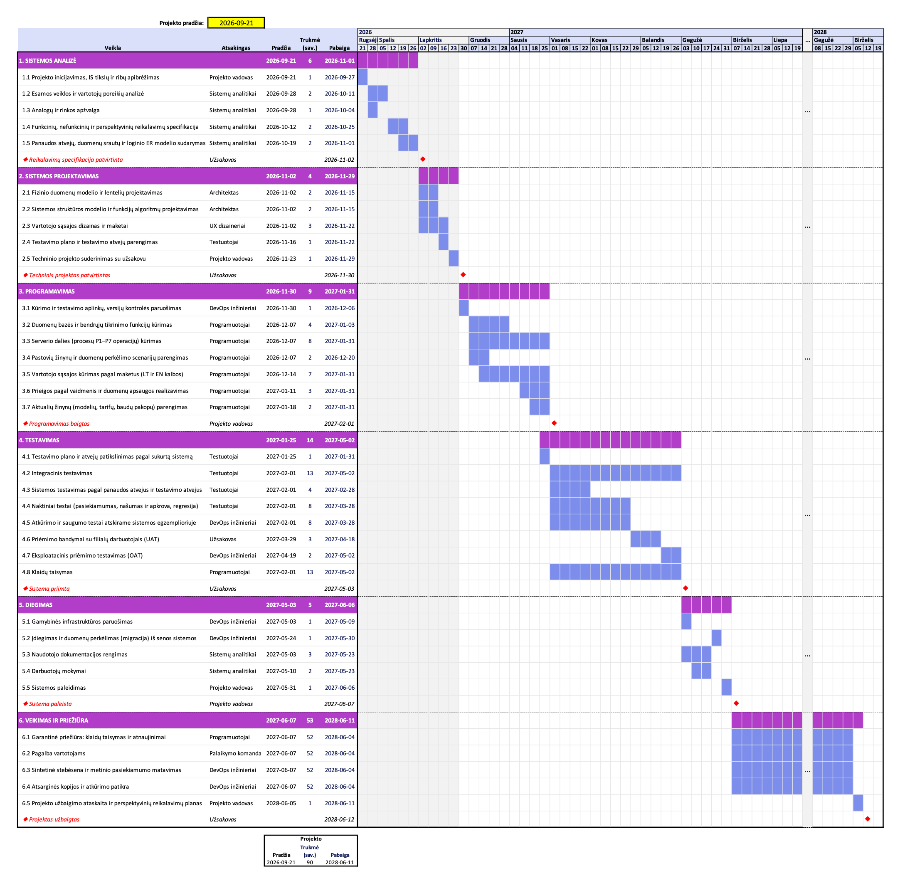{failai=../artefaktai/15-ganto-diagrama.xlsx,../artefaktai/15-ganto-diagrama.png}

## 1.2. Funkciniai reikalavimai

Reikalavimo numerį sudaro tipo žymė ir skyriaus numeris pagal šabloną: 
* FR – funkcinis reikalavimas (FR 1.2.1–FR 1.2.5), 
* NFR – nefunkcinis reikalavimas (NFR 1.3.1.1–NFR 1.3.5.2), 
* PR – perspektyvinis reikalavimas (PR 1.6.1–PR 1.6.4, 1.6 skyrius). 

Reikalavimų numeriai suteikiami vieną kartą ir toliau nekeičiami: pagal juos susiejamos diagramos, funkcijos ir testai. Reikalavimo pavadinimas nurodytas lentelės pavadinime ir naudojamas nuorodoms kituose skyriuose.

::: reikalavimas FR 1.2.1 funkcinis | Motociklų paieška
Klientas turi galėti rasti laisvus motociklus pagal nuomos datas, filialą, charakteristikas (pvz., tipą, variklio tūrį, galią), reikiamą vairuotojo pažymėjimo kategoriją ir galimybę išvažiuoti į užsienį. Paieškos rezultatuose nerodomi motociklai, kurie pasirinktomis datomis yra rezervuoti, išnuomoti, techninėje priežiūroje ar perkeliami, taip pat motociklai, kurie nuomos pradžioje bus kitame filiale.
:::

::: reikalavimas FR 1.2.2 funkcinis | Rezervacija ir jos valdymas
Klientas (arba filialo darbuotojas kliento vardu) turi galėti rezervuoti laisvą motociklą, pasirinkęs išdavimo ir grąžinimo filialus ir pateikęs vairuotojo pažymėjimo duomenis, ir iš karto gauti patvirtinimą, kuriame nurodyta nuomos kaina, užstatas ir baudų už pavėluotą grąžinimą tarifai. Sistema rezervacijos ar jos pakeitimo neleidžia, jei pasirinktos datos sutampa su kita rezervacija, technine priežiūra ar perkėlimu, jei nuomos pradžioje motociklas bus ne išdavimo filiale arba po grąžinimo nebus tame filiale, kuriame prasideda kita jo rezervacija ar perkėlimas, taip pat jei kliento pažymėjime nėra motociklui tinkamos kategorijos, galiojančios visą nuomos laikotarpį. Klientas turi galėti peržiūrėti, keisti ir atšaukti savo rezervacijas asmeninėje paskyroje.
:::

::: reikalavimas FR 1.2.3 funkcinis | Išdavimas ir grąžinimas
Filialo darbuotojas turi galėti matyti savo filialo išdavimų ir grąžinimų tvarkaraštį ir įforminti motociklo išdavimą bei grąžinimą, įskaitant grąžinimą į kitą filialą. Išdavimo ir grąžinimo metu darbuotojas užfiksuoja motociklo ridą ir trumpai aprašo jo būklę. Grąžinant sistema pagal tarifus apskaičiuoja galutinę nuomos kainą ir baudą už pavėluotą grąžinimą.
:::

::: reikalavimas FR 1.2.4 funkcinis | Techninė priežiūra
Filialo darbuotojas turi galėti iš anksto suplanuoti motociklo techninės priežiūros laikotarpį; tuo laikotarpiu motociklas nerodomas paieškoje ir jo negalima rezervuoti. Sistema neleidžia suplanuoti priežiūros, jei jos laikotarpis sutampa su rezervacija, vykstančia nuoma ar perkėlimu. Neplanuotos priežiūros atveju darbuotojas pirmiausia susisiekia su klientu, pasiūlo kitą motociklą ir perkelia rezervaciją arba ją atšaukia, o tik tada suplanuoja priežiūrą.
:::

::: reikalavimas FR 1.2.5 funkcinis | Parko administravimas ir ataskaitos
Administratorius turi galėti tvarkyti filialus, motociklų modelius, motociklus, tarifus ir darbuotojų paskyras, matyti esamą ir istorinį parko užimtumą ir formuoti statistines ataskaitas. Jis taip pat turi galėti suplanuoti vieno ar kelių motociklų perkėlimą į kitą filialą, jei perkėlimo laikotarpis nesutampa su šių motociklų rezervacijomis, vykstančiomis nuomomis ir technine priežiūra, jei perkėlimo pradžioje motociklai bus filiale, iš kurio perkeliama, ir jei kita jų rezervacija ar perkėlimas (jei yra) prasideda filiale, į kurį jie perkeliami. Perkėlimo laikotarpiu šie motociklai nerodomi paieškoje ir jų negalima rezervuoti.
:::

## 1.3. Nefunkciniai reikalavimai

Nefunkciniai reikalavimai apibrėžia, KAIP sistema turi veikti, ir taikomi visai sistemai. Kiekvienas jų suformuluotas taip, kad būtų galima patikrinti matuojant.

### 1.3.1. Reikalavimai sistemos išvaizdai

::: reikalavimas NFR 1.3.1.1 nefunkcinis | Prisitaikanti sąsaja
Sistemos sąsaja turi tinkamai veikti ekranuose nuo 360 px pločio, be viršutinės ribos. Siauruose ekranuose elementai nepersidengia ir nėra horizontalios slinkties juostos, o plačiuose ekranuose turinys neišsitempia per visą plotį, bet lieka sugrupuotas.
:::

::: reikalavimas NFR 1.3.1.2 nefunkcinis | Vieningas stilius
Visi sistemos puslapiai turi naudoti vienodą spalvų paletę, šriftus ir mygtukų išdėstymą, apibrėžtus 2.3.2 skyriuje.
:::

::: reikalavimas NFR 1.3.1.3 nefunkcinis | Motociklo kortelė
Paieškos rezultatuose kiekvienas motociklo modelis, kurio bent vienas motociklas atitinka paieškos sąlygas, rodomas kortele su nuotrauka, modelio pavadinimu, pagrindinėmis charakteristikomis (tipas, variklio tūris, galia, reikiama pažymėjimo kategorija) ir paros kaina, kad modelius būtų galima palyginti neatidarant atskiro puslapio.
:::

### 1.3.2. Reikalavimai naudojimo paprastumui

::: reikalavimas NFR 1.3.2.1 nefunkcinis | Kalbos
Sąsaja turi būti lietuvių ir anglų kalbomis. Kalbą galima pakeisti bet kuriame puslapyje neprarandant įvestų duomenų.
:::

::: reikalavimas NFR 1.3.2.2 nefunkcinis | Darbuotojo mokymas
Naujas filialo darbuotojas po ne ilgesnio kaip 3 valandų mokymo turi savarankiškai atlikti pagrindines operacijas: rezervaciją kliento vardu, motociklo išdavimą ir grąžinimą bei techninės priežiūros planavimą.
:::

::: reikalavimas NFR 1.3.2.3 nefunkcinis | Trumpas rezervacijos kelias
Klientas nuo motociklo pasirinkimo paieškos rezultatuose iki rezervacijos patvirtinimo turi pereiti ne daugiau kaip 3 ekranus (neskaičiuojant prisijungimo).
:::

::: reikalavimas NFR 1.3.2.4 nefunkcinis | Aiški atsisakymo priežastis
Jei rezervacija ar jos pakeitimas neleidžiami, sistema turi nurodyti konkrečią priežastį: datos užimtos; motociklas nuomos pradžioje bus kitame filiale; motociklo negalima grąžinti į pasirinktą filialą, nes kita jo rezervacija ar perkėlimas prasideda kitame filiale; netinka pažymėjimo kategorija arba jos galiojimas baigiasi anksčiau nei nuoma.
:::

### 1.3.3. Reikalavimai veikimo charakteristikoms

::: reikalavimas NFR 1.3.3.1 nefunkcinis | Atsako laikas
Paieškos rezultatai ir rezervacijos patvirtinimas turi būti parodyti ne vėliau kaip per 2 s, o kiti puslapiai – per 3 s, kai sistema vienu metu naudojasi iki 300 vartotojų.
:::

::: reikalavimas NFR 1.3.3.2 nefunkcinis | Pasiekiamumas
Sistema turi veikti visą parą, 7 dienas per savaitę, ir būti pasiekiama ne mažiau kaip 99 % laiko. Nuomos sezono metu (balandžio–spalio mėn.) šis reikalavimas taikomas esant iki 300, o ne sezono metu – iki 50 vienu metu prisijungusių vartotojų.
:::

::: reikalavimas NFR 1.3.3.3 nefunkcinis | Vienalaikės rezervacijos
Jei du vartotojai vienu metu rezervuoja tą patį motociklą sutampančioms datoms, sistema turi patvirtinti tik vieną rezervaciją, o kitam vartotojui pranešti, kad motociklas jau užimtas.
:::

### 1.3.4. Reikalavimai sistemos priežiūrai

::: reikalavimas NFR 1.3.4.1 nefunkcinis | Duomenų dubliavimas ir atsarginės kopijos
Visi duomenų bazės įrašai realiuoju laiku dubliuojami į atsarginę duomenų bazę, be to, kas 24 valandas daroma atsarginė kopija, saugoma ne trumpiau kaip 30 dienų. Sutrikus sistemai, duomenys atkuriami ne ilgiau kaip per 4 valandas.
:::

::: reikalavimas NFR 1.3.4.2 nefunkcinis | Istoriniai duomenys
Užbaigtos nuomos iš sistemos netrinamos ir saugomos ne trumpiau kaip 5 metus, kad būtų galima formuoti statistines ataskaitas.
:::

::: reikalavimas NFR 1.3.4.3 nefunkcinis | Klaidų taisymas ir atnaujinimai
Sezono metu kritinės klaidos, dėl kurių neveikia rezervacija, išdavimas ar grąžinimas, ištaisomos ne vėliau kaip per 1 darbo dieną; planiniai atnaujinimai sezono metu diegiami tik 0–6 val.
:::

### 1.3.5. Reikalavimai saugumui

::: reikalavimas NFR 1.3.5.1 nefunkcinis | Prieiga pagal vaidmenis
Vartotojas gali atlikti tik savo vaidmeniui (klientas, filialo darbuotojas, administratorius) leistus veiksmus: klientas mato tik savo rezervacijas ir asmens duomenis, o tarifus ir darbuotojų paskyras keisti gali tik administratorius.
:::

::: reikalavimas NFR 1.3.5.2 nefunkcinis | Duomenų apsauga
Duomenys tarp naršyklės ir serverio perduodami tik šifruotu ryšiu (HTTPS), o slaptažodžiai saugomi tik kaip maišos reikšmės.
:::

## 1.4. Panaudos atvejų diagrama

Diagramoje pavaizduoti visi trys vartotojai iš 1.1.3 skyriaus (klientas, filialo darbuotojas, administratorius) ir jiems sistemoje prieinami panaudos atvejai. Kiekvieno panaudos atvejo ovale skliaustuose nurodytas funkcinio reikalavimo numeris (žr. 1.2 skyrių), kad diagramą būtų galima susieti su reikalavimais. Panaudos atvejis „Tikrinti motociklo užimtumą“ naudojamas keliuose reikalavimuose (FR 1.2.1, FR 1.2.2, FR 1.2.4, FR 1.2.5), todėl numeris ovale nenurodytas.

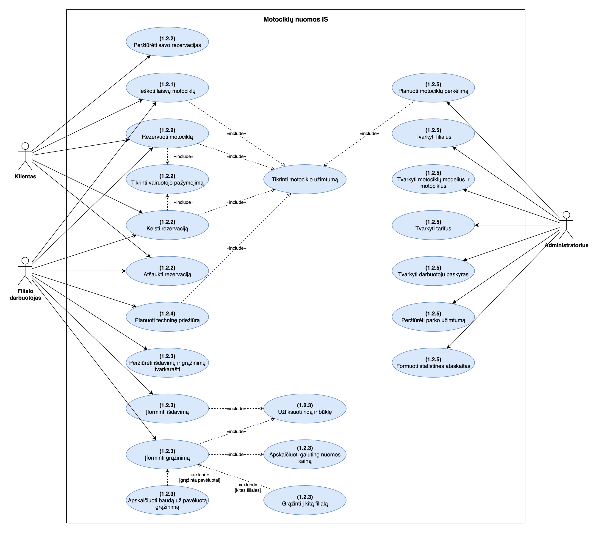{failai=../artefaktai/07-panaudos-atvejai.drawio,../artefaktai/07-panaudos-atvejai.png}

#### Žymėjimas

- Rodyklė nuo aktoriaus į panaudos atvejį: aktorius inicijuoja šį panaudos atvejį.
- Punktyrinė rodyklė «include»: bazinis panaudos atvejis visada įtraukia nurodytą panaudos atvejį.
- Punktyrinė rodyklė «extend»: panaudos atvejis papildo bazinį tik esant nurodytai sąlygai (sąlyga laužtiniuose skliaustuose).

#### Panaudos atvejų sąrašas

Panaudos atvejų numeriai PA1–PA22 diagramoje nerodomi; jais remiamasi duomenų srautų diagramos ir struktūrinės schemos aprašymuose, testavimo atvejuose ir atsekamumo matricoje (1 priedas).  
Aktoriai: 
* K – klientas, 
* D – filialo darbuotojas, 
* A – administratorius.

Lentelė: Panaudos atvejų sąrašas {#lent:pa}
| Nr. | Panaudos atvejis | Aktoriai | Reikalavimas |
|---|---|---|---|
| PA1 | Ieškoti laisvų motociklų | K, D | FR 1.2.1 |
| PA2 | Rezervuoti motociklą | K, D | FR 1.2.2 |
| PA3 | Peržiūrėti savo rezervacijas | K | FR 1.2.2 |
| PA4 | Keisti rezervaciją | K, D | FR 1.2.2 |
| PA5 | Atšaukti rezervaciją | K, D | FR 1.2.2 |
| PA6 | Tikrinti motociklo užimtumą | – | FR 1.2.1, FR 1.2.2, FR 1.2.4, FR 1.2.5 |
| PA7 | Tikrinti vairuotojo pažymėjimą | – | FR 1.2.2 |
| PA8 | Peržiūrėti išdavimų ir grąžinimų tvarkaraštį | D | FR 1.2.3 |
| PA9 | Įforminti išdavimą | D | FR 1.2.3 |
| PA10 | Įforminti grąžinimą | D | FR 1.2.3 |
| PA11 | Planuoti techninę priežiūrą | D | FR 1.2.4 |
| PA12 | Užfiksuoti ridą ir būklę | – | FR 1.2.3 |
| PA13 | Apskaičiuoti galutinę nuomos kainą | – | FR 1.2.3 |
| PA14 | Apskaičiuoti baudą už pavėluotą grąžinimą | – | FR 1.2.3 |
| PA15 | Grąžinti į kitą filialą | – | FR 1.2.3 |
| PA16 | Tvarkyti filialus | A | FR 1.2.5 |
| PA17 | Tvarkyti motociklų modelius ir motociklus | A | FR 1.2.5 |
| PA18 | Tvarkyti tarifus | A | FR 1.2.5 |
| PA19 | Tvarkyti darbuotojų paskyras | A | FR 1.2.5 |
| PA20 | Peržiūrėti parko užimtumą | A | FR 1.2.5 |
| PA21 | Formuoti statistines ataskaitas | A | FR 1.2.5 |
| PA22 | Planuoti motociklų perkėlimą | A | FR 1.2.5 |

#### Paaiškinimai

- **PA6 Tikrinti motociklo užimtumą** tikrina, ar pasirinktomis datomis motociklas nėra rezervuotas, išnuomotas, techninėje priežiūroje ar perkeliamas. Todėl paieška nerodo užimtų motociklų (FR 1.2.1), rezervacijos ir jos pakeitimo negalima atlikti užimtomis datomis (FR 1.2.2), o techninės priežiūros ir perkėlimo negalima suplanuoti laikotarpiui, kuris sutampa su rezervacija (FR 1.2.4, FR 1.2.5). Be to, PA6 tikrina motociklo buvimo vietą: nuomos ar perkėlimo pradžioje motociklas turi būti tame filiale, iš kurio jis išduodamas ar perkeliamas, o pabaigoje – tame filiale, kuriame prasideda kitas jo užimtumo laikotarpis. Todėl, pavyzdžiui, neleidžiama grąžinti motociklo į kitą filialą, jei kitą dieną jis rezervuotas pradiniame filiale (FR 1.2.2). Plačiau – 1.5.2.4 skyriuje.
- **PA7 Tikrinti vairuotojo pažymėjimą** tikrina, ar kliento pažymėjime yra motociklui tinkama kategorija ir ar ji galioja visą nuomos laikotarpį (FR 1.2.2). Kiekvienos kategorijos galiojimo data saugoma atskirai.
- **Rezervacija kliento vardu:** filialo darbuotojas susietas su PA1, PA2, PA4 ir PA5, nes registruoja rezervacijas skambinantiems ar į filialą atvykusiems klientams (FR 1.2.2).
- **Neplanuota techninė priežiūra** atskiru panaudos atveju nevaizduojama: darbuotojas perkelia rezervaciją į kitą motociklą (PA4) arba ją atšaukia (PA5), o tada suplanuoja priežiūrą (PA11), kurią leidžia PA6 patikrinimas (FR 1.2.4).
- **PA9 Įforminti išdavimą:** motociklą galima išduoti tik tada, kai jis yra išdavimo filiale ir ankstesnė jo nuoma jau užbaigta (motociklas grąžintas).
- **Pavėluotas grąžinimas** atskiru panaudos atveju nevaizduojamas. Filialo tvarkaraštyje (PA8) vėluojanti nuoma pažymima, o šalia rodomas kitas to motociklo laikotarpis. Kaip ir neplanuotos techninės priežiūros atveju, darbuotojas susisiekia su kitu klientu ir perkelia rezervaciją į kitą motociklą (PA4) arba ją atšaukia (PA5). Jei klientas sutinka palaukti, grąžinus motociklą darbuotojas pakeičia rezervacijos pradžią į išdavimo laiką (PA4), kad kaina būtų skaičiuojama už trumpesnį laikotarpį. Plačiau – 2.2.1 skyriuje.
- **Grąžinimo filialas pasirenkamas rezervuojant** (PA2) kartu su išdavimo filialu, todėl jis matomas filialo tvarkaraštyje (PA8) ir PA6 gali patikrinti motociklo buvimo vietą. PA15 taikomas, kai rezervacijoje nurodytas grąžinimo filialas skiriasi nuo išdavimo filialo. Jei klientas nori grąžinti motociklą kitur, rezervacija keičiama (PA4), o PA6 patikrina, ar tai leidžiama (FR 1.2.2).
- **Patvirtinimas su kaina, užstatu ir baudų tarifais** yra PA2 rezultatas ir atskiru panaudos atveju nevaizduojamas.
- **PA22 Planuoti motociklų perkėlimą:** administratorius vienu perkėlimu gali perkelti vieną ar kelis motociklus (jie vežami kartu) į kitą filialą. Perkėlimo laikotarpiu motociklai užimti taip pat, kaip nuomos ar techninės priežiūros metu (FR 1.2.5).

## 1.5. Duomenų diagramos

### 1.5.1. Duomenų srautų diagrama

Diagrama nubraižyta viename lygyje („0 lygis“) su procesais: atskiros konteksto diagramos ir gilesnių lygių nėra. 
Žymėjimas: 
* (E) išorinė esybė – stačiakampis, 
* (P) procesas – suapvalintas stačiakampis, 
* (DS) duomenų saugykla – cilindras, 
* duomenų srautas – rodyklė su pavadinimu.

Kai srautai kertasi nesujungti, kirtimo vietoje piešiamas lankelis.

::: gulscias

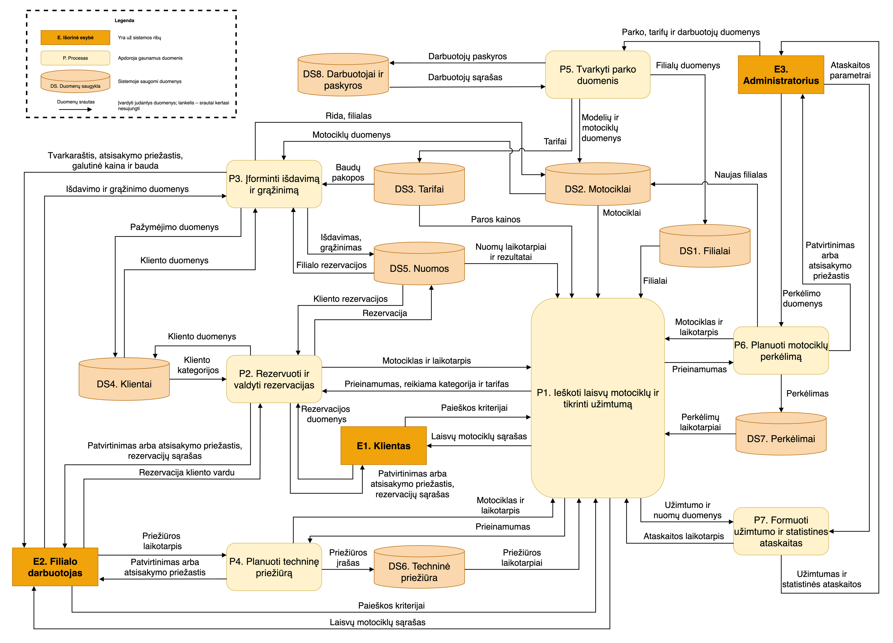{failai=../artefaktai/09-dsd.drawio,../artefaktai/09-dsd.png}

:::

#### Išorinės esybės

Lentelė: Duomenų srautų diagramos išorinės esybės
| Nr. | Esybė | Atitinka vartotoją (1.1.3 skyrius) |
|---|---|---|
| E1 | Klientas | Klientas |
| E2 | Filialo darbuotojas | Filialo darbuotojas |
| E3 | Administratorius | Administratorius (vadovas) |

#### Procesai

Lentelė: Duomenų srautų diagramos procesai {#lent:procesai}
| Nr. | Procesas | Reikalavimas | Panaudos atvejai |
|---|---|---|---|
| P1 | Ieškoti laisvų motociklų ir tikrinti užimtumą | FR 1.2.1 (ir užimtumo tikrinimas FR 1.2.2, FR 1.2.4, FR 1.2.5) | PA1, PA6 |
| P2 | Rezervuoti ir valdyti rezervacijas | FR 1.2.2 | PA2, PA3, PA4, PA5, PA7 |
| P3 | Įforminti išdavimą ir grąžinimą | FR 1.2.3 | PA8, PA9, PA10, PA12, PA13, PA14, PA15 |
| P4 | Planuoti techninę priežiūrą | FR 1.2.4 | PA11 |
| P5 | Tvarkyti parko duomenis | FR 1.2.5 | PA16, PA17, PA18, PA19 |
| P6 | Planuoti motociklų perkėlimą | FR 1.2.5 | PA22 |
| P7 | Formuoti užimtumo ir statistines ataskaitas | FR 1.2.5 | PA20, PA21 |

#### Duomenų saugyklos

Saugyklos sudarytos iš loginės ER diagramos esybių (1.5.2 skyrius); su savo pagrindine esybe sujungtos silpnos esybės ir ją aprašančios esybės. Kategorija yra klasifikatorius, kurio įrašai įvedami diegiant sistemą, todėl jos joks procesas nerašo. Klasifikatorius Gamintojas ir Motociklo tipas tvarko administratorius kartu su modeliais, todėl juos rašo P5 kartu su srautu „Modelių ir motociklų duomenys“ į DS2.

Lentelė: Duomenų srautų diagramos duomenų saugyklos {#lent:saugyklos}
| Nr. | Saugykla | ER esybės | Rašo | Skaito |
|---|---|---|---|---|
| DS1 | Filialai | Filialas | P5 | P1 |
| DS2 | Motociklai | Motociklas, Motociklo modelis, Gamintojas, Motociklo tipas, Kategorija | P3, P5, P6 | P1, P3 |
| DS3 | Tarifai | Tarifas, Baudos pakopa | P5 | P1, P3 |
| DS4 | Klientai | Klientas (su ryšiu „turi teisę“ ir jo atributu „Galioja iki“) | P2 | P2, P3 |
| DS5 | Nuomos | Nuoma, Išdavimas, Grąžinimas | P2, P3 | P1, P2, P3 |
| DS6 | Techninė priežiūra | Techninė priežiūra | P4 | P1 |
| DS7 | Perkėlimai | Perkėlimas (su ryšiu „perkeliamas“) | P6 | P1 |
| DS8 | Darbuotojai ir paskyros | Darbuotojas, Paskyra | P5 | P5 |

#### Duomenų srautai

Lentelė: Procesų gaunami ir perduodami duomenų srautai
| Procesas | Gauna | Perduoda |
|---|---|---|
| P1 | iš E1 ir E2 – paieškos kriterijus; iš P2, P4, P6 – motociklą ir laikotarpį; iš P7 – ataskaitos laikotarpį; iš DS1 – filialus; iš DS2 – motociklus; iš DS3 – paros kainas; iš DS5, DS6, DS7 – nuomų, priežiūros ir perkėlimų laikotarpius | E1 ir E2 – laisvų motociklų sąrašą; P2 – prieinamumą, reikiamą kategoriją ir tarifą; P4 ir P6 – prieinamumą; P7 – užimtumo ir nuomų duomenis |
| P2 | iš E1 – rezervacijos duomenis (nauja rezervacija, pakeitimas ar atšaukimas); iš E2 – rezervaciją kliento vardu; iš P1 – prieinamumą, reikiamą kategoriją ir tarifą; iš DS4 – kliento kategorijas; iš DS5 – kliento rezervacijas | E1 ir E2 – patvirtinimą arba atsisakymo priežastį ir rezervacijų sąrašą; P1 – motociklą ir laikotarpį; DS4 – kliento duomenis; DS5 – rezervaciją (naują, pakeistą ar atšauktą) |
| P3 | iš E2 – išdavimo ir grąžinimo duomenis (rida, būklė); iš DS2 – motociklų duomenis; iš DS3 – baudų pakopas; iš DS4 – kliento duomenis; iš DS5 – filialo rezervacijas | E2 – tvarkaraštį, galutinę kainą ir baudą; DS5 – išdavimą ir grąžinimą; DS2 – ridą ir dabartinį filialą |
| P4 | iš E2 – priežiūros laikotarpį; iš P1 – prieinamumą | E2 – patvirtinimą arba atsisakymo priežastį; P1 – motociklą ir laikotarpį; DS6 – priežiūros įrašą |
| P5 | iš E3 – parko, tarifų ir darbuotojų duomenis; iš DS8 – darbuotojų sąrašą | DS1, DS2, DS3, DS8 – filialų, modelių ir motociklų, tarifų, darbuotojų paskyrų duomenis |
| P6 | iš E3 – perkėlimo duomenis; iš P1 – prieinamumą | E3 – patvirtinimą arba atsisakymo priežastį; P1 – motociklą ir laikotarpį; DS7 – perkėlimą; DS2 – naują motociklo filialą |
| P7 | iš E3 – ataskaitos parametrus; iš P1 – užimtumo ir nuomų duomenis | E3 – užimtumą ir statistines ataskaitas; P1 – ataskaitos laikotarpį |

#### Modelio sprendimai

- **Užimtumą tikrina tik P1.** Rezervacija (P2), techninės priežiūros planavimas (P4) ir perkėlimo planavimas (P6) siunčia P1 motociklą ir laikotarpį, o P1 grąžina, ar jis laisvas. Panaudos atvejų diagramoje tai atitinka PA6 „Tikrinti motociklo užimtumą“, įtraukiamas į PA1, PA2, PA4, PA11 ir PA22. Todėl nuomų, priežiūros ir perkėlimų laikotarpius (DS5, DS6, DS7) skaito vienas procesas, o motociklo buvimo vietos taisyklė (1.5.2 skyrius) įgyvendinama vienoje vietoje.
- **P2 tarifą ir reikiamą kategoriją gauna iš P1.** P1 vis tiek skaito motociklus ir tarifus, todėl kartu su prieinamumu grąžina motociklo reikiamą kategoriją (P2 ją palygina su kliento kategorijomis iš DS4, PA7) ir tarifą (paros kaina, užstatas ir baudų pakopos rodomi patvirtinime, FR 1.2.2).
- **P7 užimtumo ir nuomų duomenis gauna iš P1**, nes tik P1 skaito visus užimtumo laikotarpius. Taip išvengiama dar kelių srautų iš saugyklų, kurie kirstų daugelį kitų.
- **P3 skaito motociklų ir klientų duomenis.** Tvarkaraštyje ir išduodant darbuotojas turi matyti, kuris motociklas (valstybinis numeris) ir kuriam klientui (vardas, pažymėjimo numeris) išduodamas, todėl P3 skaito DS2 ir DS4. Baudų pakopas P3 ima iš DS3 pagal tarifą, su kuriuo susieta nuoma (ryšys „įkainojama“, 1.5.2 skyrius). Grąžinimo filialas pasirenkamas rezervuojant (P2), todėl grąžinant jis neįvedamas, o P3 įrašo jį į DS2 kaip naują motociklo filialą.
- **Naujas filialas po perkėlimo.** P6 įrašo naują motociklo filialą į DS2, kai baigiasi perkėlimo laikotarpis, o ne planuodamas perkėlimą; iki tol motociklo buvimo vietą nusako motociklo buvimo vietos taisyklė (1.5.2 skyrius).
- **Neplanuota techninė priežiūra** atskiru procesu nevaizduojama: darbuotojas per P2 perkelia rezervaciją į kitą motociklą arba ją atšaukia, o tada per P4 suplanuoja priežiūrą (FR 1.2.4). Susisiekimas su klientu vyksta už sistemos ribų.
- **Prisijungimas nevaizduojamas** (laikomas bazine funkcija). Todėl paskyrų saugyklą DS8 skaito tik P5 (darbuotojų paskyrų tvarkymas), o kliento paskyros sukūrimas registruojantis diagramoje nerodomas.
- **Perspektyviniai reikalavimai PR 1.6.1–PR 1.6.4** (mokėjimai, pažeidimai, buhalterinė apskaita, nuolaidos) neįtraukti, kaip ir ER diagramoje.

### 1.5.2. ER loginio lygmens diagrama

Duomenų modelis sudarytas pagal funkcinius reikalavimus FR 1.2.1–FR 1.2.5 ir su duomenimis susijusius nefunkcinius reikalavimus (NFR 1.3.1.3, NFR 1.3.4.2, NFR 1.3.5.1, NFR 1.3.5.2). Diagrama nubraižyta Cheno žymėjimu: esybė – stačiakampis, atributas – elipsė, ryšys – rombas, silpna esybė – dvigubas stačiakampis, silpnas ryšys – dvigubas rombas. Papildomai naudojamas išvestinio atributo ženklas – punktyrinė elipsė (žymėjimas pagal [10]). Ryšio kardinalumas žymimas 1, N ir M. Esybės nuspalvintos pagal sritį: parkas ir filialai, klientai ir nuomos, personalas ir paskyros.

Išoriniai raktai loginiame lygmenyje nevaizduojami: juos atstoja ryšiai. Atributų tipai, išoriniai raktai ir apribojimai apibrėžti fizinėje ER diagramoje (2.1.2 skyrius) ir lentelių aprašyme (2.2.2 skyrius).

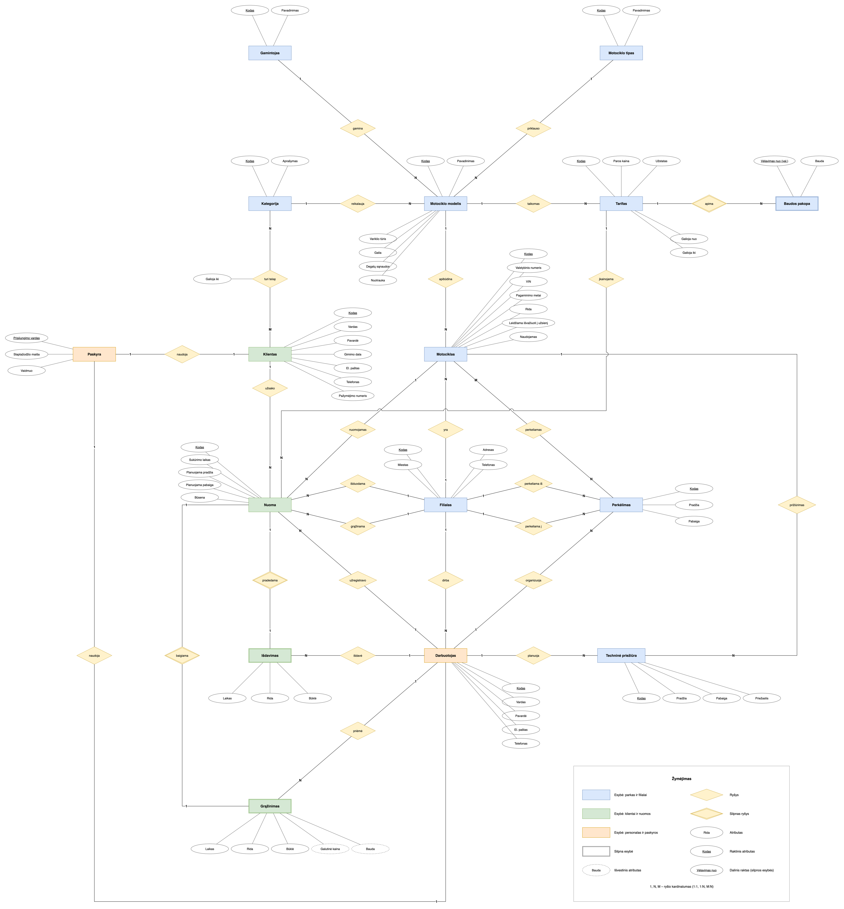{failai=../artefaktai/08-loginis-er.drawio,../artefaktai/08-loginis-er.png}

#### Esybės

Lentelė: Loginės ER diagramos esybės {#lent:esybes}
| Esybė | Atributai (raktas pabrauktas) | Paskirtis | Reikalavimai |
|---|---|---|---|
| Filialas | <u>Kodas</u>, Miestas, Adresas, Telefonas | Įmonės filialas (Vilnius, Kaunas, Klaipėda) | FR 1.2.1, FR 1.2.3, FR 1.2.5 |
| Kategorija | <u>Kodas</u> (AM, A1, A2, A), Aprašymas | Vairuotojo pažymėjimo kategorija (klasifikatorius); aprašymas paaiškina kategoriją klientui (pvz., „A2 – vidutinės galios motociklai“) | FR 1.2.1, FR 1.2.2 |
| Gamintojas | <u>Kodas</u>, Pavadinimas | Motociklų gamintojas (klasifikatorius, pvz., Honda, BMW) | FR 1.2.5 |
| Motociklo tipas | <u>Kodas</u>, Pavadinimas | Motociklo tipas paieškai ir kortelei (klasifikatorius, pvz., turistinis, enduro) | FR 1.2.1, FR 1.2.5, NFR 1.3.1.3 |
| Motociklo modelis | <u>Kodas</u>, Pavadinimas, Variklio tūris, Galia, Degalų sąnaudos, Nuotrauka | Charakteristikos paieškai ir motociklo kortelei | FR 1.2.1, FR 1.2.5, NFR 1.3.1.3 |
| Motociklas | <u>Kodas</u>, Valstybinis numeris, VIN, Pagaminimo metai, Rida, Leidžiama išvažiuoti į užsienį, Naudojamas | Konkretus parko motociklas | FR 1.2.1, FR 1.2.3, FR 1.2.5 |
| Tarifas | <u>Kodas</u>, Paros kaina, Užstatas, Galioja nuo, Galioja iki | Modelio paros kaina, užstatas ir baudų pakopos rezervacijoms, sudarytoms tam tikru laikotarpiu | FR 1.2.2, FR 1.2.3, FR 1.2.5 |
| Baudos pakopa (silpna) | <ud>Vėlavimas nuo (val.)</ud>, Bauda | Baudų už pavėluotą grąžinimą tarifų lentelės eilutė | FR 1.2.2, FR 1.2.3 |
| Techninė priežiūra | <u>Kodas</u>, Pradžia, Pabaiga, Priežastis | Laikotarpis, kai motociklas prižiūrimas ir neprieinamas | FR 1.2.4 |
| Perkėlimas | <u>Kodas</u>, Pradžia, Pabaiga | Vieno ar kelių motociklų pervežimas į kitą filialą | FR 1.2.5 |
| Klientas | <u>Kodas</u>, Vardas, Pavardė, Gimimo data, El. paštas, Telefonas, Pažymėjimo numeris | Nuomininkas ir jo vairuotojo pažymėjimo duomenys | FR 1.2.2 |
| Nuoma | <u>Kodas</u>, Sukūrimo laikas, Planuojama pradžia, Planuojama pabaiga, Būsena | Rezervacija, kuri vėliau tampa nuoma | FR 1.2.2, FR 1.2.3, NFR 1.3.4.2 |
| Išdavimas (silpna) | Laikas, Rida, Būklė | Motociklo išdavimo klientui faktas | FR 1.2.3 |
| Grąžinimas (silpna) | Laikas, Rida, Būklė, Galutinė kaina (išvestinis), Bauda (išvestinis) | Motociklo grąžinimo faktas ir galutinis atsiskaitymas | FR 1.2.3 |
| Darbuotojas | <u>Kodas</u>, Vardas, Pavardė, El. paštas, Telefonas | Filialo darbuotojas arba administratorius | FR 1.2.3, FR 1.2.4, FR 1.2.5 |
| Paskyra | <u>Prisijungimo vardas</u>, Slaptažodžio maiša, Vaidmuo | Prisijungimo duomenys ir vaidmuo | NFR 1.3.5.1, NFR 1.3.5.2 |

#### Ryšiai

Kiekvieno ryšio kardinalumo pagrindimas ir privalomumas (ar ryšio pusėje gali būti nulis įrašų) aprašyti 2.2.2 skyriuje (poskyris „Ryšiai“), nes privalomumas parodytas fizinėje ER diagramoje.

Lentelė: Loginės ER diagramos ryšiai {#lent:ryšiai-log}
| Ryšys | Esybės ir kardinalumas | Paaiškinimas |
|---|---|---|
| reikalauja | Kategorija `1:N` Motociklo modelis | Modeliui vairuoti reikalinga kategorija |
| gamina | Gamintojas `1:N` Motociklo modelis | Modelio gamintojas |
| priklauso | Motociklo tipas `1:N` Motociklo modelis | Modelio tipas |
| turi teisę | Klientas `M:N` Kategorija; ryšio atributas „Galioja iki“ | Kategorijos kliento pažymėjime; kiekvienos kategorijos galiojimo data saugoma atskirai |
| apibūdina | Motociklo modelis `1:N` Motociklas | Kiekvienas motociklas priklauso vienam modeliui |
| taikomas | Motociklo modelis `1:N` Tarifas | Modelio tarifai skirtingais laikotarpiais |
| apima (silpnas) | Tarifas `1:N` Baudos pakopa | Baudų tarifų lentelė priklauso tarifui |
| įkainojama | Tarifas `1:N` Nuoma | Tarifas, galiojęs rezervavimo dieną; pagal jį apskaičiuojama nuomos kaina, užstatas ir bauda |
| yra | Filialas `1:N` Motociklas | Filialas, kuriame motociklas yra dabar |
| nuomojamas | Motociklas `1:N` Nuoma | Kuris motociklas nuomojamas |
| užsako | Klientas `1:N` Nuoma | Kieno rezervacija |
| išduodama, grąžinama | Filialas `1:N` Nuoma (du ryšiai) | Išdavimo ir grąžinimo filialai, pasirenkami rezervuojant |
| užregistravo | Darbuotojas `1:N` Nuoma | Darbuotojas, užregistravęs rezervaciją kliento vardu (jei rezervavo pats klientas, ryšio nėra) |
| pradedama, baigiama (silpni) | Nuoma `1:1` Išdavimas, Nuoma `1:1` Grąžinimas | Išdavimas ir grąžinimas egzistuoja tik kartu su nuoma |
| išdavė, priėmė | Darbuotojas `1:N` Išdavimas, Darbuotojas `1:N` Grąžinimas | Kas išdavė ir kas priėmė motociklą |
| prižiūrimas | Motociklas `1:N` Techninė priežiūra | Motociklo priežiūros laikotarpiai |
| planuoja | Darbuotojas `1:N` Techninė priežiūra | Kas suplanavo priežiūrą |
| perkeliamas | Motociklas `M:N` Perkėlimas | Vienu perkėlimu vežamas vienas ar keli motociklai |
| perkeliama iš, perkeliama į | Filialas `1:N` Perkėlimas (du ryšiai) | Iš kurio ir į kurį filialą perkeliama |
| organizuoja | Darbuotojas `1:N` Perkėlimas | Administratorius, suplanavęs perkėlimą |
| dirba | Filialas `1:N` Darbuotojas | Darbuotojo filialas (administratorius gali būti nepriskirtas filialui) |
| naudoja | Klientas `1:1` Paskyra, Darbuotojas `1:1` Paskyra | Prisijungimo paskyra |

#### Modelio sprendimai

- **Rezervacija ir nuoma – viena esybė Nuoma.** Jos būsena: rezervuota, aktyvi, užbaigta arba atšaukta. Užbaigtos nuomos netrinamos (NFR 1.3.4.2), todėl iš jų formuojamos statistinės ataskaitos ir parko užimtumas (FR 1.2.5); atskiros ataskaitų esybės nereikia.
- **Tarifas parenkamas rezervuojant.** Nuoma susieta su motociklo modelio tarifu, galiojusiu rezervavimo dieną (ryšys „įkainojama“). Iš jo imama paros kaina ir užstatas, o grąžinant – baudų pakopos, todėl baudą galima apskaičiuoti pagal tuos pačius tarifus, kuriuos klientas matė patvirtinime (FR 1.2.2). Tarifas, pagal kurį jau yra rezervacijų, nekeičiamas: jo galiojimas baigiamas data „Galioja iki“ ir sukuriamas naujas tarifas. Vienam modeliui tą pačią dieną galioja tik vienas tarifas. Todėl Nuomoje paros kainos ir užstato kopijuoti nereikia. Galutinė kaina ir bauda apskaičiuojamos grąžinant ir saugomos Grąžinime (FR 1.2.3).
- **Išdavimas ir Grąžinimas – silpnos esybės.** Jos neturi savo rakto ir identifikuojamos per nuomą (kiekviena nuoma turi ne daugiau kaip vieną išdavimą ir vieną grąžinimą). Taip nuomoje nėra tuščių laukų, kol motociklas neišduotas, ir matyti, kas išdavė ir kas priėmė motociklą.
- **Baudos pakopa – silpna esybė.** Pakopa neturi savo kodo: ji identifikuojama tarifu ir daliniu raktu „Vėlavimas nuo (val.)“, o kitos esybės į ją nenurodo (Grąžinime saugoma baudos suma). Pakopa turi tik apatinę ribą: ji galioja nuo savo „Vėlavimas nuo (val.)“ iki kitos pakopos pradžios, o paskutinė pakopa – be viršutinės ribos. Taikoma pakopa su didžiausia „Vėlavimas nuo (val.)“ reikšme, kuri neviršija vėlavimo (vėlavimas ≥ „Vėlavimas nuo (val.)“). Bauda nesumuojama: imama tik tos pakopos suma. Jei pakopos su „Vėlavimas nuo (val.)“ = 0 nėra, iki pirmosios pakopos bauda lygi 0; jei tarifas pakopų neturi, baudos nėra. Pavyzdys: pakopos „nuo 1 val. – 20 Eur“ ir „nuo 3 val. – 60 Eur“ reiškia, kad vėluojant iki 1 val. bauda – 0 Eur, 2 val. – 20 Eur, 50 val. – 60 Eur (sumos – tik pavyzdys). Didesniems motociklams baudos gali būti didesnės. Viršutinė riba nesaugoma, todėl pakopos negali persidengti ir tarp jų negali likti tarpų.
- **Išvestiniai atributai.** Grąžinimo „Galutinė kaina“ ir „Bauda“ apskaičiuojamos iš tarifo, nuomos datų, grąžinimo laiko ir baudų pakopų, todėl diagramoje pažymėtos punktyrine elipse. Jos vis tiek saugomos kaip užfiksuotas atsiskaitymo su klientu rezultatas: skaičiavimo taisyklės (pvz., kaip skaičiuojamos paros) gali keistis, o perskaičiavus senas nuomas sumos nebesutaptų su sumokėtomis. Fizinėje ER diagramoje (2.1.2 skyrius) tai sąmoningas nukrypimas nuo normalizacijos. Kiti atributai išvestiniais nelaikomi: Nuomos „Būsena“ neišvedama, nes būsenos „atšaukta“ negalima nustatyti iš kitų duomenų; Motociklo „Rida“ turi pradinę reikšmę iki pirmosios nuomos; Tarifo „Galioja iki“ reikalinga, nes tarifas gali būti uždarytas be įpėdinio, o tarp tarifų gali būti tarpų.
- **Pažymėjimo kategorijos.** Kliento kategorijos saugomos ryšiu „turi teisę“, kiekviena su savo galiojimo data. Rezervuoti leidžiama, jei kliento pažymėjime yra būtent ta kategorija, kurios reikalauja modelis, ir ji galioja visą nuomos laikotarpį (FR 1.2.2). Kurios kategorijos apima kitas, sistema nesaugo: tai verslo proceso dalis. Registruojant pažymėjimą (klientas rezervuodamas arba darbuotojas kliento vardu) pažymimos visos kategorijos, kurias suteikia pažymėjimas; pavyzdžiui, turinčiam A kategoriją pažymimos ir A1, A2. Taip sistemoje nereikia saugoti kategorijų apimties taisyklių, kurios skirtingose šalyse gali skirtis, o naujas kategorijas galima pridėti kaip įrašus. Kategorija yra klasifikatorius: jo įrašai (AM, A1, A2, A) įvedami diegiant sistemą, todėl atskiro reikalavimo ir panaudos atvejo jiems tvarkyti nėra.
- **Klasifikatoriai.** Gamintojas ir Motociklo tipas yra atskiros esybės, o ne Motociklo modelio teksto atributai: tipu ieškoma (FR 1.2.1) ir jis rodomas kortelėje (NFR 1.3.1.3), o pagal gamintoją ir tipą grupuojama statistika (FR 1.2.5). Įvedant tekstą, ta pati reikšmė gali būti užrašyta skirtingai (pvz., „Enduro“ ir „enduro“), ir paieškos filtras bei ataskaitos ją laikytų dviem skirtingomis reikšmėmis. Šiuos klasifikatorius tvarko administratorius kartu su motociklų modeliais (FR 1.2.5, panaudos atvejis „Tvarkyti motociklų modelius ir motociklus“). Kategorija taip pat klasifikatorius, bet jos įrašai įvedami diegiant sistemą, nes kategorijas nustato teisės aktai, o ne įmonė. Klasifikatoriais nelaikomi šie atributai. Nuomos „Būsena“ ir Paskyros „Vaidmuo“: jų reikšmių sąrašą nustato ne įmonė, o pati sistema – nuo kiekvienos būsenos priklauso nuomos eiga, o nuo vaidmens – leidžiami veiksmai (NFR 1.3.5.1), todėl naujos reikšmės be programos pakeitimų nebūtų naudingos, o atskira esybė suteiktų tik tariamą lankstumą. Filialo „Miestas“: kiekvienas iš trijų filialų yra skirtingame mieste, todėl reikšmės nesikartoja. Techninės priežiūros „Priežastis“: tai laisvas aprašymas, o ne reikšmė iš sąrašo.
- **Techninė priežiūra ir perkėlimas – laikotarpiai, o ne motociklo būsena.** Motociklas taip pat turi požymį „Naudojamas“: nurašytas motociklas netrinamas, nes reikalingas istorijai, bet nerodomas paieškoje.
- **Nuotrauka ir charakteristikos priskirtos modeliui**, nes paieškos kortelėje rodomas modelis (NFR 1.3.1.3). **Pagaminimo metai ir leidimas išvažiuoti į užsienį priskirti motociklui**, nes leidimas priklauso nuo konkretaus motociklo draudimo.
- **Klientas be paskyros.** Kliento kodas nepriklauso nuo paskyros. Skambinančiam klientui darbuotojas sukuria kliento įrašą (vardas, telefonas, pažymėjimo duomenys) ir jam registruoja rezervaciją. Jei klientas vėliau užsiregistruoja svetainėje tuo pačiu el. paštu, paskyra susiejama su esamu kliento įrašu. Todėl klientas gali neturėti paskyros, o darbuotojas paskyrą turi visada.
- **Paskyra.** Prisijungimas laikomas bazine funkcija ir į darbą neįtraukiamas, todėl nesėkmingų prisijungimų žurnalo ir paskyros blokavimo modelyje nėra. Paskyroje saugomas prisijungimo vardas, slaptažodžio maiša (NFR 1.3.5.2) ir vaidmuo, pagal kurį ribojami leidžiami veiksmai (NFR 1.3.5.1).

#### Motociklo buvimo vietos taisyklė

Kadangi galimas grąžinimas į kitą filialą, motociklas ne visada lieka ten, kur buvo išduotas. Nuoma, perkėlimas ir techninė priežiūra yra motociklo užimtumo laikotarpiai (kada jie prasideda ir baigiasi, apibrėžta 2.2.1 skyriuje): nuoma prasideda išdavimo filiale ir baigiasi grąžinimo filiale, perkėlimas – „iš“ ir „į“ filialuose, o priežiūra vyksta ten, kur motociklas tuo metu yra. Naują laikotarpį galima įrašyti tik tada, kai:

1. jis nesutampa su kitais to motociklo užimtumo laikotarpiais;
2. jo pradžioje motociklas bus tame filiale, kuriame laikotarpis prasideda (pagal ankstesnio laikotarpio pabaigos filialą arba, jei jo nėra, pagal filialą, kuriame motociklas yra dabar);
3. jo pabaigoje motociklas bus tame filiale, kuriame prasideda kitas jo laikotarpis (jei toks yra).

Pavyzdys: motociklas rezervuotas dienai T Vilniuje. Klientas nori jį išsinuomoti dienai T−1 Vilniuje ir grąžinti Klaipėdoje. Pažeidžiama 3 taisyklė, todėl sistema leidžia tik grąžinimą į tą patį filialą ir nurodo priežastį (NFR 1.3.2.4).

Kaip taisyklė taikoma motociklui, kuris yra Vilniuje ir rezervuotas 2027-05-12 10:00 – 2027-05-15 10:00 su grąžinimu į Klaipėdą, parodyta @pav:buvimo-vieta pav. (šis pavyzdys aprašytas ir 2.2.1 skyriuje).

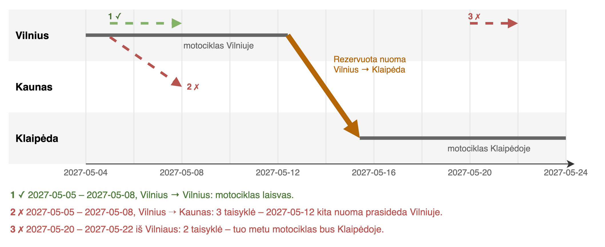{failai=../artefaktai/08-buvimo-vietos-taisykle.drawio,../artefaktai/08-buvimo-vietos-taisykle.png}

Taisyklę įgyvendina užimtumo tikrinimo funkcija `tikrintiUzimtuma` (2.2.1 skyrius), ji atitinka panaudos atvejį „Tikrinti motociklo užimtumą“. Modelyje tam pakanka esamų duomenų: nuomos išdavimo ir grąžinimo filialų, perkėlimo filialų ir dabartinio motociklo filialo. Kai perkėlimas baigiasi ar įforminamas grąžinimas, sistema pakeičia motociklo filialą (ryšys „yra“).

## 1.6. Perspektyviniai reikalavimai

Šie reikalavimai neįeina į pirmąją sistemos versiją, tačiau galėtų būti įgyvendinti naujoje versijoje. Jie atrinkti iš 1.1.2 skyriuje („Sistemos ribos“) išvardytų galimybių.

::: reikalavimas PR 1.6.1 funkcinis | Mokėjimas internetu
Klientas rezervuodamas turi galėti internetu sumokėti avansą arba visą nuomos kainą per integruotą mokėjimų sistemą. Išdavimo metu filialo darbuotojas mato, kokia suma jau sumokėta ir kiek liko sumokėti.
:::

::: reikalavimas PR 1.6.2 funkcinis | Išsamus pažeidimų registravimas
Išdavimo ir grąžinimo metu filialo darbuotojas turi galėti pažymėti motociklo pažeidimus jo schemoje ir pridėti nuotraukų. Grąžinant sistema parodo naujus pažeidimus, kurių nebuvo išdavimo metu, ir susieja juos su ta nuoma. Visa motociklo pažeidimų istorija saugoma ir matoma kitiems darbuotojams.
:::

::: reikalavimas PR 1.6.3 funkcinis | Integracija su buhalterinės apskaitos sistema
Užbaigus nuomą, sistema turi automatiškai perduoti jos mokėjimų duomenis (sumą, PVM, mokėjimo datą ir būdą) į įmonės naudojamą buhalterinės apskaitos sistemą. Administratorius turi matyti, kurių nuomų duomenys perduoti, o kurių perdavimas nepavyko.
:::

::: reikalavimas PR 1.6.4 funkcinis | Nuolaidos ir kompensacijos
Filialo darbuotojas turi galėti suteikti klientui nuolaidą arba kompensaciją (suma ar procentais), nurodydamas priežastį (pvz., klientas laukė pavėluotai grąžinto motociklo), o administratorius – nustatyti didžiausią leidžiamą nuolaidą. Grąžinant sistema galutinę nuomos kainą apskaičiuoja įvertindama nuolaidą. Administratorius turi matyti visas suteiktas nuolaidas ir jų priežastis.
:::

# 2. Sistemos projektavimas

## 2.1. Sistemos architektūros projektavimas

### 2.1.1. Sistemos struktūros modelis

Struktūrinė schema rodo, iš kokių funkcijų sudaryta sistema ir kaip jos skaidomos į smulkesnes. Ji nubraižyta medžio pavidalu, kurio viršuje – sistema, kiekvienas lygis nuspalvintas sava spalva (žalia, oranžinė, geltona, šviesiai geltona), funkcijos pavadintos veiksmažodžio bendratimi.

::: gulscias

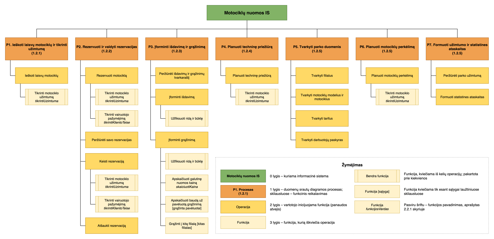{failai=../artefaktai/11-strukturine-schema.drawio,../artefaktai/11-strukturine-schema.png}

:::

#### Schemos lygiai

Lentelė: Struktūrinės schemos lygiai
| Lygis | Kas pavaizduota | Iš kur paimta |
|---|---|---|
| 0 | Motociklų nuomos IS | – |
| 1 | Procesai P1–P7, skliaustuose – funkcinis reikalavimas | Duomenų srautų diagrama (1.5.1 skyrius), tie patys numeriai ir pavadinimai |
| 2 | Operacijos, kurias inicijuoja vartotojas | Panaudos atvejai, kurie nėra įtraukiami į kitus ryšiu «include» ir nepapildo kitų ryšiu «extend» (1.4 skyrius) |
| 3 | Funkcijos, kurias iškviečia operacija | Panaudos atvejai, įtraukiami ryšiu «include» arba papildantys ryšiu «extend» |

Taip kiekvienas panaudos atvejis PA1–PA22 schemoje yra funkcija tuo pačiu pavadinimu, o grandinė „reikalavimas → panaudos atvejis → procesas → funkcija“ skaitoma be pavadinimų vertimo.

#### Žymėjimas

- Linija jungia funkciją su ją sudarančiomis (iškviečiamomis) funkcijomis.
- **Bendra funkcija** – funkcija, kurią kviečia kelios operacijos. Ji pakartota prie kiekvienos kviečiančios operacijos ir pažymėta stačiakampiu su dvigubomis šoninėmis linijomis – taip blokinėse schemose žymimas iš anksto apibrėžtas procesas (paprogramė), aprašytas kitoje vietoje.
- **[sąlyga]** – funkcija kviečiama tik esant sąlygai laužtiniuose skliaustuose (kaip «extend» sąlygos panaudos atvejų diagramoje).
- **Pasviru šriftu** – funkcijos pavadinimas programoje; šios funkcijos išsamiai aprašytos 2.2.1 skyriuje.
- Diagramoje yra žymėjimo legenda.

#### Funkcijos

Lentelė: Struktūrinės schemos funkcijos {#lent:funkcijos}
| Funkcija | Lygis | Procesas | Panaudos atvejis | Reikalavimas | Kviečia |
|---|---|---|---|---|---|
| Ieškoti laisvų motociklų | 2 | P1 | PA1 | FR 1.2.1 | Tikrinti motociklo užimtumą |
| Tikrinti motociklo užimtumą (`tikrintiUzimtuma`) | 3 | P1 | PA6 | FR 1.2.1, FR 1.2.2, FR 1.2.4, FR 1.2.5 | – |
| Rezervuoti motociklą | 2 | P2 | PA2 | FR 1.2.2 | Tikrinti motociklo užimtumą, Tikrinti vairuotojo pažymėjimą |
| Peržiūrėti savo rezervacijas | 2 | P2 | PA3 | FR 1.2.2 | – |
| Keisti rezervaciją | 2 | P2 | PA4 | FR 1.2.2 | Tikrinti motociklo užimtumą, Tikrinti vairuotojo pažymėjimą |
| Atšaukti rezervaciją | 2 | P2 | PA5 | FR 1.2.2 | – |
| Tikrinti vairuotojo pažymėjimą (`tikrintiKlientoTeise`) | 3 | P2 | PA7 | FR 1.2.2 | – |
| Peržiūrėti išdavimų ir grąžinimų tvarkaraštį | 2 | P3 | PA8 | FR 1.2.3 | – |
| Įforminti išdavimą | 2 | P3 | PA9 | FR 1.2.3 | Užfiksuoti ridą ir būklę |
| Įforminti grąžinimą | 2 | P3 | PA10 | FR 1.2.3 | Užfiksuoti ridą ir būklę, Apskaičiuoti galutinę nuomos kainą, Apskaičiuoti baudą už pavėluotą grąžinimą [grąžinta pavėluotai], Grąžinti į kitą filialą [kitas filialas] |
| Užfiksuoti ridą ir būklę | 3 | P3 | PA12 | FR 1.2.3 | – |
| Apskaičiuoti galutinę nuomos kainą (`skaiciuotiKaina`) | 3 | P3 | PA13 | FR 1.2.3 | – |
| Apskaičiuoti baudą už pavėluotą grąžinimą | 3 | P3 | PA14 | FR 1.2.3 | – |
| Grąžinti į kitą filialą | 3 | P3 | PA15 | FR 1.2.3 | – |
| Planuoti techninę priežiūrą | 2 | P4 | PA11 | FR 1.2.4 | Tikrinti motociklo užimtumą |
| Tvarkyti filialus | 2 | P5 | PA16 | FR 1.2.5 | – |
| Tvarkyti motociklų modelius ir motociklus | 2 | P5 | PA17 | FR 1.2.5 | – |
| Tvarkyti tarifus | 2 | P5 | PA18 | FR 1.2.5 | – |
| Tvarkyti darbuotojų paskyras | 2 | P5 | PA19 | FR 1.2.5 | – |
| Planuoti motociklų perkėlimą | 2 | P6 | PA22 | FR 1.2.5 | Tikrinti motociklo užimtumą |
| Peržiūrėti parko užimtumą | 2 | P7 | PA20 | FR 1.2.5 | – |
| Formuoti statistines ataskaitas | 2 | P7 | PA21 | FR 1.2.5 | – |

Lentelėje kiekviena funkcija nurodyta vieną kartą; „Tikrinti motociklo užimtumą“ priskirta P1, nes duomenų srautų diagramoje užimtumą tikrina tik P1, o P2, P4 ir P6 kreipiasi į jį.

#### Modelio sprendimai

- **Šakos – pagal duomenų srautų diagramos procesus P1–P7**, o ne pagal funkcinius reikalavimus FR 1.2.1–FR 1.2.5. Reikalavimą FR 1.2.5 įgyvendina trys skirtingi procesai (P5, P6, P7), o P1 tikrina užimtumą keliems reikalavimams, todėl šakos pagal reikalavimus nesutaptų su duomenų srautų diagrama. Reikalavimo numeris vis tiek nurodytas kiekviename procese.
- **2 ir 3 lygiai sudaryti pagal panaudos atvejų ryšius.** Operacija (2 lygis) – panaudos atvejis, kurį tiesiogiai inicijuoja aktorius; jos iškviečiamos funkcijos (3 lygis) – panaudos atvejai, kuriuos ji įtraukia («include») arba kurie ją papildo («extend»). Funkcijų pavadinimai sutampa su panaudos atvejų pavadinimais.
- **Bendros funkcijos pakartotos.** „Tikrinti motociklo užimtumą“ kviečia penkios operacijos (kaip PA6 «include» – PA1, PA2, PA4, PA11, PA22), „Tikrinti vairuotojo pažymėjimą“ – dvi (PA2, PA4), „Užfiksuoti ridą ir būklę“ – dvi (PA9, PA10). Jei funkcija būtų nubraižyta tik vieną kartą, schemoje nesimatytų, kad, pavyzdžiui, rezervacija tikrina užimtumą. Kad būtų aišku, jog tai ta pati funkcija, visi jos pasikartojimai pažymėti dvigubomis šoninėmis linijomis.
- **Funkcijų pavadinimai programoje** (`tikrintiUzimtuma`, `tikrintiKlientoTeise`, `skaiciuotiKaina`) nurodyti tų funkcijų, kurios išsamiai aprašomos 2.2.1 skyriuje, kad 2.1.1 ir 2.2.1 skyrius būtų galima susieti. `skaiciuotiKaina` apskaičiuoja galutinę kainą kartu su bauda, todėl pavadinimas parašytas prie „Apskaičiuoti galutinę nuomos kainą“, o baudos apskaičiavimas, kaip PA14, lieka atskira sąlygine funkcija.
- **Taisyklės be panaudos atvejo atskiromis funkcijomis nevaizduojamos.** Tarifų galiojimo nepersidengimas ir naudoto tarifo nekeičiamumas, bent vienas motociklas perkėlime, paskyros vaidmens atitiktis savininkui, išdavimas tik grąžinus ankstesnę nuomą ir nurašyto motociklo būsimi laikotarpiai (2.2.2 skyrius, „Taisyklės, kurias tikrina sistemos funkcijos“) – tai operacijų „Tvarkyti tarifus“, „Planuoti motociklų perkėlimą“, „Tvarkyti darbuotojų paskyras“, „Įforminti išdavimą“ ir „Tvarkyti motociklų modelius ir motociklus“ vidiniai patikrinimai. Atskiros funkcijos jiems būtų funkcijos be panaudos atvejo.
- **Neplanuota techninė priežiūra** atskira funkcija nevaizduojama, kaip ir panaudos atvejų bei duomenų srautų diagramose: darbuotojas naudoja „Keisti rezervaciją“ arba „Atšaukti rezervaciją“, tada „Planuoti techninę priežiūrą“ (FR 1.2.4). Taip pat ir **pavėluotas grąžinimas**: kito kliento rezervacija keičiama arba atšaukiama tomis pačiomis operacijomis (2.2.1 skyrius).
- **Prisijungimas ir registracija** nevaizduojami (laikomi bazine funkcija), **perspektyviniai reikalavimai PR 1.6.1–PR 1.6.4** neįtraukti.
- **Išdėstymas.** Procesai išdėstyti septyniais vienodo pločio stulpeliais, sistema – virš jų centre. 2 ir 3 lygio funkcijos po procesu surašytos vertikaliai su įtrauka, kaip darbų išskaidymo schemoje: išdėsčius 16 operacijų horizontaliai, schema būtų per plati ataskaitos puslapiui.

### 2.1.2. Duomenų modelis

Fizinė ER diagrama sudaryta iš loginės ER diagramos (1.5.2 skyrius). Kiekviena esybė tapo lentele, `M:N` ryšiai – atskiromis lentelėmis, o `1:N` ir `1:1` ryšiai – išoriniais raktais. Diagrama nubraižyta varnos pėdos žymėjimu: lentelė vaizduojama trimis stulpeliais (raktas, atributas, duomenų tipas), ryšys jungia pirminio rakto eilutę su išorinio rakto eilute, o linijos galai rodo, kiek įrašų gali būti kiekvienoje ryšio pusėje (kodėl kiekvienas ryšys toks – 2.2.2 skyriaus poskyris „Ryšiai“). Lentelės nuspalvintos pagal tas pačias sritis kaip loginėje diagramoje. Diagramoje rodomi tik pirminiai ir išoriniai raktai, atributų pavadinimai ir duomenų tipai; kiti apribojimai (`NOT NULL`, `UNIQUE`, `CHECK`, numatytosios reikšmės) aprašyti lentelių aprašyme.

::: gulscias

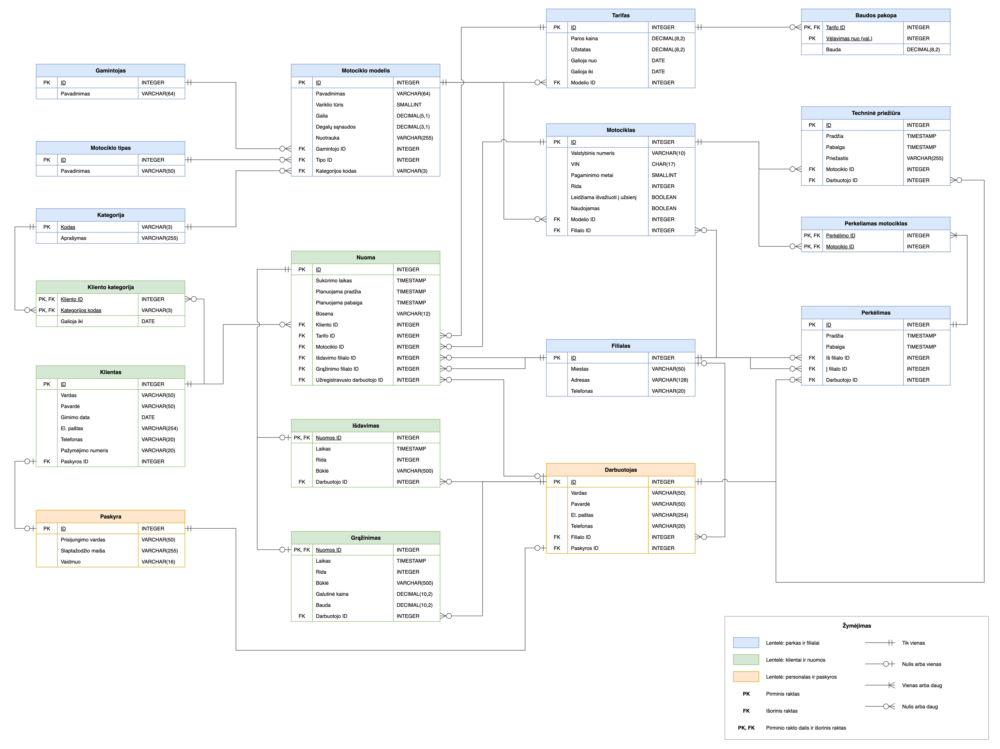{failai=../artefaktai/10-fizinis-er.drawio,../artefaktai/10-fizinis-er.png}

:::

## 2.2. Detalus sistemos projektavimas

### 2.2.1. Sistemos struktūros aprašymas

Šablonas prašo išsamiai aprašyti 2–3 sistemos funkcijas. Aprašomos trys funkcijos, kurios tikrina ir skaičiuoja tai, ko duomenų bazės apribojimais išreikšti negalima (2.2.2 skyrius, „Taisyklės, kurias tikrina sistemos funkcijos“):

Lentelė: Išsamiai aprašomos funkcijos
| Funkcija programoje | Pavadinimas (panaudos atvejis) | Procesas | Struktūrinės schemos lygis | Reikalavimai |
|---|---|---|---|---|
| `tikrintiUzimtuma` | Tikrinti motociklo užimtumą (PA6) | P1 | 3, kviečia PA1, PA2, PA4, PA11, PA22 | FR 1.2.1, FR 1.2.2, FR 1.2.4, FR 1.2.5, NFR 1.3.2.4, NFR 1.3.3.3 |
| `tikrintiKlientoTeise` | Tikrinti vairuotojo pažymėjimą (PA7) | P2 | 3, kviečia PA2, PA4 | FR 1.2.2, NFR 1.3.2.4 |
| `skaiciuotiKaina` | „Apskaičiuoti galutinę nuomos kainą“ (PA13) ir „Apskaičiuoti baudą už pavėluotą grąžinimą“ (PA14) | P3 | 3, kviečia PA10 | FR 1.2.3 |

Funkcijų pavadinimai programoje tokie pat kaip struktūrinėje schemoje (2.1.1 skyrius), todėl 2.1.1 ir 2.2.1 skyrius galima susieti. Kintamųjų tipai – tie patys SQL standarto tipai kaip duomenų bazės lentelėse (2.2.2 skyrius). Abi tikrinimo funkcijos grąžina ne tik atsakymą, bet ir atsisakymo priežastį, kurią sistema parodo vartotojui (NFR 1.3.2.4). Algoritmai aprašyti sunumeruotais žingsniais (šablonas leidžia laisvą formą).

#### Bendros sąvokos

**Motociklo užimtumo laikotarpis** – laikas, kai motociklo negalima išnuomoti kitam klientui:

- **Nuoma** prasideda planuojama pradžia, net jei klientas motociklą pasiima anksčiau: kaina ir grąžinimo laikas nuo to nesikeičia. Rezervuota nuoma baigiasi planuojama pabaiga. Grąžinta nuoma baigiasi grąžinimo laiku – ir grąžinus anksčiau, ir pavėlavus. Vykstanti nuoma baigiasi vėlesniu iš dviejų laikų: planuojamos pabaigos ir dabartinio laiko. Taip vėluojanti nuoma lieka užimtumo laikotarpiu tol, kol motociklas negrąžintas. Nuoma prasideda išdavimo filiale ir baigiasi grąžinimo filiale. Atšaukta nuoma laiko neužima.
- **Techninė priežiūra** trunka nuo „Pradžia“ iki „Pabaiga“. Ji vyksta ten, kur motociklas yra, ir jo vietos nekeičia.
- **Perkėlimas** trunka nuo „Pradžia“ iki „Pabaiga“, prasideda filiale „iš“ ir baigiasi filiale „į“.

Laikotarpiai sutampa, jei vienas prasideda anksčiau, nei baigiasi kitas, ir atvirkščiai. Kai vienas baigiasi tą pačią minutę, kai prasideda kitas, jie nesutampa (@pav:sutapimas pav.). Motociklo buvimo vietos taisyklė aprašyta 1.5.2.4 skyriuje.

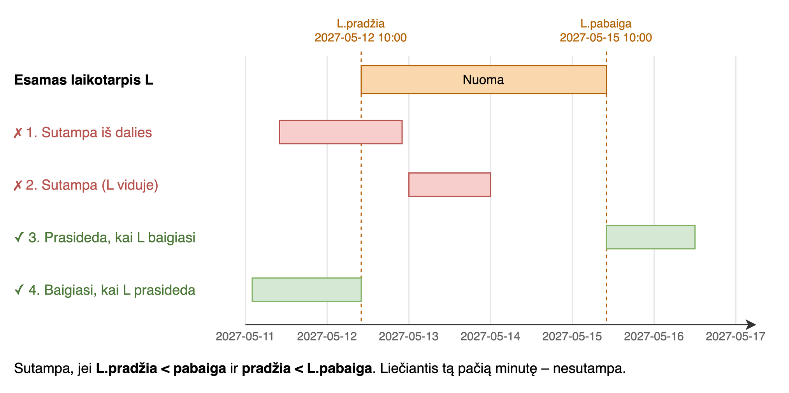{failai=../artefaktai/12-sutapimas.drawio,../artefaktai/12-sutapimas.png}

**Dabartinis laikas** – sistemos laikrodžio reikšmė. Funkcijos jo negauna kaip įėjimo.

#### `tikrintiUzimtuma` – Tikrinti motociklo užimtumą

**Paskirtis.** Patikrina, ar motociklas norimu laikotarpiu užimtas: ar laikotarpis sutampa su kitu to motociklo užimtumo laikotarpiu ir ar pažeidžiama motociklo buvimo vietos taisyklė. Funkcija duomenų nekeičia. Ją kviečia:

- paieška (PA1): kiekvienam motociklui, o išdavimo ir grąžinimo filialas – paieškoje pasirinktas filialas; rezultatuose rodomi tik neužimti motociklai (FR 1.2.1);
- rezervacijos sukūrimas ir keitimas (PA2, PA4);
- techninės priežiūros planavimas (PA11);
- perkėlimo planavimas (PA22): kiekvienam perkeliamam motociklui atskirai.

**Įėjimai.**

Lentelė: Funkcijos `tikrintiUzimtuma` įėjimai
| Kintamasis | Tipas | Reikšmė |
|---|---|---|
| `motociklasId` | `INTEGER` | Tikrinamas motociklas |
| `pradzia` | `TIMESTAMP` | Naujo laikotarpio pradžia |
| `pabaiga` | `TIMESTAMP` | Naujo laikotarpio pabaiga |
| `pradziosFilialasId` | `INTEGER`, gali būti tuščias | Nuomos išdavimo filialas arba perkėlimo filialas „iš“; techninei priežiūrai tuščias |
| `pabaigosFilialasId` | `INTEGER`, gali būti tuščias | Nuomos grąžinimo filialas arba perkėlimo filialas „į“; techninei priežiūrai tuščias |
| `keiciamaNuomaId` | `INTEGER`, gali būti tuščias | Keičiama rezervacija (PA4); jos senasis laikotarpis netikrinamas |

**Algoritmas.**

1. Nuskaityti motociklą. Jei jis nebenaudojamas, grąžinti (`true`, „Motociklas nebenaudojamas“).
2. Surinkti dar nesibaigusius motociklo užimtumo laikotarpius (pasibaigusių nereikia: grąžinant ir baigiantis perkėlimui sistema įrašo naują motociklo filialą, todėl jų rezultatas jau yra motociklo duomenyse):
   - rezervuotas ir vykstančias nuomas, išskyrus `keiciamaNuomaId`;
   - techninę priežiūrą ir perkėlimus, kurių pabaiga vėlesnė už dabartinį laiką.
3. Jei kuris nors laikotarpis L sutampa su naujuoju (`L.pradžia < pabaiga` ir `pradzia < L.pabaiga`), grąžinti (`true`, „Motociklas užimtas {L.pradžia} – {L.pabaiga} ({nuoma / techninė priežiūra / perkėlimas})“).
4. Jei `pradziosFilialasId` tuščias (techninė priežiūra), grąžinti (`false`, –): priežiūra motociklo vietos nekeičia.
5. Rasti ankstesnį laikotarpį – paskutinę 2 žingsnio nuomą ar perkėlimą, kurio `pabaiga ≤ pradzia`. Motociklo filialas laikotarpio pradžioje yra ankstesnio laikotarpio pabaigos filialas, o jei tokio laikotarpio nėra – dabartinis motociklo filialas.
6. Jei šis filialas ≠ `pradziosFilialasId`, grąžinti (`true`, „Laikotarpio pradžioje motociklas bus filiale {filialas}“).
7. Rasti kitą laikotarpį – pirmą 2 žingsnio nuomą ar perkėlimą, kurio `pradžia ≥ pabaiga`. Jei toks yra ir jo pradžios filialas ≠ `pabaigosFilialasId`, grąžinti (`true`, „Motociklą reikia grąžinti į filialą {filialas}, nes {data} ten prasideda kita jo nuoma“; jei kitas laikotarpis – perkėlimas, pabaiga „… kitas jo perkėlimas“).
8. Grąžinti (`false`, –).

**Išėjimas.** Funkcija grąžina du kintamuosius:

- `uzimtas` (`BOOLEAN`) – `true`, jei laikotarpio įrašyti negalima;
- `priezastis` (`VARCHAR(255)`) – kodėl motociklas užimtas (tuščia, kai jis laisvas).

**Pavyzdžiai** (bandomieji duomenys). Motociklas CB500 Hornet yra Vilniuje ir rezervuotas 2027-05-12 10:00 – 2027-05-15 10:00 su grąžinimu į Klaipėdą (@pav:sutapimas ir @pav:buvimo-vieta pav.):

- nuoma 2027-05-13 – 2027-05-14 → „Motociklas užimtas 2027-05-12 10:00 – 2027-05-15 10:00 (nuoma)“;
- nuoma 2027-05-20 – 2027-05-22 Vilniuje → „Laikotarpio pradžioje motociklas bus filiale Klaipėda“;
- nuoma 2027-05-05 – 2027-05-08 su grąžinimu į Kauną → „Motociklą reikia grąžinti į filialą Vilnius, nes 2027-05-12 10:00 ten prasideda kita jo nuoma“; su grąžinimu į Vilnių – motociklas laisvas.

##### Naudojimas įrašant laikotarpį (NFR 1.3.3.3)

Funkcija tik tikrina ir užraktų nevaldo, todėl pati negali užtikrinti, kad tarp patikrinimo ir įrašymo kitas vartotojas neužims to paties motociklo. Tai užtikrina ją kviečianti operacija – rezervacijos sukūrimas ar keitimas (PA2, PA4), techninės priežiūros planavimas (PA11), perkėlimo planavimas (PA22). Viską ji atlieka vienoje transakcijoje:

1. pradeda transakciją;
2. užrakina motociklo įrašą (perkėlime – visų perkeliamų motociklų įrašus didėjančia ID tvarka, kad dvi operacijos neužblokuotų viena kitos), o rezervuodama – ir taikomo tarifo įrašą bendru užraktu;
3. iškviečia `tikrintiUzimtuma` (rezervuodama – ir `tikrintiKlientoTeise`);
4. jei motociklas užimtas, atšaukia transakciją ir parodo priežastį (NFR 1.3.2.4), kitaip įrašo laikotarpį;
5. patvirtina transakciją – tik tada užraktai nuimami.

Antroji operacija su tuo pačiu motociklu laukia 2 žingsnyje. Gavusi užraktą, ji tikrina jau matydama pirmosios įrašytą rezervaciją ir gauna „Motociklas užimtas“. Taip iš dviejų vienu metu pateiktų rezervacijų įrašoma tik viena, o antrajam vartotojui pranešama, kad motociklas užimtas (NFR 1.3.3.3, @pav:lygiagreti pav.). Užraktas laikomas tik vienos transakcijos metu, todėl atsako laikui (NFR 1.3.3.1) įtakos neturi. Paieška (PA1) motociklų neužrakina: jos rezultatas gali pasenti, bet galutinai užimtumas patikrinamas rezervuojant.

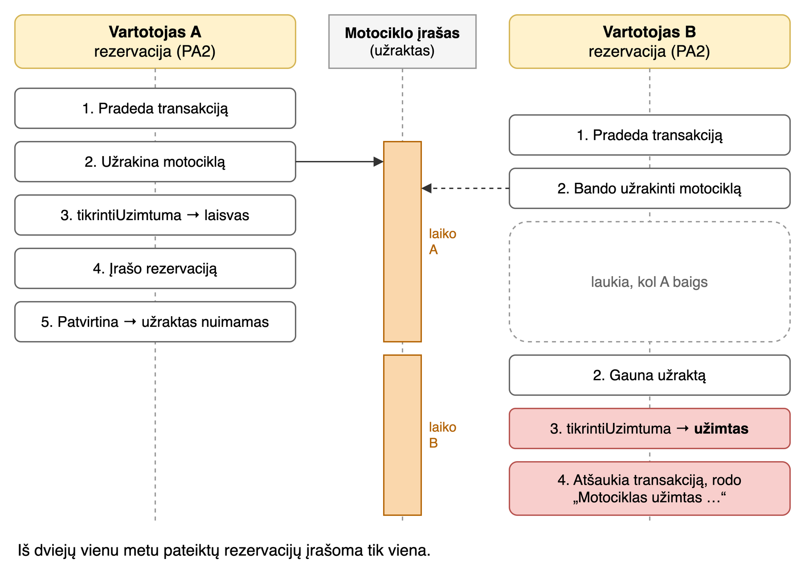{plotis=14 failai=../artefaktai/12-lygiagreti-rezervacija.drawio,../artefaktai/12-lygiagreti-rezervacija.png}

Užraktas nėra duomenų srautas, todėl duomenų srautų diagramoje (1.5.1 skyrius) nevaizduojamas: ten P2, P4 ir P6 siunčia P1 motociklą ir laikotarpį, gauna atsakymą ir patys įrašo duomenis į saugyklą.

##### Pavėluotas grąžinimas

Funkcija neleidžia suplanuoti laikotarpio, kuris sutampa su jau suplanuotu, bet vėlavimo iš anksto žinoti negalima: klientas gali negrąžinti motociklo laiku, kai po jo motociklas jau rezervuotas. Todėl:

1. išduoti motociklą (PA9) galima tik tada, kai jis yra išdavimo filiale ir neturi vykstančios nuomos, techninės priežiūros ar perkėlimo, t. y. ankstesnė nuoma jau užbaigta (motociklas grąžintas);
2. filialo tvarkaraštyje (PA8) vėluojanti nuoma pažymima, o šalia parodomas kitas to motociklo laikotarpis;
3. darbuotojas susisiekia su kitu klientu, kaip ir neplanuotos techninės priežiūros atveju (FR 1.2.4), ir perkelia rezervaciją į kitą laisvą motociklą (PA4) arba ją atšaukia (PA5). Jei klientas sutinka palaukti, motociklą grąžinus darbuotojas pakeičia rezervacijos pradžią į išdavimo laiką (PA4), todėl kaina skaičiuojama už trumpesnį laikotarpį; tarifas nesikeičia. Ar laukusiam klientui taikoma kompensacija, sprendžia įmonės verslo taisyklės – pirmoje versijoje nuolaidų nėra (perspektyvinis reikalavimas PR 1.6.4);
4. pavėlavęs klientas moka baudą pagal baudų pakopas (`skaiciuotiKaina`).

Jei po vėluojančios nuomos suplanuota techninė priežiūra ar perkėlimas, juos perplanuoja darbuotojas arba administratorius.

Pavyzdys (bandomieji duomenys, G 310 R Vilniuje): nuoma 2026-11-10 10:00 – 2026-11-12 10:00 grąžinta 13:00, t. y. 3 val. pavėluotai. Kito kliento rezervacija buvo suplanuota nuo 11:00 iki 2026-11-13 13:00 (26 val., 2 paros). Klientas palaukė, todėl jo rezervacijos pradžia pakeista į išdavimo laiką 13:20 (23 val. 40 min., 1 para; @pav:pavelavimas pav.).

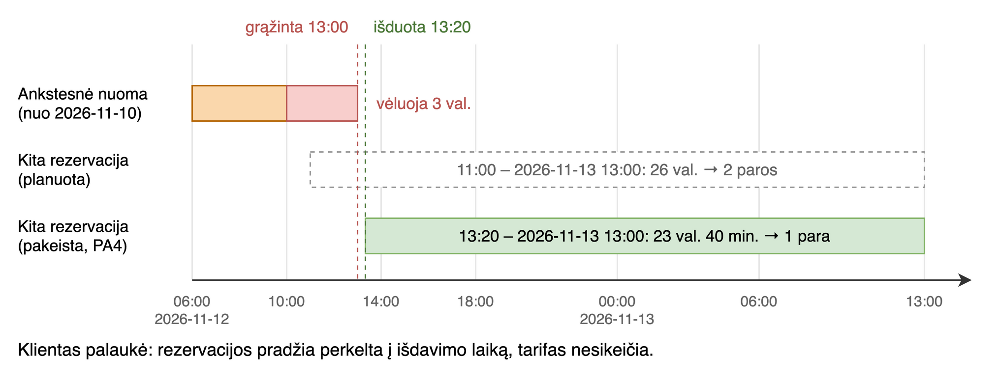{failai=../artefaktai/12-pavelavimas.drawio,../artefaktai/12-pavelavimas.png}

#### `tikrintiKlientoTeise` – Tikrinti vairuotojo pažymėjimą

**Paskirtis.** Patikrina, ar klientas turi motociklo modeliui reikiamą vairuotojo pažymėjimo kategoriją, galiojančią visą nuomos laikotarpį (FR 1.2.2). Kviečiama rezervuojant ir keičiant rezervaciją (PA2, PA4) toje pačioje transakcijoje kaip `tikrintiUzimtuma`.

**Įėjimai.**

Lentelė: Funkcijos `tikrintiKlientoTeise` įėjimai
| Kintamasis | Tipas | Reikšmė |
|---|---|---|
| `klientasId` | `INTEGER` | Klientas, kuriam rezervuojama |
| `motociklasId` | `INTEGER` | Rezervuojamas motociklas |
| `pabaiga` | `TIMESTAMP` | Planuojama nuomos pabaiga |

**Algoritmas.**

1. Reikiama kategorija – motociklo modelio „Kategorijos kodas“.
2. Rasti kliento kategoriją su šiuo kodu. Jei jos nėra, grąžinti (`false`, „Vairuotojo pažymėjime nėra {kodas} kategorijos“).
3. Jei kategorijos „Galioja iki“ data ankstesnė už nuomos pabaigos datą, grąžinti (`false`, „{kodas} kategorija galioja iki {data}, o nuoma baigiasi {data}“). Kategorija, kuri baigia galioti nuomos pabaigos dieną, dar tinka.
4. Grąžinti (`true`, –).

**Išėjimas.** Funkcija grąžina du kintamuosius:

- `turiTeise` (`BOOLEAN`) – `true`, jei klientas turi teisę vairuoti motociklą visą nuomos laikotarpį;
- `priezastis` (`VARCHAR(255)`) – kodėl neturi (tuščia, kai turi).

Nuomos pradžios funkcijai nereikia: kategorija neturi pradžios datos, todėl jei ji galioja nuomos pabaigoje, galioja ir pradžioje. Tikrinamas tik tikslus kategorijos kodas: kuri kategorija apima kurią, sistema nesaugo, o registruojant pažymėjimą pažymimos visos kategorijos, kurias jis suteikia (pvz., turint A – ir A1, A2; žr. 1.5.2.3 skyrių).

**Pavyzdžiai.** Klientas, kurio A kategorija galioja iki 2027-05-10, gali išsinuomoti F 900 R 2027-04-14 – 2027-04-18, bet ne iki 2027-05-12 („A kategorija galioja iki 2027-05-10, o nuoma baigiasi 2027-05-12“). Klientui, turinčiam tik A1, Panigale V2 neleidžiama („Vairuotojo pažymėjime nėra A kategorijos“).

#### `skaiciuotiKaina` – Apskaičiuoti galutinę nuomos kainą

**Paskirtis.** Grąžinant apskaičiuoja galutinę nuomos kainą ir baudą už pavėluotą grąžinimą pagal nuomai priskirtą tarifą ir jo baudų pakopas (FR 1.2.3). Tai tas pats tarifas, kurį klientas matė rezervacijos patvirtinime (FR 1.2.2). Funkciją kviečia grąžinimo įforminimas (PA10). Galutinę kainą ir baudą ši operacija įrašo į Grąžinimą, kur jos saugomos kaip užfiksuotas atsiskaitymo rezultatas (2.2.2 skyrius, „Normalizacija“).

**Įėjimai.**

Lentelė: Funkcijos `skaiciuotiKaina` įėjimai
| Kintamasis | Tipas | Reikšmė |
|---|---|---|
| `nuomaId` | `INTEGER` | Grąžinama nuoma |
| `grazinimoLaikas` | `TIMESTAMP` | Faktinis grąžinimo laikas |

**Algoritmas.**

1. Nuskaityti nuomos planuojamą pradžią ir pabaigą bei nuomos tarifo paros kainą.
2. `paros` = ⌈(planuojama pabaiga − planuojama pradžia) / 24 val.⌉ – parų skaičius, suapvalintas į viršų. Pabaiga visada vėlesnė už pradžią (`CHECK` apribojimas lentelėje Nuoma), todėl `paros ≥ 1`. Jei taip nėra, funkcija grąžina klaidą ir kainos neskaičiuoja.
3. `nuomosKaina` = `paros` × paros kaina.
4. `velavimas` = (`grazinimoLaikas` − planuojama pabaiga) valandomis.
5. Jei `velavimas ≤ 0`, `bauda = 0`: grąžinus anksčiau kaina nemažinama. Kitaip (PA14) imama tarifo baudos pakopa su didžiausia „Vėlavimas nuo (val.)“ reikšme, neviršijančia vėlavimo; `bauda` = jos suma. Jei tokios pakopos nėra (vėluojama mažiau nei pirmoji pakopa arba tarifas pakopų neturi), `bauda = 0`.
6. `galutineKaina = nuomosKaina + bauda`.

**Išėjimas.** Funkcija grąžina du kintamuosius:

- `galutineKaina` (`DECIMAL(10,2)`) – visa suma eurais su bauda;
- `bauda` (`DECIMAL(10,2)`) – bauda už pavėluotą grąžinimą eurais.

Užstatas į galutinę kainą neįeina: jis sumokamas ir grąžinamas filiale atskirai. Bauda nesumuojama: vėluojant 30 val. taikoma tik pakopa „nuo 24 val.“. Paskutinė pakopa viršutinės ribos neturi, todėl įmonė ją nustato pakankamai didelę, o klientas visą baudų lentelę mato rezervacijos patvirtinime (FR 1.2.2). Kai rezervacijos laikotarpis pakeičiamas (PA4), funkcija skaičiuoja pagal naują laikotarpį.

**Pavyzdys.** NC750X, 2 paros po 84 €, baudų pakopos „nuo 0 val. – 10 €“, „nuo 2 val. – 30 €“, „nuo 24 val. – 84 €“:

- grąžinta laiku arba anksčiau → 168 €;
- 10 min. vėliau → 178 € (bauda 10 €);
- 3 val. 33 min. vėliau → 198 € (bauda 30 €).

#### Kitos taisyklės, kurias tikrina operacijos

Šios taisyklės nėra atskiros funkcijos (2.1.1 skyrius): jas tikrina pačios operacijos tuo pačiu principu – pirma užrakina įrašą, nuo kurio priklauso patikrinimas, tada tikrina, tada rašo.

- **Tarifo keitimas (PA18).** Tarifas, pagal kurį jau yra rezervacijų, nekeičiamas. Rezervuojant tarifo įrašas užrakinamas bendru užraktu: kelios rezervacijos viena kitai netrukdo, o tarifo keitimas laukia, kol jos baigsis, ir tik gavęs užraktą tikrina, ar yra rezervacijų.
- **Motociklo nurašymas (PA17).** Nebenaudojamas motociklas neturi būsimų užimtumo laikotarpių. Nurašymas užrakina motociklo įrašą ir tik tada patikrina, ar būsimų laikotarpių nėra; `tikrintiUzimtuma` 1 žingsnis tą patį užtikrina iš rezervacijos pusės.
- **Išdavimas (PA9).** Motociklas yra išdavimo filiale, o pagal ankstesnę nuomą jis jau grąžintas (žr. „Pavėluotas grąžinimas“).
- **Ridos fiksavimas (PA12).** Grąžinant rida ne mažesnė nei išduodant.

### 2.2.2. Duomenų modelio aprašymas
#### Bendri sprendimai

- **Duomenų bazių valdymo sistema nepasirinkta.** Naudojami tik SQL standarto duomenų tipai: `INTEGER`, `SMALLINT`, `DECIMAL`, `VARCHAR`, `CHAR`, `DATE`, `TIMESTAMP`, `BOOLEAN`. Pavadinimai tokie pat kaip loginėje diagramoje, o išorinio rakto pavadinime nurodoma lentelė, į kurią jis rodo (pvz., „Filialo ID“).
- **Pirminiai raktai.** Loginio modelio „Kodas“ tampa sveikojo skaičiaus pirminiu raktu „ID“, kurį sistema sugeneruoja automatiškai. Toks raktas nesikeičia ir yra trumpas išoriniuose raktuose. Išimtis – Kategorija: jos raktas yra pati kategorijos žymė „Kodas“ (AM, A1, A2, A), nes ji trumpa, nekinta ir suprantama be papildomos užklausos. Paskyros raktas taip pat „ID“, o loginio modelio raktas „Prisijungimo vardas“ tapo unikaliu atributu, kad jį būtų galima pakeisti nekeičiant susijusių įrašų.
- **Laikas ir datos.** Visi motociklo užimtumo laikotarpiai – nuomos planuojama pradžia ir pabaiga, išdavimo ir grąžinimo laikas, techninės priežiūros ir perkėlimo pradžia ir pabaiga – saugomi kaip `TIMESTAMP`, nes prieinamumą reikia rodyti tiksliai, o vėlavimas skaičiuojamas valandomis. `DATE` naudojama tik kalendorinėms datoms, nesusijusioms su užimtumu: tarifo galiojimui (tarifas parenkamas pagal rezervavimo dieną), kategorijos galiojimui ir gimimo datai.
- **Pinigų sumos** saugomos kaip `DECIMAL` eurais (ne slankiojo kablelio skaičiai), kad nebūtų apvalinimo klaidų.
- **Silpnos esybės.** Išdavimo ir Grąžinimo pirminis raktas kartu yra išorinis raktas į Nuomą („Nuomos ID“), todėl kiekviena nuoma turi ne daugiau kaip vieną išdavimą ir vieną grąžinimą. Baudos pakopos pirminis raktas sudėtinis: tarifas ir dalinis raktas „Vėlavimas nuo (val.)“.
- **`M:N` ryšiai** tapo lentelėmis su sudėtiniu pirminiu raktu: Kliento kategorija (ryšys „turi teisę“ su atributu „Galioja iki“) ir Perkeliamas motociklas (ryšys „perkeliamas“). Kiekvieno ryšio kardinalumas ir privalomumas paaiškintas skyriuje „Ryšiai“.
- **Ryšiai `1:1` su Paskyra.** Išorinis raktas „Paskyros ID“ yra Kliento ir Darbuotojo lentelėse ir yra unikalus. Klientui jis neprivalomas (klientą be paskyros gali užregistruoti darbuotojas), darbuotojui privalomas.
- **Įrašų trynimas.** Kartu su pagrindiniu įrašu ištrinami tik nuo jo priklausantys įrašai: tarifo baudų pakopos, kliento kategorijos ir perkėlimo motociklai. Kitų įrašų, į kuriuos yra nuorodų, ištrinti negalima: užbaigtos nuomos ir jų istorija saugomos ne trumpiau kaip 5 metus (NFR 1.3.4.2), o nebenaudojamo motociklo požymis „Naudojamas“ išjungiamas (motociklas netrinamas).
- **Normalizacija.** Lentelės atitinka trečiąją normalinę formą: reikšmės atominės, o neraktiniai atributai priklauso tik nuo viso pirminio rakto. Sąmoningas nukrypimas – Grąžinimo „Galutinė kaina“ ir „Bauda“. Tai išvestiniai atributai, kuriuos galima apskaičiuoti iš tarifo, nuomos laikų ir baudų pakopų, bet jie saugomi kaip užfiksuotas atsiskaitymo su klientu rezultatas: skaičiavimo taisyklės gali keistis, o perskaičiuotos senų nuomų sumos nebesutaptų su sumokėtomis.
- **Klasifikatoriai.** Gamintojas, Motociklo tipas ir Kategorija – atskiros lentelės, nes jų reikšmės kartojasi daugelyje modelių, pagal jas ieškoma ir grupuojamos ataskaitos, o įvedant tekstą ta pati reikšmė galėtų būti užrašyta skirtingai. Gamintojus ir tipus tvarko administratorius kartu su modeliais (FR 1.2.5), kategorijos įvedamos diegiant sistemą. Nuomos „Būsena“ ir Paskyros „Vaidmuo“ į atskiras lenteles neiškeliami: jų reikšmių sąrašą nustato ne įmonė, o pati sistema (nuo būsenos priklauso nuomos eiga, nuo vaidmens – leidžiami veiksmai, NFR 1.3.5.1), todėl nauja reikšmė be programos pakeitimų nebūtų naudinga. Šių atributų leistinos reikšmės apribotos `CHECK` sąlyga. Filialo „Miestas“ nesikartoja (kiekvienas filialas kitame mieste), o techninės priežiūros „Priežastis“ – laisvas aprašymas.
- **Išplečiamumas.** Kadangi kategorijų apimties taisyklės nesaugomos, naujas pažymėjimo kategorijas (pvz., B, C, D) ir naujus motociklų tipus galima pridėti kaip įrašus, nekeičiant schemos. Kitų transporto priemonių nuomai reikėtų tik apibendrinti lentelę „Motociklo modelis“.

##### Taisyklės, kurias tikrina sistemos funkcijos

Kai kurių taisyklių duomenų bazės apribojimais (`PK`, `FK`, `UNIQUE`, `NOT NULL`, `CHECK`) išreikšti negalima, nes jos apima kelias lenteles ar kelis įrašus. Jas tikrina sistemos funkcijos ir operacijos (2.2.1 skyrius) prieš įrašydamos duomenis:

- motociklo užimtumo laikotarpiai (nuomos, techninė priežiūra, perkėlimai) nepersidengia ir atitinka motociklo buvimo vietos taisyklę (1.5.2 skyrius) – funkcija `tikrintiUzimtuma`. Ją kviečianti operacija pirmiausia užrakina motociklo įrašą, tada iškviečia funkciją ir įrašo laikotarpį toje pačioje transakcijoje; įrašas atrakinamas tik transakcijos pabaigoje, todėl iš dviejų vienu metu pateiktų rezervacijų įrašoma tik viena (NFR 1.3.3.3);
- vieno modelio tarifų galiojimo laikotarpiai nepersidengia, o tarifas, pagal kurį jau yra rezervacijų, nekeičiamas (uždaromas data „Galioja iki“); rezervacija tarifo įrašą užrakina bendru užraktu, todėl tarifo keitimas laukia, kol ji bus įrašyta;
- nuomos tarifas priklauso nuomojamo motociklo modeliui ir galiojo rezervavimo dieną;
- perkėlimas turi bent vieną motociklą (diagramoje – „vienas arba daug“);
- klientas turi modeliui reikiamą kategoriją, galiojančią visą nuomos laikotarpį – funkcija `tikrintiKlientoTeise`;
- motociklas išduodamas tik tada, kai jis yra išdavimo filiale, o pagal ankstesnę nuomą jis jau grąžintas;
- rida grąžinant ne mažesnė nei išduodant – tikrinama fiksuojant ridą ir būklę;
- „Galutinė kaina“ ir „Bauda“ apskaičiuojamos pagal nuomos tarifą ir baudų pakopas – funkcija `skaiciuotiKaina`;
- nebenaudojamas (nurašytas) motociklas neturi būsimų užimtumo laikotarpių: nurašymas užrakina motociklo įrašą ir tik tada tikrina, ar jų nėra;
- paskyros vaidmuo atitinka, kam ji priklauso (kliento paskyra – vaidmuo „klientas“, darbuotojo – „darbuotojas“ arba „administratorius“).

Motociklo užimtumo laikotarpis apibrėžtas 2.2.1 skyriuje: nuoma prasideda planuojama pradžia, o baigiasi grąžinimo laiku (jei motociklas grąžintas), vykstanti – ne anksčiau nei dabartiniu laiku, rezervuota – planuojama pabaiga.

##### Ryšys su loginiu modeliu ir duomenų srautų diagrama

Lentelė: Duomenų saugyklų, loginės ER diagramos esybių ir lentelių atitiktis
| Saugykla (1.5.1 skyrius) | Loginės ER esybės | Lentelės |
|---|---|---|
| DS1 Filialai | Filialas | Filialas |
| DS2 Motociklai | Motociklas, Motociklo modelis, Gamintojas, Motociklo tipas, Kategorija | Motociklas, Motociklo modelis, Gamintojas, Motociklo tipas, Kategorija |
| DS3 Tarifai | Tarifas, Baudos pakopa | Tarifas, Baudos pakopa |
| DS4 Klientai | Klientas, ryšys „turi teisę“ | Klientas, Kliento kategorija |
| DS5 Nuomos | Nuoma, Išdavimas, Grąžinimas | Nuoma, Išdavimas, Grąžinimas |
| DS6 Techninė priežiūra | Techninė priežiūra | Techninė priežiūra |
| DS7 Perkėlimai | Perkėlimas, ryšys „perkeliamas“ | Perkėlimas, Perkeliamas motociklas |
| DS8 Darbuotojai ir paskyros | Darbuotojas, Paskyra | Darbuotojas, Paskyra |

Kiekviena lentelė priklauso vienai saugyklai, todėl duomenų srautų diagramos keisti nereikia.

#### Ryšiai

Diagramoje yra 29 ryšiai. Kiekvienas jungia tėvinės lentelės pirminį raktą su vaikinės lentelės išoriniu raktu. Ryšių pavadinimai tokie pat kaip loginėje ER diagramoje (1.5.2 skyrius); `M:N` ryšiai „turi teisę“ ir „perkeliamas“ fizinėje diagramoje išskaidyti į du `1:N` ryšius per tarpinę lentelę.

Kaip skaityti linijos galus:

- **Ženklas prie tėvinės lentelės** rodo, su kiek tėvinės lentelės įrašų susijęs vienas vaikinės lentelės įrašas. „Tik vienas“ reiškia, kad išorinis raktas privalomas (`NOT NULL`). „Nulis arba vienas“ reiškia, kad išorinis raktas gali būti tuščias.
- **Ženklas prie vaikinės lentelės** rodo, kiek vaikinės lentelės įrašų gali turėti vienas tėvinės lentelės įrašas. „Nulis arba daug“ reiškia, kad tėvinis įrašas gali egzistuoti be vaikinių; „vienas arba daug“ – kad be bent vieno vaikinio įrašo jis neturi prasmės. `1:1` ryšiuose prie vaikinės lentelės yra „nulis arba vienas“: išorinis raktas yra unikalus arba kartu yra pirminis raktas, todėl antro įrašo būti negali.

Pavyzdys: ryšys „apibūdina“ (Motociklo modelis – Motociklas) pažymėtas „tik vienas“ prie Motociklo modelio ir „nulis arba daug“ prie Motociklo. Tai reiškia: kiekvienas motociklas turi lygiai vieną modelį, o modelis gali turėti daug motociklų arba nė vieno.

Lentelėse: **ryšys** – loginės diagramos ryšio pavadinimas; **tėvinė → vaikinė (`FK`)** – tėvinė ir vaikinė lentelė, skliaustuose – vaikinės lentelės išorinis raktas; **kardinalumas**; **ženklai** – prie tėvinės / prie vaikinės lentelės.

##### Parkas, klasifikatoriai ir tarifai

Lentelė: Fizinės ER diagramos ryšiai. Parkas, klasifikatoriai ir tarifai {plotis=9.9,13.4,5.5,9.9,34.8}
| Ryšys | Tėvinė → vaikinė (`FK`) | Kard. | Ženklai | Kodėl taip |
|---|---|---|---|---|
| reikalauja | Kategorija → Motociklo modelis (Kategorijos kodas) | `1:N` | tik vienas / nulis arba daug | Modeliui vairuoti reikia vienos konkrečios kategorijos, be jos negalima patikrinti kliento teisės (FR 1.2.2), todėl raktas privalomas. Ta pati kategorija tinka daugeliui modelių, o kategorija gali būti įvesta, nors parke dar nėra jai priskirto modelio. |
| gamina | Gamintojas → Motociklo modelis (Gamintojo ID) | `1:N` | tik vienas / nulis arba daug | Modelį gamina vienas gamintojas, o gamintojas – daug modelių. Gamintojas įvedamas anksčiau nei jo modeliai. |
| priklauso | Motociklo tipas → Motociklo modelis (Tipo ID) | `1:N` | tik vienas / nulis arba daug | Modelis priskiriamas vienam tipui, kad paieškoje jį būtų galima atrinkti pagal tipą (FR 1.2.1); tipui gali priklausyti daug modelių arba dar nė vieno. |
| apibūdina | Motociklo modelis → Motociklas (Modelio ID) | `1:N` | tik vienas / nulis arba daug | Charakteristikos, nuotrauka ir reikiama kategorija saugomos modelyje, todėl motociklas be modelio neturėtų šių duomenų. Parke yra keli to paties modelio motociklai; modelis įvedamas anksčiau nei motociklai. |
| taikomas | Motociklo modelis → Tarifas (Modelio ID) | `1:N` | tik vienas / nulis arba daug | Tarifas visada nustatomas konkrečiam modeliui. Modelis turi kelis tarifus skirtingiems laikotarpiams (pasikeitus kainai, senas tarifas uždaromas ir sukuriamas naujas); ką tik įvestas modelis tarifo dar neturi. |
| apima | Tarifas → Baudos pakopa (Tarifo ID) | `1:N` | tik vienas / nulis arba daug | Baudos pakopa be tarifo neegzistuoja (silpna esybė). Tarifas gali turėti kelias pakopas arba nė vienos – tada bauda už vėlavimą neskaičiuojama. |
| yra | Filialas → Motociklas (Filialo ID) | `1:N` | tik vienas / nulis arba daug | Motociklas visada yra lygiai viename filiale – tame, iš kurio išduodamas ar kuriame laukia kitos nuomos. Saugomas tik dabartinis filialas (ankstesnės vietos matyti iš nuomų ir perkėlimų), todėl ryšys `1:N`, o ne `M:N`. Filiale gali nebūti nė vieno motociklo. |
| prižiūrimas | Motociklas → Techninė priežiūra (Motociklo ID) | `1:N` | tik vienas / nulis arba daug | Priežiūros laikotarpis visada skirtas vienam motociklui; motociklas prižiūrimas daug kartų arba dar nė karto. |
| perkeliamas (1) | Motociklas → Perkeliamas motociklas (Motociklo ID) | `1:N` | tik vienas / nulis arba daug | Loginio `M:N` ryšio dalis: motociklas per savo naudojimo laiką gali būti perkeltas daug kartų arba nė karto. |
| perkeliamas (2) | Perkėlimas → Perkeliamas motociklas (Perkėlimo ID) | `1:N` | tik vienas / vienas arba daug | Vienu perkėlimu (vienu reisu) vežamas vienas ar keli motociklai, todėl ryšys loginiame modelyje `M:N`. Perkėlimas be motociklų neturi prasmės, todėl „vienas arba daug“; šią sąlygą tikrina perkėlimo planavimo funkcija, nes duomenų bazės apribojimu jos išreikšti negalima. |
| perkeliama iš | Filialas → Perkėlimas (Iš filialo ID) | `1:N` | tik vienas / nulis arba daug | Kiekvienas perkėlimas turi lygiai vieną pradžios filialą. Du ryšiai su ta pačia lentele reikalingi, nes filialas perkėlime atlieka du skirtingus vaidmenis. |
| perkeliama į | Filialas → Perkėlimas (Į filialo ID) | `1:N` | tik vienas / nulis arba daug | Kiekvienas perkėlimas turi lygiai vieną tikslo filialą, kuris skiriasi nuo pradžios filialo (`CHECK`). |

##### Klientai ir nuomos

Lentelė: Fizinės ER diagramos ryšiai. Klientai ir nuomos {plotis=9,11.8,5.5,9.9,34.6}
| Ryšys | Tėvinė → vaikinė (`FK`) | Kard. | Ženklai | Kodėl taip |
|---|---|---|---|---|
| turi teisę (1) | Klientas → Kliento kategorija (Kliento ID) | `1:N` | tik vienas / nulis arba daug | Loginio `M:N` ryšio dalis: kliento pažymėjime gali būti kelios kategorijos, ir kiekvienos galiojimo data skirtinga, todėl „Galioja iki“ priklauso porai klientas–kategorija ir saugoma tarpinėje lentelėje. Klientas gali neturėti nė vienos sistemoje esančios kategorijos (pvz., turi tik B kategorijos pažymėjimą) – tada motociklo rezervacija atmetama (NFR 1.3.2.4). |
| turi teisę (2) | Kategorija → Kliento kategorija (Kategorijos kodas) | `1:N` | tik vienas / nulis arba daug | Ta pati kategorija yra daugelio klientų pažymėjimuose arba dar nė viename. |
| užsako | Klientas → Nuoma (Kliento ID) | `1:N` | tik vienas / nulis arba daug | Kiekviena rezervacija yra lygiai vieno kliento – net jei ją registravo darbuotojas, ji priskiriama klientui. Klientas gali turėti daug nuomų (užbaigtos saugomos, NFR 1.3.4.2) arba dar nė vienos. |
| įkainojama | Tarifas → Nuoma (Tarifo ID) | `1:N` | tik vienas / nulis arba daug | Nuomai taikomas lygiai vienas tarifas – galiojęs rezervavimo dieną; pagal jį skaičiuojama kaina, užstatas ir bauda. Pagal vieną tarifą sudaroma daug nuomų, o naujas tarifas gali būti dar nepanaudotas. |
| nuomojamas | Motociklas → Nuoma (Motociklo ID) | `1:N` | tik vienas / nulis arba daug | Rezervuojamas konkretus motociklas, o ne modelis, nes užimtumas tikrinamas kiekvienam motociklui. Motociklas nuomojamas daug kartų (laikotarpiai nepersidengia) arba dar nė karto. |
| išduodama | Filialas → Nuoma (Išdavimo filialo ID) | `1:N` | tik vienas / nulis arba daug | Išdavimo filialas pasirenkamas rezervuojant ir yra privalomas (FR 1.2.2). |
| grąžinama | Filialas → Nuoma (Grąžinimo filialo ID) | `1:N` | tik vienas / nulis arba daug | Grąžinimo filialas taip pat pasirenkamas rezervuojant; jis gali skirtis nuo išdavimo filialo (grąžinimas į kitą filialą), todėl tai atskiras ryšys. |
| pradedama | Nuoma → Išdavimas (Nuomos ID) | `1:1` | tik vienas / nulis arba vienas | Motociklas pagal nuomą išduodamas ne daugiau kaip vieną kartą: Išdavimo pirminis raktas yra nuomos raktas. Kol rezervacija neįvykdyta ar jei ji atšaukta, išdavimo nėra, todėl „nulis arba vienas“. Išdavimas be nuomos neegzistuoja (silpna esybė). |
| baigiama | Nuoma → Grąžinimas (Nuomos ID) | `1:1` | tik vienas / nulis arba vienas | Kaip ir išdavimo atveju: grąžinimas įforminamas vieną kartą ir tik išduotai nuomai, o iki tol jo nėra. |

##### Personalas ir paskyros

Lentelė: Fizinės ER diagramos ryšiai. Personalas ir paskyros {plotis=11.7,14.4,5.5,10.4,27.9}
| Ryšys | Tėvinė → vaikinė (`FK`) | Kard. | Ženklai | Kodėl taip |
|---|---|---|---|---|
| dirba | Filialas → Darbuotojas (Filialo ID) | `1:N` | nulis arba vienas / nulis arba daug | Filialo darbuotojas dirba viename filiale, o administratorius gali būti nepriskirtas jokiam filialui (jis tvarko visą parką), todėl išorinis raktas neprivalomas. Filiale dirba keli darbuotojai. |
| užregistravo | Darbuotojas → Nuoma (Užregistravusio darbuotojo ID) | `1:N` | nulis arba vienas / nulis arba daug | Jei rezervaciją sudarė pats klientas svetainėje, darbuotojo nėra, todėl raktas neprivalomas; jei skambinusiam klientui rezervavo darbuotojas – nurodomas jis. |
| išdavė | Darbuotojas → Išdavimas (Darbuotojo ID) | `1:N` | tik vienas / nulis arba daug | Motociklą visada išduoda konkretus darbuotojas (atsakomybė už ridą ir būklę). Administratorius išdavimų gali neturėti. |
| priėmė | Darbuotojas → Grąžinimas (Darbuotojo ID) | `1:N` | tik vienas / nulis arba daug | Grąžintą motociklą visada priima konkretus darbuotojas. |
| planuoja | Darbuotojas → Techninė priežiūra (Darbuotojo ID) | `1:N` | tik vienas / nulis arba daug | Kiekvieną priežiūrą suplanuoja vienas darbuotojas (FR 1.2.4). |
| organizuoja | Darbuotojas → Perkėlimas (Darbuotojo ID) | `1:N` | tik vienas / nulis arba daug | Perkėlimą suplanuoja vienas administratorius (FR 1.2.5). |
| naudoja (klientas) | Paskyra → Klientas (Paskyros ID) | `1:1` | nulis arba vienas / nulis arba vienas | Klientas gali turėti ne daugiau kaip vieną paskyrą, bet gali neturėti ir jokios (jį telefonu užregistravo darbuotojas). Paskyra priklauso daugiausia vienam klientui (raktas unikalus) arba nė vienam, jei tai darbuotojo paskyra. |
| naudoja (darbuotojas) | Paskyra → Darbuotojas (Paskyros ID) | `1:1` | tik vienas / nulis arba vienas | Darbuotojas visada turi lygiai vieną paskyrą, nes be jos negalėtų dirbti sistemoje. Paskyra priklauso daugiausia vienam darbuotojui arba nė vienam, jei tai kliento paskyra. |

Ryšiai `1:1` su Paskyra nesujungti į vieną lentelę, nes paskyra klientui neprivaloma, o prisijungimo duomenys vienodi klientams ir darbuotojams. Išdavimas ir Grąžinimas nesujungti su Nuoma, kad nuomoje nebūtų tuščių laukų, kol motociklas neišduotas (1.5.2 skyrius).

#### Lentelių aprašymas

Žymėjimas: `PK` – pirminis raktas, `FK` – išorinis raktas (nurodoma lentelė, į kurią jis rodo), `NOT NULL` – privaloma reikšmė, `UNIQUE` – reikšmė nesikartoja, `CHECK` – reikšmės sąlyga, `DEFAULT` – numatytoji reikšmė. Atributai be `NOT NULL` gali neturėti reikšmės.

##### Filialas

Įmonės filialai (Vilnius, Kaunas, Klaipėda): iš kur motociklai išduodami, kur grąžinami ir kur jie yra.

Lentelė: Lentelės „Filialas“ atributai
| Atributas | Duomenų tipas | Apribojimai |
|---|---|---|
| ID | `INTEGER` | `PK`, generuojamas automatiškai |
| Miestas | `VARCHAR(50)` | `NOT NULL` |
| Adresas | `VARCHAR(128)` | `NOT NULL` |
| Telefonas | `VARCHAR(20)` | `NOT NULL` |

##### Kategorija

Vairuotojo pažymėjimo kategorijų klasifikatorius. Įrašai (AM, A1, A2, A) įvedami diegiant sistemą.

Lentelė: Lentelės „Kategorija“ atributai
| Atributas | Duomenų tipas | Apribojimai |
|---|---|---|
| Kodas | `VARCHAR(3)` | `PK` |
| Aprašymas | `VARCHAR(255)` | `NOT NULL`; paaiškinimas klientui, pvz., „A2 – vidutinės galios motociklai“ |

##### Gamintojas

Motociklų gamintojų klasifikatorius (pvz., Honda, BMW). Tvarko administratorius.

Lentelė: Lentelės „Gamintojas“ atributai
| Atributas | Duomenų tipas | Apribojimai |
|---|---|---|
| ID | `INTEGER` | `PK`, generuojamas automatiškai |
| Pavadinimas | `VARCHAR(64)` | `NOT NULL`, `UNIQUE` |

##### Motociklo tipas

Motociklų tipų klasifikatorius paieškai ir kortelei (pvz., turistinis, enduro). Tvarko administratorius.

Lentelė: Lentelės „Motociklo tipas“ atributai
| Atributas | Duomenų tipas | Apribojimai |
|---|---|---|
| ID | `INTEGER` | `PK`, generuojamas automatiškai |
| Pavadinimas | `VARCHAR(50)` | `NOT NULL`, `UNIQUE` |

##### Motociklo modelis

Modelio charakteristikos, rodomos paieškoje ir motociklo kortelėje (FR 1.2.1, NFR 1.3.1.3).

Lentelė: Lentelės „Motociklo modelis“ atributai
| Atributas | Duomenų tipas | Apribojimai |
|---|---|---|
| ID | `INTEGER` | `PK`, generuojamas automatiškai |
| Pavadinimas | `VARCHAR(64)` | `NOT NULL`; `UNIQUE` kartu su „Gamintojo ID“ |
| Variklio tūris | `SMALLINT` | `NOT NULL`, `CHECK (> 0)`; cm³ |
| Galia | `DECIMAL(5,1)` | `NOT NULL`, `CHECK (> 0)`; kW |
| Degalų sąnaudos | `DECIMAL(3,1)` | `NOT NULL`, `CHECK (> 0)`; l/100 km |
| Nuotrauka | `VARCHAR(255)` | `NOT NULL`; nuotraukos failo kelias (pats failas saugomas ne duomenų bazėje) |
| Gamintojo ID | `INTEGER` | `FK` → Gamintojas, `NOT NULL` |
| Tipo ID | `INTEGER` | `FK` → Motociklo tipas, `NOT NULL` |
| Kategorijos kodas | `VARCHAR(3)` | `FK` → Kategorija, `NOT NULL`; kategorija, reikalinga modeliui vairuoti |

##### Motociklas

Konkretus parko motociklas.

Lentelė: Lentelės „Motociklas“ atributai
| Atributas | Duomenų tipas | Apribojimai |
|---|---|---|
| ID | `INTEGER` | `PK`, generuojamas automatiškai |
| Valstybinis numeris | `VARCHAR(10)` | `NOT NULL`, `UNIQUE` |
| VIN | `CHAR(17)` | `NOT NULL`, `UNIQUE`; transporto priemonės identifikavimo numeris visada turi 17 simbolių |
| Pagaminimo metai | `SMALLINT` | `NOT NULL`, `CHECK (≥ 1900)` |
| Rida | `INTEGER` | `NOT NULL`, `CHECK (≥ 0)`; km, atnaujinama grąžinant |
| Leidžiama išvažiuoti į užsienį | `BOOLEAN` | `NOT NULL`, `DEFAULT FALSE` |
| Naudojamas | `BOOLEAN` | `NOT NULL`, `DEFAULT TRUE`; nurašytas motociklas netrinamas, tik nerodomas paieškoje |
| Modelio ID | `INTEGER` | `FK` → Motociklo modelis, `NOT NULL` |
| Filialo ID | `INTEGER` | `FK` → Filialas, `NOT NULL`; filialas, kuriame motociklas yra dabar (keičiamas grąžinant ir pasibaigus perkėlimui) |

##### Tarifas

Modelio paros kaina ir užstatas, galiojantys rezervacijoms, sudarytoms nurodytu laikotarpiu.

Lentelė: Lentelės „Tarifas“ atributai
| Atributas | Duomenų tipas | Apribojimai |
|---|---|---|
| ID | `INTEGER` | `PK`, generuojamas automatiškai |
| Paros kaina | `DECIMAL(8,2)` | `NOT NULL`, `CHECK (> 0)` |
| Užstatas | `DECIMAL(8,2)` | `NOT NULL`, `CHECK (≥ 0)` |
| Galioja nuo | `DATE` | `NOT NULL` |
| Galioja iki | `DATE` | `CHECK` (≥ „Galioja nuo“); tuščia – galioja neribotai |
| Modelio ID | `INTEGER` | `FK` → Motociklo modelis, `NOT NULL` |

##### Baudos pakopa

Baudų už pavėluotą grąžinimą lentelės eilutė. Pakopa galioja nuo savo „Vėlavimas nuo (val.)“ iki kitos pakopos pradžios; taikoma pakopa su didžiausia „Vėlavimas nuo (val.)“ reikšme, kuri neviršija vėlavimo.

Lentelė: Lentelės „Baudos pakopa“ atributai
| Atributas | Duomenų tipas | Apribojimai |
|---|---|---|
| Tarifo ID | `INTEGER` | `PK` (kartu su „Vėlavimas nuo (val.)“), `FK` → Tarifas; ištrinamas kartu su tarifu |
| Vėlavimas nuo (val.) | `INTEGER` | `PK` (kartu su „Tarifo ID“), `CHECK (≥ 0)` |
| Bauda | `DECIMAL(8,2)` | `NOT NULL`, `CHECK (> 0)` |

##### Klientas

Nuomininkas ir jo vairuotojo pažymėjimo duomenys.

Lentelė: Lentelės „Klientas“ atributai
| Atributas | Duomenų tipas | Apribojimai |
|---|---|---|
| ID | `INTEGER` | `PK`, generuojamas automatiškai |
| Vardas | `VARCHAR(50)` | `NOT NULL` |
| Pavardė | `VARCHAR(50)` | `NOT NULL` |
| Gimimo data | `DATE` | `NOT NULL` |
| El. paštas | `VARCHAR(254)` | `UNIQUE`; gali būti tuščias, jei klientą telefonu užregistravo darbuotojas; pagal jį paskyra susiejama su klientu |
| Telefonas | `VARCHAR(20)` | `NOT NULL` |
| Pažymėjimo numeris | `VARCHAR(20)` | `NOT NULL`, `UNIQUE` |
| Paskyros ID | `INTEGER` | `FK` → Paskyra, `UNIQUE`; tuščias, jei klientas neturi paskyros |

##### Kliento kategorija

Kliento pažymėjimo kategorijos su kiekvienos galiojimo data (loginio modelio ryšys „turi teisę“).

Lentelė: Lentelės „Kliento kategorija“ atributai
| Atributas | Duomenų tipas | Apribojimai |
|---|---|---|
| Kliento ID | `INTEGER` | `PK` (kartu su „Kategorijos kodas“), `FK` → Klientas; ištrinamas kartu su klientu |
| Kategorijos kodas | `VARCHAR(3)` | `PK` (kartu su „Kliento ID“), `FK` → Kategorija |
| Galioja iki | `DATE` | `NOT NULL` |

##### Nuoma

Rezervacija, kuri išdavus motociklą tampa nuoma.

Lentelė: Lentelės „Nuoma“ atributai
| Atributas | Duomenų tipas | Apribojimai |
|---|---|---|
| ID | `INTEGER` | `PK`, generuojamas automatiškai |
| Sukūrimo laikas | `TIMESTAMP` | `NOT NULL`, `DEFAULT` dabartinis laikas |
| Planuojama pradžia | `TIMESTAMP` | `NOT NULL` |
| Planuojama pabaiga | `TIMESTAMP` | `NOT NULL`, `CHECK` (> „Planuojama pradžia“) |
| Būsena | `VARCHAR(12)` | `NOT NULL`, `DEFAULT 'rezervuota'`, `CHECK` (reikšmė iš sąrašo: rezervuota, aktyvi, užbaigta, atšaukta) |
| Kliento ID | `INTEGER` | `FK` → Klientas, `NOT NULL` |
| Tarifo ID | `INTEGER` | `FK` → Tarifas, `NOT NULL`; rezervavimo dieną galiojęs motociklo modelio tarifas |
| Motociklo ID | `INTEGER` | `FK` → Motociklas, `NOT NULL` |
| Išdavimo filialo ID | `INTEGER` | `FK` → Filialas, `NOT NULL` |
| Grąžinimo filialo ID | `INTEGER` | `FK` → Filialas, `NOT NULL`; gali skirtis nuo išdavimo filialo |
| Užregistravusio darbuotojo ID | `INTEGER` | `FK` → Darbuotojas; tuščias, jei rezervavo pats klientas |

##### Išdavimas

Motociklo išdavimo klientui faktas.

Lentelė: Lentelės „Išdavimas“ atributai
| Atributas | Duomenų tipas | Apribojimai |
|---|---|---|
| Nuomos ID | `INTEGER` | `PK`, `FK` → Nuoma |
| Laikas | `TIMESTAMP` | `NOT NULL` |
| Rida | `INTEGER` | `NOT NULL`, `CHECK (≥ 0)` |
| Būklė | `VARCHAR(500)` | `NOT NULL`; trumpas motociklo būklės aprašymas |
| Darbuotojo ID | `INTEGER` | `FK` → Darbuotojas, `NOT NULL`; kas išdavė |

##### Grąžinimas

Motociklo grąžinimo faktas ir galutinis atsiskaitymas.

Lentelė: Lentelės „Grąžinimas“ atributai
| Atributas | Duomenų tipas | Apribojimai |
|---|---|---|
| Nuomos ID | `INTEGER` | `PK`, `FK` → Nuoma |
| Laikas | `TIMESTAMP` | `NOT NULL` |
| Rida | `INTEGER` | `NOT NULL`, `CHECK (≥ 0)` |
| Būklė | `VARCHAR(500)` | `NOT NULL` |
| Galutinė kaina | `DECIMAL(10,2)` | `NOT NULL`, `CHECK (≥ 0)`; išvestinis atributas, saugomas sąmoningai (žr. „Normalizacija“) |
| Bauda | `DECIMAL(10,2)` | `NOT NULL`, `DEFAULT 0`, `CHECK (≥ 0)`; išvestinis atributas, saugomas sąmoningai |
| Darbuotojo ID | `INTEGER` | `FK` → Darbuotojas, `NOT NULL`; kas priėmė |

##### Techninė priežiūra

Laikotarpis, kai motociklas prižiūrimas ir negali būti rezervuotas.

Lentelė: Lentelės „Techninė priežiūra“ atributai
| Atributas | Duomenų tipas | Apribojimai |
|---|---|---|
| ID | `INTEGER` | `PK`, generuojamas automatiškai |
| Pradžia | `TIMESTAMP` | `NOT NULL` |
| Pabaiga | `TIMESTAMP` | `NOT NULL`, `CHECK` (> „Pradžia“) |
| Priežastis | `VARCHAR(255)` | `NOT NULL` |
| Motociklo ID | `INTEGER` | `FK` → Motociklas, `NOT NULL` |
| Darbuotojo ID | `INTEGER` | `FK` → Darbuotojas, `NOT NULL`; kas suplanavo |

##### Perkėlimas

Vieno ar kelių motociklų pervežimas į kitą filialą.

Lentelė: Lentelės „Perkėlimas“ atributai
| Atributas | Duomenų tipas | Apribojimai |
|---|---|---|
| ID | `INTEGER` | `PK`, generuojamas automatiškai |
| Pradžia | `TIMESTAMP` | `NOT NULL` |
| Pabaiga | `TIMESTAMP` | `NOT NULL`, `CHECK` (> „Pradžia“) |
| Iš filialo ID | `INTEGER` | `FK` → Filialas, `NOT NULL` |
| Į filialo ID | `INTEGER` | `FK` → Filialas, `NOT NULL`, `CHECK` (≠ „Iš filialo ID“) |
| Darbuotojo ID | `INTEGER` | `FK` → Darbuotojas, `NOT NULL`; administratorius, suplanavęs perkėlimą |

##### Perkeliamas motociklas

Motociklai, vežami perkėlimu (loginio modelio ryšys „perkeliamas“). Perkėlimas turi bent vieną motociklą.

Lentelė: Lentelės „Perkeliamas motociklas“ atributai
| Atributas | Duomenų tipas | Apribojimai |
|---|---|---|
| Perkėlimo ID | `INTEGER` | `PK` (kartu su „Motociklo ID“), `FK` → Perkėlimas; ištrinamas kartu su perkėlimu |
| Motociklo ID | `INTEGER` | `PK` (kartu su „Perkėlimo ID“), `FK` → Motociklas |

##### Darbuotojas

Filialo darbuotojas arba administratorius.

Lentelė: Lentelės „Darbuotojas“ atributai
| Atributas | Duomenų tipas | Apribojimai |
|---|---|---|
| ID | `INTEGER` | `PK`, generuojamas automatiškai |
| Vardas | `VARCHAR(50)` | `NOT NULL` |
| Pavardė | `VARCHAR(50)` | `NOT NULL` |
| El. paštas | `VARCHAR(254)` | `NOT NULL`, `UNIQUE` |
| Telefonas | `VARCHAR(20)` | `NOT NULL` |
| Filialo ID | `INTEGER` | `FK` → Filialas; tuščias administratoriui, nepriskirtam filialui |
| Paskyros ID | `INTEGER` | `FK` → Paskyra, `NOT NULL`, `UNIQUE` |

##### Paskyra

Prisijungimo duomenys ir vaidmuo, pagal kurį ribojami leidžiami veiksmai (NFR 1.3.5.1).

Lentelė: Lentelės „Paskyra“ atributai
| Atributas | Duomenų tipas | Apribojimai |
|---|---|---|
| ID | `INTEGER` | `PK`, generuojamas automatiškai |
| Prisijungimo vardas | `VARCHAR(50)` | `NOT NULL`, `UNIQUE` |
| Slaptažodžio maiša | `VARCHAR(255)` | `NOT NULL`; saugoma tik slaptažodžio maiša, ne pats slaptažodis (NFR 1.3.5.2) |
| Vaidmuo | `VARCHAR(16)` | `NOT NULL`, `CHECK` (reikšmė iš sąrašo: klientas, darbuotojas, administratorius) |

## 2.3. Sistemos dizainas

### 2.3.1. Panašių sistemų apžvalga ir pasirinkti dizaino sprendimai

Apžvelgtos trijų Lietuvos motociklų nuomos įmonių svetainės, aprašytos 1.1.4 skyriuje. Ekrano nuotraukos padarytos 2026-11-18 ir 2026-11-19, 1512 px pločio naršyklės lange. Ketvirtojo analogo, SaaS sistemos RentSyst, rezervavimo ir administravimo sąsajos viešai nerodomos (svetainėje – tik pristatymas ir kainos), todėl apie jos dizainą duomenų nėra.

#### Bikerent (bikerent.lt)

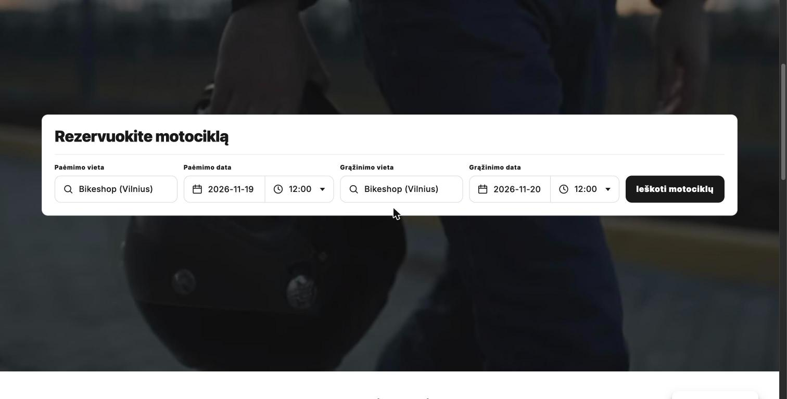{failai=../darbas/ekrano-nuotraukos/bikerent-paieskos-forma_2026-11-18.png}

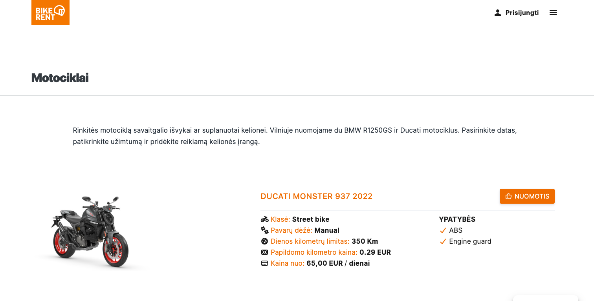{failai=../darbas/ekrano-nuotraukos/bikerent-motociklu-sarasas_2026-11-19.png}

- **Pasiteisina.** Paieška – pirmas elementas puslapyje: vienoje eilutėje paėmimo vieta, data ir laikas, grąžinimo vieta, data ir laikas ir vienas mygtukas „Ieškoti motociklų“. Šviesus fonas, tamsus tekstas, viena akcento spalva (oranžinė).
- **Reikėtų keisti.** Sąraše kiekvienas motociklas užima visą ekrano plotį (nuotrauka kairėje, savybės dešinėje), todėl ekrane matomas tik vienas motociklas ir jų neįmanoma palyginti viename vaizde. Savybių mažai (klasė, pavarų dėžė, kilometrų limitas, kaina), nėra vairuotojo pažymėjimo kategorijos.

#### KuBa Motors (kubamotors.lt)

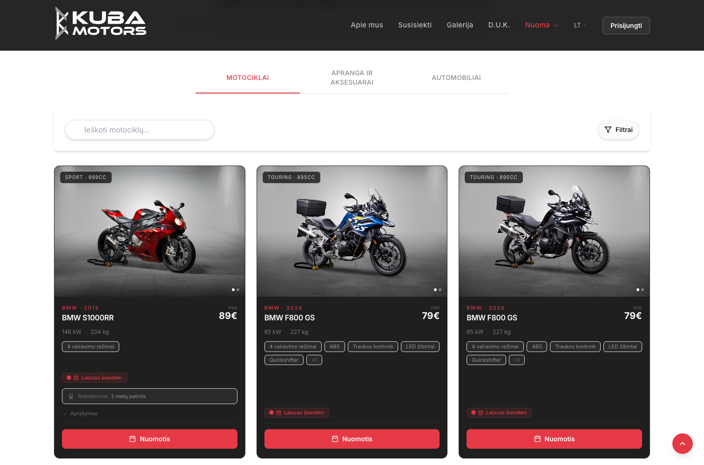{failai=../darbas/ekrano-nuotraukos/kubamotors-motociklu-sarasas_2026-11-19.png}

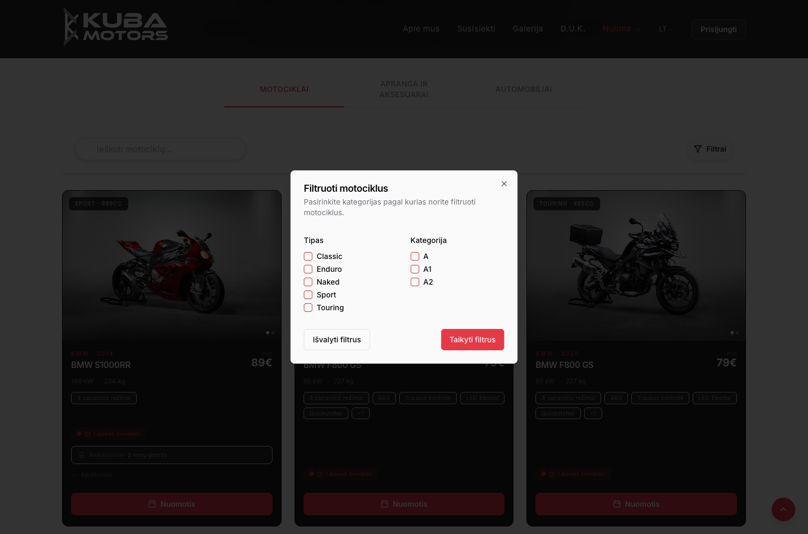{failai=../darbas/ekrano-nuotraukos/kubamotors-filtrai_2026-11-19.png}

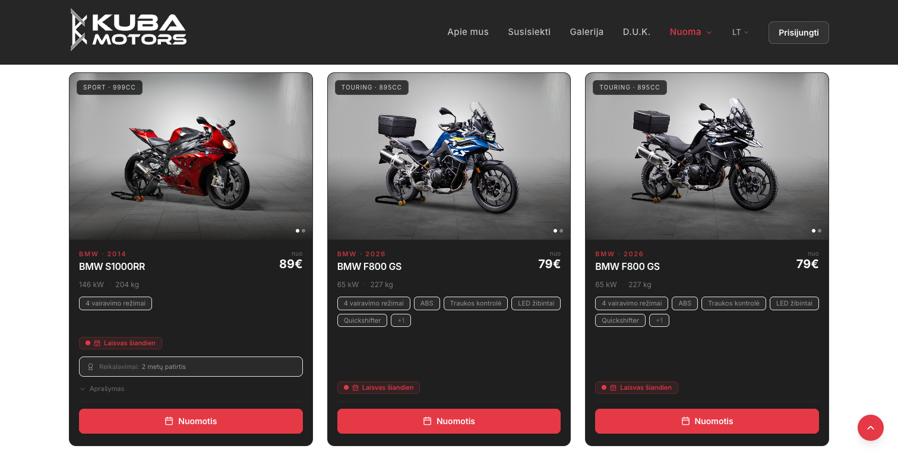{failai=../darbas/ekrano-nuotraukos/kubamotors-uzimtumas_2026-11-19.png}

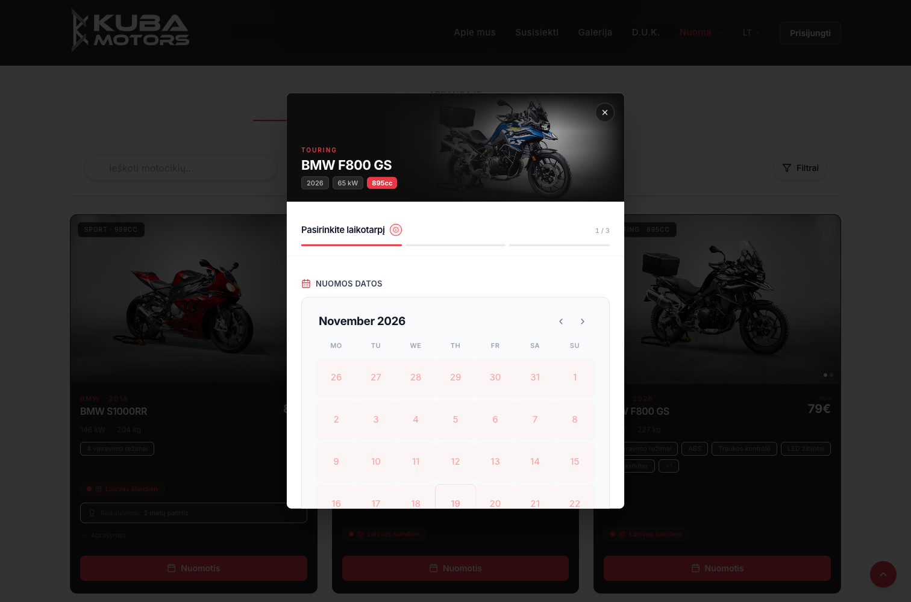{failai=../darbas/ekrano-nuotraukos/kubamotors-rezervacijos-forma_2026-11-19.png}

- **Pasiteisina.** Motociklai rodomi kortelėmis po tris eilutėje: nuotrauka, tipo ir variklio tūrio žyma, gamintojas ir metai, pavadinimas, galia ir svoris, kaina. Filtras pagal vairuotojo pažymėjimo kategoriją (A, A1, A2). Rezervacijos lange rodomas žingsnių skaičius („1 / 3“) ir juosta, rodanti, kiek liko.
- **Reikėtų keisti.** Filtrai paslėpti atskirame lange, todėl nematyti, kurie taikomi. Užimtumas rodomas tik šiai dienai („Laisvas šiandien“), o ne pasirinktam laikotarpiui. Tamsiose kortelėse smulkus pilkas tekstas (galia, svoris, ypatybės) sunkiai įskaitomas. Kalendoriuje renkamos tik dienos, be laiko.

#### RideRent (riderent.lt)

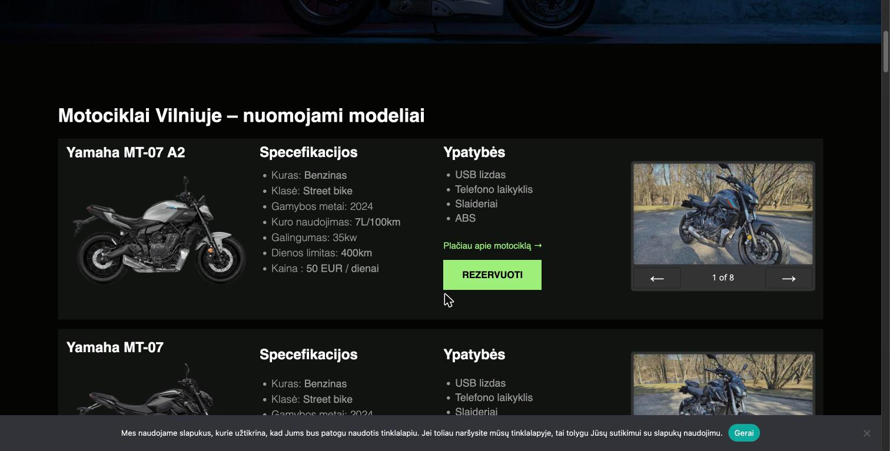{failai=../darbas/ekrano-nuotraukos/riderent-motociklu-sarasas_2026-11-18.png}

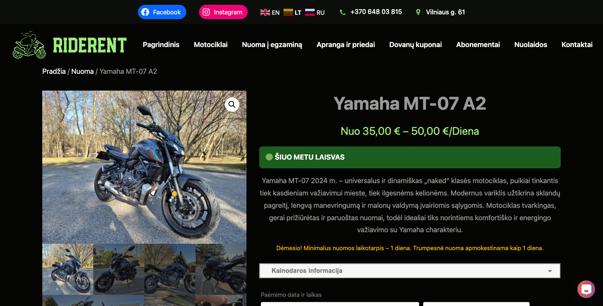{failai=../darbas/ekrano-nuotraukos/riderent-motociklo-puslapis_2026-11-19.png}

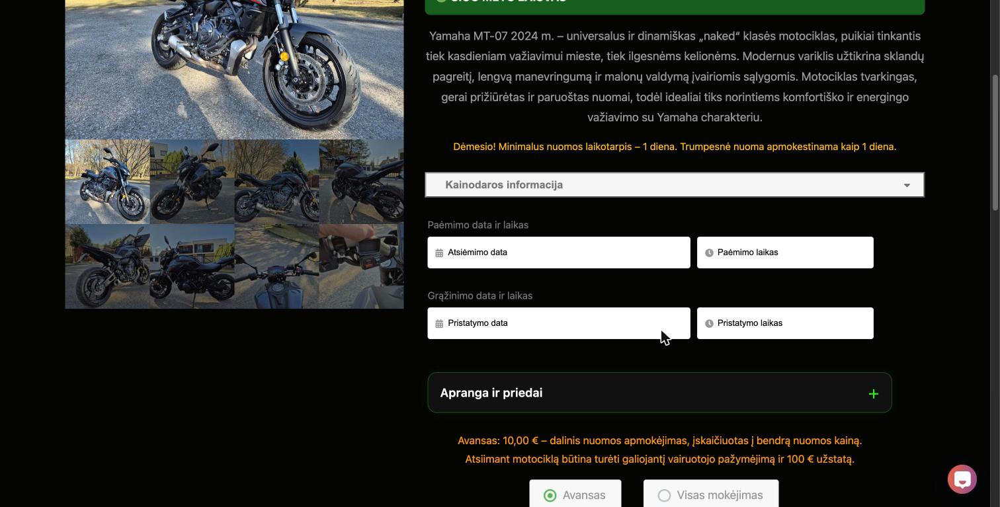{failai=../darbas/ekrano-nuotraukos/riderent-rezervacijos-forma_2026-11-18.png}

- **Pasiteisina.** Išsamios charakteristikos; užimtumo žyma ryškiu fonu; svarbios sąlygos (minimalus nuomos laikotarpis, avansas, 100 € užstatas) parašytos prie pat formos, kitokia spalva.
- **Reikėtų keisti.** Nėra paieškos ir filtrų – visi modeliai viename ilgame puslapyje, kiekvienas per visą plotį. Kaina „Nuo 35,00 € – 50,00 €/Diena“ neaiški, kol nepasirinktos datos. Juodas fonas su pilku tekstu, slapukų juosta uždengia sąrašo apačią.

#### Pasirinkti dizaino sprendimai

Lentelė: Pasirinkti dizaino sprendimai
| Sprendimas | Iš kurios sistemos | Kaip pritaikome |
|---|---|---|
| Paieškos juosta – pirmas elementas | Bikerent | Išdavimo ir grąžinimo filialas, nuomos pradžia ir pabaiga, mygtukas „Ieškoti“ (EKRANAS01) |
| Motociklų kortelės tinklelyje | KuBa Motors | Kortelė su nuotrauka, tipu, variklio tūriu, galia, kategorija ir paros kaina (NFR 1.3.1.3); 1–3 kortelės eilutėje pagal ekrano plotį |
| Filtras pagal kategoriją | KuBa Motors | Filtrai matomi šoniniame stulpelyje; papildomai – variklio tūris, galia, išvažiavimas į užsienį (FR 1.2.1) |
| Rezervacijos žingsniai | KuBa Motors | Juosta „1. Motociklas – 2. Duomenys – 3. Patvirtinimas“ (NFR 1.3.2.3) |
| Sąlygos prie formos | RideRent | Kaina, užstatas ir baudų lentelė rodomi prieš patvirtinimą (FR 1.2.2) |

Ko vengiame: tamsaus fono su smulkiu pilku tekstu, sąrašo „vienas motociklas per visą plotį“, filtrų atskirame lange, užimtumo „tik šiandien“ (rodome tik pasirinktam laikotarpiui laisvus motociklus) ir kainos intervalo be datų.

### 2.3.2. Kuriamos sistemos dizainas

Sąsajos maketai sukurti kaip prototipai, skirti vartotojo sąsajai kurti ir trūkstamiems reikalavimams rasti. Jie padaryti statiniais HTML ir CSS puslapiais su vienu bendru stiliaus failu ir užfiksuoti ekrano nuotraukomis naršyklėje 360 px (siauras ekranas) ir 1280 px (platus ekranas) pločiu.

#### Dizaino principai

- **Dizaino tipas.** Prisitaikanti (angl. *responsive*) žiniatinklio sąsaja, projektuojama nuo siauro ekrano. Plokščias, minimalistinis stilius: balti blokai šviesiame fone, be šešėlių ir dekoracijų. Klientui – kortelės, darbuotojui ir administratoriui – lentelės ir laiko juosta.
- **Vienas stilius visiems puslapiams (NFR 1.3.1.2).** Spalvos, šriftai, tarpai ir mygtukai apibrėžti viename stiliaus faile, kurį naudoja visi maketai.

#### Spalvos

Šviesus fonas ir tamsus tekstas; konkurentų spalvų (oranžinės, raudonos, žalios) akcentui nenaudojame. Būsenų spalvos naudojamos tik būsenoms, ne puošybai.

Lentelė: Spalvų paletė
| Paskirtis | Spalva |
|---|---|
| Pagrindinė: veiksmo mygtukai, nuorodos, pažymėti elementai | tamsiai žalsvai mėlyna `#0F766E` |
| Viršutinė juosta | grafitas `#1E293B` |
| Fonas / blokai | `#F8FAFC` / balta `#FFFFFF` |
| Tekstas / antrinis tekstas | `#0F172A` / `#475569` |
| Laisvas, patvirtinta | žalia `#15803D` |
| Vėluoja, įspėjimas, techninė priežiūra | gintarinė `#B45309` |
| Atsisakymas, klaida | raudona `#B91C1C` |
| Užimtumo juostose: nuoma / perkėlimas | mėlyna `#2563EB` / violetinė `#7C3AED` |

#### Šriftas

Viena šriftų šeima **Inter** (Google Fonts [11], nemokama, palaiko lietuviškas raides). Dydžiai: 14 px – paaiškinimai, 16 px – tekstas, 20 px – bloko antraštė, 28 px – puslapio antraštė (siaurame ekrane 24 px). Skaičiai lygiapločiai, kad kainos ir datos lygiuotųsi stulpeliuose. Datos rašomos `yyyy-mm-dd`, laikas – 24 val. formatu, kainos – „100,00 €“.

#### Tinklelis ir išdėstymas (NFR 1.3.1.1)

- Tarpai – 8 px žingsniu (8, 16, 24, 32 px).
- Plačiame ekrane turinys ne platesnis kaip 1200 px ir centruojamas, todėl neišsitempia; kortelių eilutėje – 3 (nuo 1200 px), 2 (nuo 768 px) arba 1.
- Siaurame ekrane (nuo 360 px) laukai išdėstomi vienas po kito, viršutinės juostos meniu paslepiamas, filtrai atidaromi mygtuku „Filtrai“. Horizontalios slinkties nėra.
- Darbuotojo ekrane šalia vienas kito – sąrašas ir pasirinkto įrašo forma, kad nereikėtų pereiti į kitą puslapį.

#### Mygtukų išdėstymas

- **Pagrindinis veiksmas** – užpildytas pagrindinės spalvos mygtukas formos apačioje dešinėje. Siaurame ekrane jis per visą plotį ir pritvirtintas ekrano apačioje, kad būtų pasiekiamas neslenkant.
- **Antrinis veiksmas** („Atgal“, „Atšaukti“) – baltas mygtukas pilku kontūru kairėje nuo pagrindinio (siaurame ekrane – po juo).
- **Negrįžtamas veiksmas** („Atšaukti rezervaciją“) – baltas mygtukas raudonu kontūru, atskirai nuo kitų, su patvirtinimu.
- **Kalbos perjungiklis LT | EN** – kiekvieno puslapio viršutinėje juostoje dešinėje (NFR 1.3.2.1).

#### Pranešimai ir žymos

- **Atsisakymo priežastis (NFR 1.3.2.4)** – raudonas blokas puslapio viršuje su konkrečia priežastimi iš funkcijos (2.2.1 skyrius) ir patarimu, ką daryti; klaidingas laukas pažymimas raudonai.
- **Sėkmė** – žalias blokas; **įspėjimas** – gintarinis.
- **Būsenų žymos** – apvalūs ženkleliai: „Rezervuota“ (pilka), „Vėluoja 3 val.“ (gintarinė), „Laukia grąžinimo“ (raudona).

#### Ekranai

Lentelė: Sąsajos maketų ekranai {#lent:ekranai}
| Nr. | Ekranas | Vartotojas | Panaudos atvejai | Reikalavimai | Plotis |
|---|---|---|---|---|---|
| EKRANAS01 | Motociklų paieška | Klientas | PA1 | FR 1.2.1, NFR 1.3.1.1, NFR 1.3.1.3 | 360 ir 1280 px |
| EKRANAS02 | Rezervacijos duomenys | Klientas | PA2, PA7 | FR 1.2.2, NFR 1.3.2.3, NFR 1.3.2.4 | 360 px |
| EKRANAS03 | Rezervacija patvirtinta | Klientas | PA2 | FR 1.2.2, NFR 1.3.2.3 | 360 px |
| EKRANAS04 | Išdavimų ir grąžinimų tvarkaraštis | Filialo darbuotojas | PA8–PA10, PA12–PA14 | FR 1.2.3 | 1280 px |
| EKRANAS05 | Parko užimtumas | Administratorius | PA20 | FR 1.2.5 | 1280 px |

Rezervacijos kelias: klientas pasirenka motociklą paieškos rezultatuose (EKRANAS01), įveda pažymėjimo duomenis ir mato kainą (EKRANAS02), gauna patvirtinimą (EKRANAS03) – 3 ekranai (NFR 1.3.2.3). Visi maketuose rodomi duomenys paimti iš bandomųjų duomenų (3 skyrius); nuotraukos vietoje rodomas schematinis motociklas.

##### EKRANAS01. Motociklų paieška

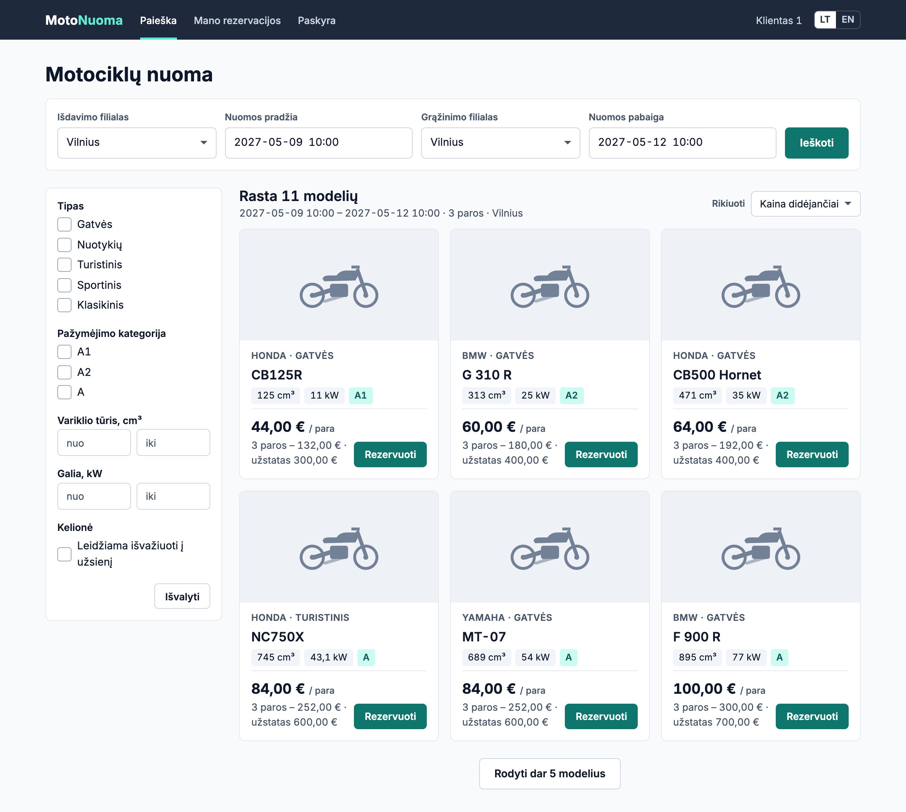{failai=../artefaktai/13-dizainas/13-e1-paieska-1280.png}

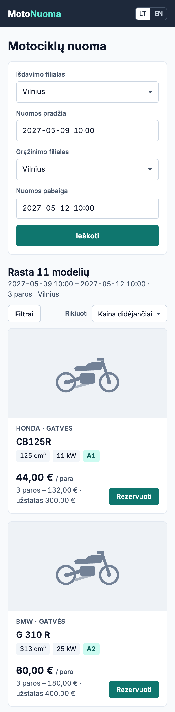{failai=../artefaktai/13-dizainas/13-e1-paieska-360.png}

Paieška Vilniuje 2027-05-09 10:00 – 2027-05-12 10:00: laisvi 11 modelių, rodomi 6 pigiausi. Viena kortelė – vienas modelis (NFR 1.3.1.3); rezervuojant sistema parenka laisvą to modelio motociklą, atitinkantį paieškos sąlygas (pvz., leidimą išvažiuoti į užsienį). Kortelėje – paros kaina, kaina už visą laikotarpį ir užstatas, kad klientas juos matytų iš karto.

##### EKRANAS02. Rezervacijos duomenys

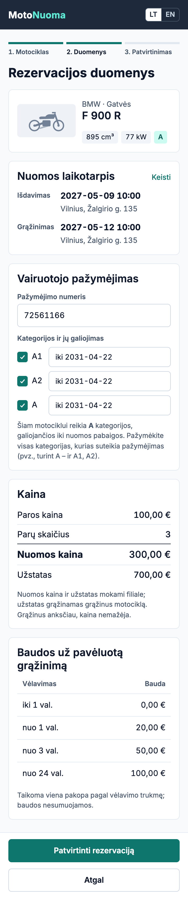{failai=../artefaktai/13-dizainas/13-e2-rezervacijos-duomenys-360.png}

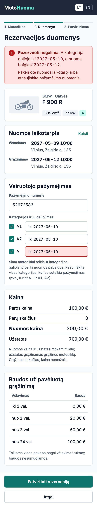{failai=../artefaktai/13-dizainas/13-e2-atsisakymas-360.png}

Klientas 1 rezervuoja BMW F 900 R: 3 paros × 100,00 € = 300,00 €, užstatas 700,00 €, baudų lentelė pagal tarifą. Antrame variante tą patį motociklą rezervuoja Klientas 26, kurio A kategorija galioja iki 2027-05-10, todėl rodoma funkcijos `tikrintiKlientoTeise` priežastis „A kategorija galioja iki 2027-05-10, o nuoma baigiasi 2027-05-12“. Užuomina prie kategorijų primena pažymėti visas pažymėjimo suteikiamas kategorijas (kurios kategorijos apima kitas, sistema nesaugo, 1.5.2 skyrius).

##### EKRANAS03. Rezervacija patvirtinta

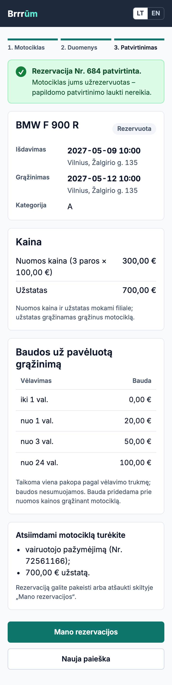{failai=../artefaktai/13-dizainas/13-e3-patvirtinimas-360.png}

Rezervacija patvirtinama iš karto (Nr. 684 – kitas laisvas numeris bandomuosiuose duomenyse). Rodoma visa baudų lentelė, įskaitant numanomą pakopą „iki 1 val. – 0,00 €“, nes pirmoji tarifo pakopa prasideda nuo 1 val.

##### EKRANAS04. Išdavimų ir grąžinimų tvarkaraštis

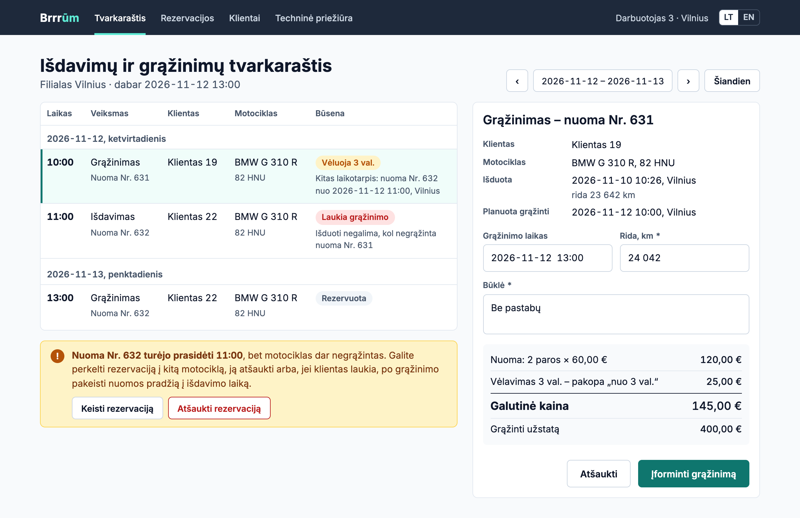{failai=../artefaktai/13-dizainas/13-e4-tvarkarastis-1280.png}

Vilniaus filialas 2026-11-12 13:00 – pavėluoto grąžinimo atvejis iš bandomųjų duomenų (nuomos 631 ir 632, BMW G 310 R). Nuoma 631 turėjo būti grąžinta 10:00 – ji pažymėta „Vėluoja 3 val.“, šalia parodytas kitas motociklo laikotarpis (nuoma 632 nuo 11:00). Nuomos 632 išduoti negalima, kol 631 negrąžinta; įspėjime – trys galimi darbuotojo veiksmai (2.2.1 skyrius, „Pavėluotas grąžinimas“). Grąžinimo formoje darbuotojas įveda ridą ir būklę, o sistema apskaičiuoja kainą: 2 paros × 60,00 € + bauda 25,00 € (pakopa „nuo 3 val.“) = 145,00 €, kaip įrašyta bandomuosiuose duomenyse.

##### EKRANAS05. Parko užimtumas

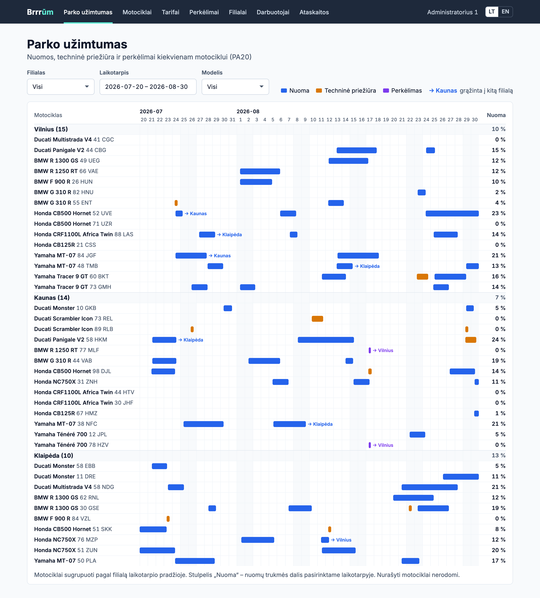{failai=../artefaktai/13-dizainas/13-e5-parko-uzimtumas-1280.png}

Laiko juosta 2026-07-20 – 2026-08-30 (sezono vidurys) visiems 39 naudojamiems motociklams, sugrupuotiems pagal filialą laikotarpio pradžioje. Mėlyna – nuomos, gintarinė – techninė priežiūra, violetinė – perkėlimas (2026-08-17 Kaunas → Vilnius); „→ Kaunas“ – nuoma grąžinta į kitą filialą. Dešiniajame stulpelyje – nuomų trukmės dalis laikotarpyje, grupės eilutėje – filialo vidurkis. Statistinės ataskaitos (PA21) nemaketuojamos, nes jų turinys dar nenustatytas.

#### Atitiktis nefunkciniams reikalavimams

Lentelė: Nefunkcinių reikalavimų įgyvendinimas maketuose
| Reikalavimas | Kaip įgyvendinta maketuose |
|---|---|
| NFR 1.3.1.1 Prisitaikanti sąsaja | EKRANAS01 parodytas 360 ir 1280 px pločio; turinys ne platesnis kaip 1200 px |
| NFR 1.3.1.2 Vieningas stilius | Visi ekranai naudoja vieną stiliaus failą; paletė, šriftas ir mygtukai aprašyti šiame skyriuje |
| NFR 1.3.1.3 Motociklo kortelė | EKRANAS01 – po vieną kortelę kiekvienam tinkamam modeliui: nuotrauka, modelis, tipas, variklio tūris, galia, kategorija, paros kaina |
| NFR 1.3.2.1 Kalbos | Perjungiklis LT \| EN kiekvieno ekrano viršuje dešinėje |
| NFR 1.3.2.3 Trumpas rezervacijos kelias | EKRANAS01 → EKRANAS02 → EKRANAS03, žingsnių juosta EKRANAS02 ir EKRANAS03 |
| NFR 1.3.2.4 Aiški atsisakymo priežastis | EKRANAS02 atmetimo variantas; EKRANAS04 – priežastis, kodėl nuomos negalima išduoti |

# 3. Testavimo planas ir programa

Testavimas planuojamas sistemos lygiu. Testavimo atvejai (TA) sudaryti pagal panaudos atvejus: kiekvienas žingsnis – vartotojo veiksmas sąsajoje, o laukiamas rezultatas trumpai aprašomas po kiekvieno žingsnio. Po kiekvienos lentelės nurodomos sąlygos po testavimo atvejo vykdymo – kas turi būti įrašyta duomenų bazėje. Sistema tikrinama juodosios dėžės principu per sąsają, o duomenų bazėje papildomai patikrinama, kas įrašyta – tai pilkosios dėžės testavimas. Duomenys parinkti ekvivalenčių klasių ir ribinių reikšmių metodais ir kiekvienas TA apima ne tik tinkamus, bet ir netinkamus duomenis.

Pradiniai duomenys paimti iš bandomųjų duomenų – išgalvoto filialų, motociklų, tarifų, klientų ir nuomų rinkinio, kurio būsena užfiksuota 2026-11-19 12:00 (iš jo paimti ir 2.2.1 skyriaus funkcijų pavyzdžiai bei 2.3.2 skyriaus maketų duomenys; TA3 – to paties rinkinio būsena 2026-11-12 11:00, žr. TA3), todėl TA galima pakartoti tomis pačiomis sąlygomis. Laukiami pranešimai – 2.2.1 skyriaus funkcijų grąžinamos priežastys, parodomos taip, kaip 2.3.2 skyriaus maketuose.

Sistema dar nesukurta (darbe atliekama tik analizė ir projektavimas), todėl stulpeliai „Pavyko gauti laukiamą rezultatą?“ ir „Klaidos, pastabos“ paliekami tušti – jie pildomi testavimo etape.

## 3.1. Testavimo apžvalga

### 3.1.1. Testavimo tikslai

1. Patikrinti, ar sistema atitinka funkcinius reikalavimus FR 1.2.1–FR 1.2.5, ypač taisykles, kurių duomenų bazės apribojimai neužtikrina: motociklo užimtumą ir buvimo vietą, vairuotojo pažymėjimo kategoriją ir jos galiojimą, galutinės kainos ir baudos skaičiavimą (2.2.1 skyriaus funkcijos).
2. Surasti defektus įvedant netinkamus ir ribinius duomenis (sutampantys ir besiliečiantys laikotarpiai, kategorija, kuri baigia galioti nuomos pabaigos dieną, vėlavimas lygiai ties baudos pakopos riba) ir patikrinti, ar sistema tokių veiksmų neleidžia ir nurodo aiškią priežastį (NFR 1.3.2.4).
3. Patikrinti nefunkcinius reikalavimus, kurių negalima patikrinti atskiromis funkcijomis: vienalaikes rezervacijas, atsako laiką ir pasiekiamumą esant 300 vartotojų, prieigą pagal vaidmenis.

### 3.1.2. Testuojamų sistemos funkcinių ir nefunkcinių reikalavimų sąrašas

Šablono lentelė papildyta stulpeliu „Kaip tikrinama“: jame nurodytas testavimo atvejis (3.2 skyrius) arba testavimo rūšis.

Lentelė: Testuojami funkciniai ir nefunkciniai reikalavimai {#lent:testuojami}
| Reikalavimo pavadinimas | Reikalavimo Nr. | Kaip tikrinama |
|---|---|---|
| Motociklų paieška | FR 1.2.1 | Testavimas pagal panaudos atvejį PA1; paieškos rezultatai tikrinami TA2 (1 žingsnis) ir TA4 (2 žingsnis) |
| Rezervacija ir jos valdymas | FR 1.2.2 | TA1, TA2, TA4 |
| Išdavimas ir grąžinimas | FR 1.2.3 | TA3 |
| Techninė priežiūra | FR 1.2.4 | TA1 (7–8 žingsniai) |
| Parko administravimas ir ataskaitos | FR 1.2.5 | Testavimas pagal panaudos atvejus PA16–PA22 |
| Prisitaikanti sąsaja | NFR 1.3.1.1 | Sąsajos peržiūra 360 ir 1280 px pločio ekranuose: siaurame ekrane elementai nepersidengia ir nėra horizontalios slinkties juostos, plačiame turinys neišsitempia per visą plotį |
| Vieningas stilius | NFR 1.3.1.2 | Visų puslapių palyginimas su 2.3.2 skyriuje apibrėžta spalvų palete, šriftu ir mygtukų išdėstymu |
| Motociklo kortelė | NFR 1.3.1.3 | Paieškos rezultatų peržiūra: kiekvienam tinkamam modeliui – viena kortelė su nuotrauka, pavadinimu, tipu, variklio tūriu, galia, kategorija ir paros kaina |
| Kalbos | NFR 1.3.2.1 | Kiekviename puslapyje kalba perjungiama LT ↔ EN; įvesti formos duomenys išlieka |
| Darbuotojo mokymas | NFR 1.3.2.2 | Priėmimo bandymai: naujas darbuotojas po ne ilgesnio kaip 3 val. mokymo savarankiškai atlieka rezervaciją kliento vardu, išdavimą, grąžinimą ir techninės priežiūros planavimą |
| Trumpas rezervacijos kelias | NFR 1.3.2.3 | TA2 (4 žingsnis): nuo motociklo pasirinkimo iki patvirtinimo – 3 ekranai |
| Aiški atsisakymo priežastis | NFR 1.3.2.4 | TA1–TA4 |
| Atsako laikas | NFR 1.3.3.1 | Našumo ir apkrovos testavimas: imituojant 300 vienu metu dirbančių vartotojų, paieškos rezultatai ir rezervacijos patvirtinimas parodomi ne vėliau kaip per 2 s, kiti puslapiai – per 3 s |
| Pasiekiamumas | NFR 1.3.3.2 | Patikimumo testavimas sintetiniais testais: testavimo etape kiekvieną naktį 6 valandas kas minutę automatiškai vykdomi paieškos ir rezervacijos scenarijai, kartu imituojant 300 vienu metu prisijungusių vartotojų apkrovą; per kiekvieną naktį sėkmingų vykdymų turi būti ne mažiau kaip 99 % (iš 360 – ne daugiau kaip 3 nesėkmingi). Naktį testuojama tam, kad apkrova netrukdytų dienos testams. Metinis pasiekiamumas matuojamas tais pačiais testais sistemos veikimo ir priežiūros etape (sintetinė stebėsena) |
| Vienalaikės rezervacijos | NFR 1.3.3.3 | TA4 |
| Duomenų dubliavimas ir atsarginės kopijos | NFR 1.3.4.1 | Atkūrimo bandymas: pagrindinėje duomenų bazėje įrašyta rezervacija iš karto yra ir atsarginėje; sistema atkuriama iš paskutinės atsarginės kopijos ne ilgiau kaip per 4 val.; saugomos ne mažiau kaip 30 dienų kopijos |
| Istoriniai duomenys | NFR 1.3.4.2 | Bandoma ištrinti užbaigtą nuomą kiekvieno vaidmens paskyra – sistema neleidžia |
| Prieiga pagal vaidmenis | NFR 1.3.5.1 | TA1 (1 žingsnis): klientas mato tik savo rezervacijas |
| Duomenų apsauga | NFR 1.3.5.2 | Kreipiantis HTTP adresu naršyklė nukreipiama į HTTPS; duomenų bazėje saugoma tik slaptažodžio maiša, o ne pats slaptažodis |

**Netestuojamas reikalavimas – NFR 1.3.4.3 „Klaidų taisymas ir atnaujinimai“.** Reikalavimas nustato ne programos savybę, o priežiūros darbų tvarką: per kiek laiko ištaisomos kritinės klaidos ir kada diegiami atnaujinimai. Todėl programos testavimu jo patikrinti negalima. Jo laikymasis vertinamas sistemos veikimo ir priežiūros etape.

**Pasiekiamumas ir planiniai atnaujinimai.** NFR 1.3.3.2 neišskiria planinių atnaujinimų, kurie sezono metu diegiami 0–6 val. (NFR 1.3.4.3), todėl sintetinė stebėsena veikimo etape jų metu sistemą laiko nepasiekiama ir šios prastovos turi tilpti į leistiną 1 %. Testavimo etape atnaujinimai nediegiami, todėl naktiniams testams tai įtakos neturi.

## 3.2. Testavimo atvejai

Šablonas prašo 3 testavimo atvejų; pateikiami 4, nes vienalaikės rezervacijos (NFR 1.3.3.3) tikrinamos atskiru atveju. Atvejai susieti su 2.2.1 skyriaus funkcijomis:

Lentelė: Testavimo atvejų ryšys su funkcijomis ir reikalavimais
| TA | Pavadinimas | Funkcija | Panaudos atvejai | Reikalavimai |
|---|---|---|---|---|
| 1 | Rezervacijos keitimas ir techninės priežiūros planavimas | `tikrintiUzimtuma` | PA3, PA4, PA6, PA11 | FR 1.2.2, FR 1.2.4, NFR 1.3.2.4, NFR 1.3.5.1 |
| 2 | Vairuotojo pažymėjimo tikrinimas rezervuojant | `tikrintiKlientoTeise` | PA1, PA2, PA4, PA7 | FR 1.2.1, FR 1.2.2, NFR 1.3.2.3, NFR 1.3.2.4 |
| 3 | Pavėluotas grąžinimas ir galutinė kaina | `skaiciuotiKaina` | PA4, PA8, PA9, PA10, PA12, PA13, PA14 | FR 1.2.3, NFR 1.3.2.4 |
| 4 | Vienalaikės rezervacijos | `tikrintiUzimtuma` | PA1, PA2, PA6 | FR 1.2.1, FR 1.2.2, NFR 1.3.2.4, NFR 1.3.3.3 |

::: ta 1 | Rezervacijos keitimas ir techninės priežiūros planavimas: motociklo užimtumas ir buvimo vieta
Aprašymas: tikrinama, ar keičiant rezervaciją (PA4) ir planuojant techninę priežiūrą (PA11) sistema neleidžia laikotarpio, kuris sutampa su kitu motociklo užimtumo laikotarpiu arba pažeidžia motociklo buvimo vietos taisyklę, ir nurodo priežastį (funkcija `tikrintiUzimtuma`, PA6). Ribinės reikšmės: laikotarpis, kuris baigiasi tą pačią minutę, kai prasideda kitas, leidžiamas, o 1 min. ilgesnis – ne. Taip pat tikrinama, ar klientas mato tik savo rezervacijas. Testuojami reikalavimai FR 1.2.2, FR 1.2.4, NFR 1.3.2.4, NFR 1.3.5.1.
Pradiniai duomenys (sąlygos prieš): dabartinis laikas 2026-11-19 12:00. Klientas 8 prisijungęs prie savo paskyros; jo pažymėjimo kategorijos A1, A2, A galioja iki 2033-10-13. Kliento 8 rezervacija Nr. 655: Honda CB500 Hornet, valst. nr. 52 UVE (motociklas dabar Vilniuje), 2027-05-12 10:00 – 2027-05-15 10:00, išdavimas Vilniuje, grąžinimas Klaipėdoje, tarifas 64,00 €/para, užstatas 400,00 €. Kita šio motociklo nuoma – Kliento 12 rezervacija Nr. 661: 2027-05-24 10:00 – 2027-05-26 10:00, išdavimas ir grąžinimas Klaipėdoje. Kitų šio motociklo užimtumo laikotarpių po 2027-05-12 nėra. 7–8 žingsniuose dirba Klaipėdos filialo darbuotojas (Darbuotojas 6).
| Nr. | Testavimo atvejo (scenarijaus) žingsnis | Laukiamas rezultatas | Pavyko gauti laukiamą rezultatą? (Taip/Ne) | Klaidos, pastabos |
|---|---|---|---|---|
| 1. | Klientas 8 atidaro „Mano rezervacijos“. | Rodomos tik Kliento 8 rezervacijos, tarp jų Nr. 655; Nr. 661 nėra. | | |
| 2. | Rezervacijoje Nr. 655 spaudžia „Keisti rezervaciją“, pabaigą pakeičia į 2027-05-25 10:00 ir išsaugo. | Atmesta: „Motociklas užimtas 2027-05-24 10:00 – 2027-05-26 10:00 (nuoma)“. | | |
| 3. | Pabaigą grąžina į 2027-05-15 10:00, grąžinimo filialą pakeičia į Vilnių ir išsaugo. | Atmesta: „Motociklą reikia grąžinti į filialą Klaipėda, nes 2027-05-24 10:00 ten prasideda kita jo nuoma“. | | |
| 4. | Grąžinimo filialą grąžina į Klaipėdą, išdavimo filialą pakeičia į Kauną ir išsaugo. | Atmesta: „Laikotarpio pradžioje motociklas bus filiale Vilnius“. | | |
| 5. | Išdavimo filialą grąžina į Vilnių, pabaigą pakeičia į 2027-05-24 10:01 ir išsaugo. | Atmesta: „Motociklas užimtas 2027-05-24 10:00 – 2027-05-26 10:00 (nuoma)“. | | |
| 6. | Pabaigą pakeičia į 2027-05-24 10:00 ir išsaugo. | Išsaugota; nauja kaina 12 parų × 64,00 € = 768,00 €. | | |
| 7. | Darbuotojas 6 planuoja motociklo 52 UVE techninę priežiūrą 2027-05-14 08:00 – 17:00. | Atmesta: „Motociklas užimtas 2027-05-12 10:00 – 2027-05-24 10:00 (nuoma)“. | | |
| 8. | Darbuotojas 6 planuoja priežiūrą 2027-05-27 08:00 – 17:00. | Priežiūra įrašyta. | | |
:::

**Sąlygos po:** rezervacijos Nr. 655 laikotarpis – 2027-05-12 10:00 – 2027-05-24 10:00, filialai ir tarifas nepakeisti, naujų nuomos įrašų nėra; atmesti pakeitimai neišsaugoti. Motociklui 52 UVE įrašyta techninė priežiūra 2027-05-27 08:00 – 17:00 ir šiuo laikotarpiu jis paieškoje nerodomas.

::: ta 2 | Vairuotojo pažymėjimo tikrinimas rezervuojant
Aprašymas: tikrinama, ar sistema leidžia rezervuoti (PA2) ir keisti rezervaciją (PA4) tik tada, kai kliento pažymėjime yra motociklo modeliui reikalinga kategorija, galiojanti visą nuomos laikotarpį (funkcija `tikrintiKlientoTeise`, PA7), ir nurodo atsisakymo priežastį. Duomenys parinkti ekvivalenčių klasių metodu: reikiamos kategorijos nėra (turima tik žemesnė kategorija arba nėra jokios motociklų kategorijos); kategorija baigia galioti nuomos metu; kategorija galioja iki nuomos pabaigos dienos (ribinė reikšmė). Taip pat skaičiuojami ekranai nuo motociklo pasirinkimo iki patvirtinimo. Testuojami reikalavimai FR 1.2.1, FR 1.2.2, NFR 1.3.2.3, NFR 1.3.2.4.
Pradiniai duomenys (sąlygos prieš): dabartinis laikas 2026-11-19 12:00. BMW F 900 R, valst. nr. 26 HUN – vienintelis šio modelio motociklas Vilniuje, laisvas 2027-05-09 10:00 – 2027-05-12 10:00. Modeliui reikia A kategorijos; tarifas 100,00 €/para, užstatas 700,00 €, baudų pakopos: nuo 1 val. – 20,00 €, nuo 3 val. – 50,00 €, nuo 24 val. – 100,00 €. Klientas 26 (turi paskyrą): A1, A2 ir A galioja iki 2027-05-10; jo rezervacija Nr. 642 – BMW F 900 R, valst. nr. 84 VZL, 2027-04-14 11:00 – 2027-04-18 11:00, išdavimas ir grąžinimas Kaune. Klientas 33 (turi paskyrą): tik A1, galioja iki 2030-01-21. Klientas 35: paskyros neturi, pažymėjime motociklų kategorijų nėra. 2 žingsnyje dirba Vilniaus filialo darbuotojas (Darbuotojas 1).
| Nr. | Testavimo atvejo (scenarijaus) žingsnis | Laukiamas rezultatas | Pavyko gauti laukiamą rezultatą? (Taip/Ne) | Klaidos, pastabos |
|---|---|---|---|---|
| 1. | Klientas 33 ieško motociklų Vilniuje 2027-05-09 10:00 – 2027-05-12 10:00, BMW F 900 R kortelėje spaudžia „Rezervuoti“, tada „Patvirtinti rezervaciją“. | Paieškos rezultatuose rodoma BMW F 900 R kortelė. Atmesta: „Vairuotojo pažymėjime nėra A kategorijos“. | | |
| 2. | Darbuotojas 1 Kliento 35 vardu rezervuoja tą patį motociklą tam pačiam laikotarpiui. | Atmesta: „Vairuotojo pažymėjime nėra A kategorijos“. | | |
| 3. | Klientas 26 atlieka tą pačią paiešką, pasirenka BMW F 900 R ir spaudžia „Patvirtinti rezervaciją“. | Atmesta: „A kategorija galioja iki 2027-05-10, o nuoma baigiasi 2027-05-12“. | | |
| 4. | Klientas 26 spaudžia „Atgal“, paieškoje nurodo grąžinimą 2027-05-10 10:00 ir rezervuoja BMW F 900 R. | Rodomas patvirtinimas: 100,00 €, užstatas 700,00 €, baudų lentelė su pakopa „iki 1 val. – 0,00 €“. Nuo motociklo pasirinkimo – 3 ekranai. | | |
| 5. | Klientas 26 puslapyje „Mano rezervacijos“ keičia rezervacijos Nr. 642 pabaigą į 2027-05-12 11:00. | Atmesta: „A kategorija galioja iki 2027-05-10, o nuoma baigiasi 2027-05-12“. | | |
:::

**Sąlygos po:** įrašyta tik viena nauja nuoma – Kliento 26, BMW F 900 R 26 HUN, 2027-05-09 10:00 – 2027-05-10 10:00, būsena „rezervuota“, tarifas 100,00 €/para. Rezervacija Nr. 642 nepakeista.

::: ta 3 | Pavėluotas grąžinimas ir galutinė kaina
Aprašymas: tikrinama, kaip sistema elgiasi, kai motociklas grąžinamas pavėluotai, o po šios nuomos jau rezervuota kita. Tvarkaraštyje (PA8) vėlavimas pažymimas; motociklo neleidžiama išduoti, kol ankstesnė nuoma negrąžinta (PA9); neleidžiama įrašyti mažesnės ridos nei išduodant (PA12); grąžinant apskaičiuojama galutinė kaina ir bauda (PA13, PA14, funkcija `skaiciuotiKaina`). Ribinė reikšmė: vėlavimas lygiai 3 val. – baudos pakopos „nuo 3 val.“ pradžia. Laukusiam klientui pakeičiama nuomos pradžia (PA4). Testuojami reikalavimai FR 1.2.3, NFR 1.3.2.4.
Pradiniai duomenys (sąlygos prieš): Vilniaus filialas, dabartinis laikas 2026-11-12 11:00, prisijungęs Darbuotojas 3. Duomenys – bandomųjų duomenų būsena šiuo momentu: rinkinyje (būsena 2026-11-19 12:00) nuomos Nr. 631 ir 632 jau užbaigtos taip, kaip nurodyta „Sąlygose po“. Motociklas BMW G 310 R, valst. nr. 82 HNU. Nuoma Nr. 631 (Klientas 19): 2026-11-10 10:00 – 2026-11-12 10:00, išdavimas ir grąžinimas Vilniuje, išduota 2026-11-10 10:26 su 23 642 km rida, dar negrąžinta (būsena „aktyvi“). Nuoma Nr. 632 (Klientas 22) tam pačiam motociklui: 2026-11-12 11:00 – 2026-11-13 13:00, išdavimas ir grąžinimas Vilniuje, būsena „rezervuota“. Abiejų nuomų tarifas: 60,00 €/para, užstatas 400,00 €, baudų pakopos: nuo 1 val. – 10,00 €, nuo 3 val. – 25,00 €, nuo 24 val. – 60,00 €.
| Nr. | Testavimo atvejo (scenarijaus) žingsnis | Laukiamas rezultatas | Pavyko gauti laukiamą rezultatą? (Taip/Ne) | Klaidos, pastabos |
|---|---|---|---|---|
| 1. | 11:00 darbuotojas atidaro 2026-11-12 išdavimų ir grąžinimų tvarkaraštį. | Nr. 631 pažymėta „Vėluoja 1 val.“ su nuoroda į kitą laikotarpį (Nr. 632 nuo 11:00), Nr. 632 – „Laukia grąžinimo“. | | |
| 2. | Bando išduoti nuomą Nr. 632. | Atmesta: „Išduoti negalima, kol negrąžinta nuoma Nr. 631“; siūlomi galimi veiksmai. | | |
| 3. | Klientas 22 sutinka palaukti. 13:00 darbuotojas nuomos Nr. 631 grąžinimo formoje įveda ridą 23 600 km, būklę „Be pastabų“ ir spaudžia „Įforminti grąžinimą“. | Atmesta: „Grąžinimo rida (23 600 km) negali būti mažesnė už išdavimo ridą (23 642 km)“. | | |
| 4. | Ridą pakeičia į 24 042 km ir spaudžia „Įforminti grąžinimą“. | Galutinė kaina 145,00 € = 2 paros × 60,00 € + bauda 25,00 € (pakopa „nuo 3 val.“); grąžinti užstatą 400,00 €. | | |
| 5. | Rezervacijos Nr. 632 pradžią pakeičia į 2026-11-12 13:20. | Išsaugota; nauja kaina 1 para × 60,00 € = 60,00 €. | | |
| 6. | 13:20 įformina nuomos Nr. 632 išdavimą: rida 24 042 km, būklė „Be pastabų“. | Motociklas išduotas, nuomos būsena „aktyvi“. | | |
| 7. | 2026-11-13 12:40 įformina nuomos Nr. 632 grąžinimą: rida 24 157 km, būklė „Be pastabų“. | Galutinė kaina 60,00 €, bauda 0,00 € (grąžinta anksčiau – kaina nemažinama). | | |
:::

**Sąlygos po:** nuomos Nr. 631 ir 632 užbaigtos. Grąžinimai: Nr. 631 – 2026-11-12 13:00, 24 042 km, 145,00 €, bauda 25,00 €; Nr. 632 – 2026-11-13 12:40, 24 157 km, 60,00 €, bauda 0,00 €. Nuomos Nr. 632 pradžia ir išdavimas – 2026-11-12 13:20. Motociklo 82 HNU rida 24 157 km, filialas Vilnius.

::: ta 4 | Vienalaikės rezervacijos
Aprašymas: tikrinama, ar sistema, gavusi dvi tuo pačiu metu pateiktas to paties motociklo rezervacijas sutampančiam laikotarpiui, patvirtina tik vieną, o kitam klientui praneša, kad motociklas užimtas, ir ar užimtas motociklas nebėra paieškos rezultatuose. Testas vykdomas automatizuotai: abi rezervacijos pateikiamos dviem lygiagrečiomis užklausomis, nes rankiniu būdu to paties momento pasiekti negalima. Testuojami reikalavimai FR 1.2.1, FR 1.2.2, NFR 1.3.2.4, NFR 1.3.3.3.
Pradiniai duomenys (sąlygos prieš): dabartinis laikas 2026-11-19 12:00. BMW F 900 R, valst. nr. 84 VZL – vienintelis šio modelio motociklas Kaune, laisvas 2027-05-05 11:00 – 2027-05-08 11:00. Klientai 2 ir 3 prisijungę skirtingose naršyklėse; abiejų A kategorija galioja (iki 2034-11-26 ir 2034-02-26). Abu ieškojo motociklų Kaune šiam laikotarpiui, pasirinko BMW F 900 R ir yra rezervacijos duomenų ekrane.
| Nr. | Testavimo atvejo (scenarijaus) žingsnis | Laukiamas rezultatas | Pavyko gauti laukiamą rezultatą? (Taip/Ne) | Klaidos, pastabos |
|---|---|---|---|---|
| 1. | Abiejų klientų rezervacijos patvirtinamos tuo pačiu metu (dvi lygiagrečios užklausos „Patvirtinti rezervaciją“). | Vienam klientui rodomas patvirtinimas, kitam – „Motociklas užimtas 2027-05-05 11:00 – 2027-05-08 11:00 (nuoma)“. | | |
| 2. | Klientas, kurio rezervacija atmesta, pakartoja paiešką Kaune tam pačiam laikotarpiui. | BMW F 900 R kortelė nerodoma. | | |
:::

**Sąlygos po:** motociklui 84 VZL laikotarpiui 2027-05-05 11:00 – 2027-05-08 11:00 įrašyta lygiai viena nuoma – to kliento, kuris gavo patvirtinimą.

# Šaltiniai {-}

1. Bikerent. Motociklų nuoma [interaktyvus]. UAB „Motociklų nuoma“. Prieiga per internetą: [https://www.bikerent.lt/](https://www.bikerent.lt/) (žiūrėta 2026-11-18).
2. KuBa Motors. Motociklų nuoma [interaktyvus]. Prieiga per internetą: [https://kubamotors.lt/](https://kubamotors.lt/) (žiūrėta 2026-11-18).
3. RideRent. Motociklų nuoma Vilniuje [interaktyvus]. Prieiga per internetą: [https://riderent.lt/motociklai-vilniuje/](https://riderent.lt/motociklai-vilniuje/) (žiūrėta 2026-11-18).
4. RentSyst. Car and motorcycle rental software [interaktyvus]. RentSyst Ltd. Prieiga per internetą: [https://rentsyst.com/](https://rentsyst.com/) (žiūrėta 2026-11-18).
5. Moto Rent Vilnius [interaktyvus]. Prieiga per internetą: [https://motorentvilnius.lt/motociklai/](https://motorentvilnius.lt/motociklai/) (žiūrėta 2026-11-18).
6. Admita / TopRent [interaktyvus]. Prieiga per internetą: [https://admita.lt](https://admita.lt), [https://toprent.lt](https://toprent.lt) (žiūrėta 2026-11-18).
7. MotoNuoma24 [interaktyvus]. Prieiga per internetą: [https://motonuoma24.lt](https://motonuoma24.lt) (žiūrėta 2026-11-18).
8. Motus2p [interaktyvus]. Prieiga per internetą: [https://www.motus2p.lt/](https://www.motus2p.lt/) (žiūrėta 2026-11-18).
9. CheapAuto. Motociklų nuoma [interaktyvus]. Prieiga per internetą: [https://www.cheapauto.lt/motociklu-nuoma/](https://www.cheapauto.lt/motociklu-nuoma/) (žiūrėta 2026-11-18).
10. GeeksforGeeks. Introduction of ER Model [interaktyvus]. Prieiga per internetą: [https://www.geeksforgeeks.org/dbms/introduction-of-er-model/](https://www.geeksforgeeks.org/dbms/introduction-of-er-model/).
11. Inter (šriftas). Google Fonts [interaktyvus]. Prieiga per internetą: [https://fonts.google.com/specimen/Inter](https://fonts.google.com/specimen/Inter).

# Priedai {-}

## 1 priedas. Atsekamumo matrica {-}

Atsekamumo matrica rodo, kaip kiekvienas funkcinis reikalavimas (1.2 skyrius) ir jo panaudos atvejai (1.4 skyrius) susiję su duomenų srautų diagramos procesais ir saugyklomis (1.5.1 skyrius), ER modelio esybėmis (1.5.2 ir 2.2.2 skyriai), struktūrinės schemos funkcijomis (2.1.1 ir 2.2.1 skyriai) ir testavimu (3 skyrius), o nefunkciniai reikalavimai (1.3 skyrius) – kur jie atsispindi projekte ir kaip tikrinami. Ja patikrinta, ar kiekvienas elementas susietas su kitais ir ar pavadinimai visur vienodi.
::: gulscias

Saugyklose: R – skaito, W – rašo; „per P1“ – duomenis procesas gauna iš P1 (užimtumo tikrinimas, PA6). Schemos funkcija: lygis (2 – operacija, 3 – iškviečiama funkcija), rodyklė – kviečiamos funkcijos, pasviru šriftu – 2.2.1 skyriaus funkcija. Testavimas: TA ir žingsniai (3.2 skyrius) arba „pagal PA“ – testavimas pagal panaudos atvejį be atskiro TA (3.1.2 skyrius).

Lentelė: Funkcinių reikalavimų ir panaudos atvejų atsekamumo matrica {#lent:matrica-a maza}
| PA | Panaudos atvejis | Procesas | Saugyklos | ER esybės | Schemos funkcija | Testavimas |
|---|---|---|---|---|---|---|
| | **FR 1.2.1 Motociklų paieška** | | | | | |
| PA1 | Ieškoti laisvų motociklų | P1 | DS1, DS2, DS3 R; DS5–DS7 R (PA6) | Filialas, Motociklas, Motociklo modelis, Motociklo tipas, Kategorija, Tarifas | 2 → PA6 | TA2 (1), TA4 (2) |
| | **FR 1.2.2 Rezervacija ir jos valdymas** | | | | | |
| PA2 | Rezervuoti motociklą | P2 | DS4 R/W, DS5 W; DS3 per P1 | Klientas, Kategorija („turi teisę“), Nuoma, Tarifas, Baudos pakopa, Filialas, Darbuotojas | 2 → PA6, PA7 | TA2 (4), TA4 (1) |
| PA3 | Peržiūrėti savo rezervacijas | P2 | DS5 R | Nuoma | 2 | TA1 (1) |
| PA4 | Keisti rezervaciją | P2 | DS4 R, DS5 R/W | Nuoma, Klientas, Kategorija („turi teisę“) | 2 → PA6, PA7 | TA1 (2–6), TA2 (5), TA3 (5) |
| PA5 | Atšaukti rezervaciją | P2 | DS5 W | Nuoma | 2 | pagal PA |
| PA6 | Tikrinti motociklo užimtumą | P1 | DS2, DS5, DS6, DS7 R | Motociklas, Filialas, Nuoma, Techninė priežiūra, Perkėlimas | 3, `tikrintiUzimtuma` | TA1 (2–8), TA4 (1) |
| PA7 | Tikrinti vairuotojo pažymėjimą | P2 | DS4 R; reikiama kategorija per P1 | Klientas, Kategorija („turi teisę“), Motociklo modelis | 3, `tikrintiKlientoTeise` | TA2 (1–5) |
| | **FR 1.2.3 Išdavimas ir grąžinimas** | | | | | |
| PA8 | Peržiūrėti išdavimų ir grąžinimų tvarkaraštį | P3 | DS2, DS4, DS5 R | Nuoma, Motociklas, Klientas | 2 | TA3 (1) |
| PA9 | Įforminti išdavimą | P3 | DS5 R/W | Išdavimas, Nuoma, Darbuotojas | 2 → PA12 | TA3 (2, 6) |
| PA10 | Įforminti grąžinimą | P3 | DS3 R, DS5 W, DS2 W | Grąžinimas, Nuoma, Darbuotojas | 2 → PA12, PA13, PA14 [grąžinta pavėluotai], PA15 [kitas filialas] | TA3 (3, 4, 7) |
| PA12 | Užfiksuoti ridą ir būklę | P3 | DS5 W, DS2 W | Išdavimas, Grąžinimas, Motociklas (Rida) | 3 | TA3 (3, 4, 6, 7) |
| PA13 | Apskaičiuoti galutinę nuomos kainą | P3 | DS3 R, DS5 W | Tarifas, Nuoma, Grąžinimas (Galutinė kaina) | 3, `skaiciuotiKaina` | TA3 (4, 7) |
| PA14 | Apskaičiuoti baudą už pavėluotą grąžinimą | P3 | DS3 R, DS5 W | Baudos pakopa, Grąžinimas (Bauda) | 3 [grąžinta pavėluotai] | TA3 (4) |
| PA15 | Grąžinti į kitą filialą | P3 | DS2 W | Motociklas, Filialas (ryšys „yra“) | 3 [kitas filialas] | pagal PA |
| | **FR 1.2.4 Techninė priežiūra** | | | | | |
| PA11 | Planuoti techninę priežiūrą | P4 | DS6 W | Techninė priežiūra, Motociklas, Darbuotojas | 2 → PA6 | TA1 (7–8) |
| | **FR 1.2.5 Parko administravimas ir ataskaitos** | | | | | |
| PA16 | Tvarkyti filialus | P5 | DS1 W | Filialas | 2 | pagal PA |
| PA17 | Tvarkyti motociklų modelius ir motociklus | P5 | DS2 W | Motociklo modelis, Motociklas, Gamintojas, Motociklo tipas | 2 | pagal PA |
| PA18 | Tvarkyti tarifus | P5 | DS3 W | Tarifas, Baudos pakopa | 2 | pagal PA |
| PA19 | Tvarkyti darbuotojų paskyras | P5 | DS8 R/W | Darbuotojas, Paskyra | 2 | pagal PA |
| PA20 | Peržiūrėti parko užimtumą | P7 | per P1 (DS5–DS7) | Nuoma, Techninė priežiūra, Perkėlimas, Motociklas | 2 | pagal PA |
| PA21 | Formuoti statistines ataskaitas | P7 | per P1 (DS5) | Nuoma, Grąžinimas | 2 | pagal PA |
| PA22 | Planuoti motociklų perkėlimą | P6 | DS7 W, DS2 W | Perkėlimas (ryšys „perkeliamas“), Motociklas, Filialas, Darbuotojas | 2 → PA6 | pagal PA |

Ne kiekvienam panaudos atvejui sudarytas atskiras testavimo atvejis: šablonas prašo 3 testavimo atvejų, todėl jie parinkti svarbiausioms taisyklėms (2.2.1 skyriaus funkcijoms) ir vienam nefunkciniam reikalavimui (NFR 1.3.3.3). Kiti panaudos atvejai tikrinami testavimu pagal panaudos atvejus (3.1.2 skyrius).

:::

Lentelė: Nefunkcinių reikalavimų atsekamumo matrica {#lent:matrica-b}
| Reikalavimas | Kur atsispindi projekte | Kaip tikrinama (3.1.2) |
|---|---|---|
| NFR 1.3.1.1 Prisitaikanti sąsaja | 2.3.2 „Tinklelis ir išdėstymas“; EKRANAS01 360 ir 1280 px | Peržiūra 360 ir 1280 px pločio ekranuose |
| NFR 1.3.1.2 Vieningas stilius | 2.3.2: paletė, šriftas, mygtukai; vienas stiliaus failas | Puslapių palyginimas su 2.3.2 |
| NFR 1.3.1.3 Motociklo kortelė | Motociklo modelis (Nuotrauka, charakteristikos), Motociklo tipas, Kategorija, Tarifas (Paros kaina); EKRANAS01 | Paieškos rezultatų peržiūra |
| NFR 1.3.2.1 Kalbos | Perjungiklis LT \| EN visuose ekranuose | Kalbos perjungimas kiekviename puslapyje |
| NFR 1.3.2.2 Darbuotojo mokymas | Darbuotojo operacijos PA2, PA9, PA10, PA11; EKRANAS04; mokymai (Ganto diagrama, 5.4) | Priėmimo bandymai |
| NFR 1.3.2.3 Trumpas rezervacijos kelias | EKRANAS01 → EKRANAS02 → EKRANAS03 | TA2 (4) |
| NFR 1.3.2.4 Aiški atsisakymo priežastis | `tikrintiUzimtuma` ir `tikrintiKlientoTeise` grąžina priežastį; EKRANAS02 (atmetimas), EKRANAS04 (įspėjimas) | TA1–TA4 |
| NFR 1.3.3.1 Atsako laikas | Užraktas laikomas tik transakcijos metu (2.2.1 skyrius) | Našumo ir apkrovos testavimas |
| NFR 1.3.3.2 Pasiekiamumas | Sintetinė stebėsena veikimo etape (Ganto diagrama, 6.3) | Naktiniai sintetiniai testai |
| NFR 1.3.3.3 Vienalaikės rezervacijos | Operacijos PA2, PA4, PA11, PA22 užrakina motociklą prieš `tikrintiUzimtuma` | TA4 |
| NFR 1.3.4.1 Duomenų dubliavimas ir atsarginės kopijos | Gamybinė infrastruktūra ir atkūrimo patikra (Ganto diagrama, 5.1, 6.4) | Atkūrimo bandymas |
| NFR 1.3.4.2 Istoriniai duomenys | Nuoma, Išdavimas, Grąžinimas netrinami; nuomos būsena „užbaigta“ (1.5.2 ir 2.2.2 skyriai) | Bandymas ištrinti užbaigtą nuomą |
| NFR 1.3.4.3 Klaidų taisymas ir atnaujinimai | Garantinė priežiūra (Ganto diagrama, 6.1) | Netestuojamas – priežiūros darbų tvarka, ne programos savybė |
| NFR 1.3.5.1 Prieiga pagal vaidmenis | Paskyra (Vaidmuo) | TA1 (1) |
| NFR 1.3.5.2 Duomenų apsauga | Paskyra (Slaptažodžio maiša); HTTPS (Ganto diagrama, 3.6, 5.1) | HTTPS nukreipimo ir maišos patikra |
